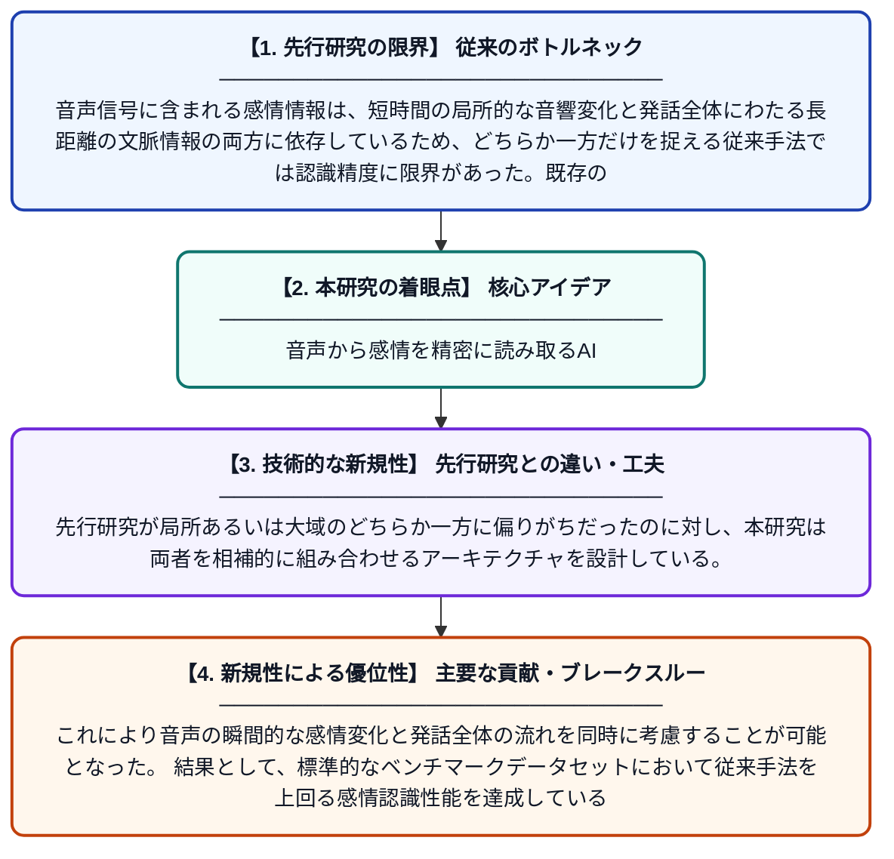

# WTSM-Net: 局所的動的強調と長距離系列モデリングを組み合わせた音声感情認識ネットワーク

**Original Title**: *WTSM-Net: Speech Emotion Recognition Network Combining Local Dynamic Enhancement and Long-range Sequence Modeling*

> **💡 一言要約**: 音声から感情を精密に読み取るAI

| 項目 | 内容 |
|---|---|
| **著者** | W Wei, Q Zhao, J Zhang |
| **掲載誌** | International Conference on Intelligent Computing 2026 |
| **アラートキーワード** | affective computing |
| **原文リンク** | [https://dl.acm.org/doi/abs/10.1007/978-981-92-3410-3_30](https://dl.acm.org/doi/abs/10.1007/978-981-92-3410-3_30) |
| **PDF版要約** | [README.pdf](./README.pdf) |

---

## 📊 新規性の図解（先行研究との違いと本研究のブレークスルー）

## 📝 要約

本論文は、音声信号から感情を認識する「音声感情認識（SER）」において、局所的な特徴の動的強調と長距離の時系列モデリングを組み合わせた新しいネットワーク「WTSM-Net」を提案する。従来の深層学習手法が抱える局所特徴と大域的文脈の同時捉えにくさという課題に対応し、より高精度な感情認識を実現している。スマートインタラクションやメンタルヘルス支援など幅広い応用が期待される。

## ❓ どんな問題に取り組んだか

音声信号に含まれる感情情報は、短時間の局所的な音響変化と発話全体にわたる長距離の文脈情報の両方に依存しているため、どちらか一方だけを捉える従来手法では認識精度に限界があった。既存の深層学習モデルはCNNによる局所特徴抽出とRNN・Transformerによる大域的モデリングを別々に扱うことが多く、両者を効果的に統合することが困難であった。

## ✨ 何が新しい？何がすごい？（新規性）

WTSM-Netは、局所的な動的特徴を強調するモジュールと長距離系列をモデリングするモジュールを有機的に統合した点が新しい。先行研究が局所あるいは大域のどちらか一方に偏りがちだったのに対し、本研究は両者を相補的に組み合わせるアーキテクチャを設計している。これにより音声の瞬間的な感情変化と発話全体の流れを同時に考慮することが可能となった。結果として、標準的なベンチマークデータセットにおいて従来手法を上回る感情認識性能を達成している。

## 🎓 大学1年生向けの解説

私たちが話すとき、声のトーンや速さ、抑揚に「喜び」「怒り」「悲しみ」などの感情情報が含まれています。この研究では、AIが音声から感情を正確に読み取るための新しい仕組み「WTSM-Net」を開発しました。声の細かい一瞬の変化（局所情報）と、発話全体の流れ（大域情報）を同時にうまく捉えられるよう工夫されています。これにより、スマートスピーカーやメンタルヘルスのサポートアプリなど、私たちの日常生活に役立つ技術の向上が期待できます。
