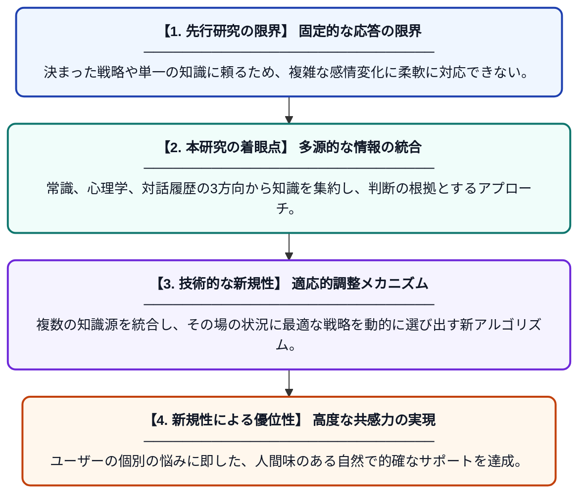

# 多源的な知識を用いた応答戦略の適応的調整による感情サポート対話の強化

**Original Title**: *Adaptive Adjustments of Response Strategies with Multi-source Knowledge to Enhance Emotional Support Conversation*

> **💡 一言要約**: 多様な知識で心に寄り添い、最適な応答を導くAI

| 項目 | 内容 |
|---|---|
| **著者** | J Yu, M Gan, Z Gou, H Zhu, L Zheng, H Lai, J Yin |
| **掲載誌** | … on Affective Computing 2026 |
| **アラートキーワード** | affective computing |
| **原文リンク** | [https://www.computer.org/csdl/journal/ta/5555/01/11780622/2lc4ajqGvNS](https://www.computer.org/csdl/journal/ta/5555/01/11780622/2lc4ajqGvNS) |
| **PDF版要約** | [README.pdf](./README.pdf) |

---

## 📊 新規性の図解（先行研究との違いと本研究のブレークスルー）

## 📝 要約

感情サポート対話において、外部知識を含む複数の情報源を活用し、ユーザーの状況に合わせて応答戦略を柔軟に切り替える新手法を提案しています。これにより、ユーザーの心理状態に深く寄り添いながら、共感的かつ的確なアドバイスを提供することが可能になります。

## ❓ どんな問題に取り組んだか

従来の感情サポート対話システムは、限られた応答パターンや単一の知識源に依存しており、ユーザーの複雑な感情変化や個別の状況に柔軟に対応できない課題がありました。特に、いつ、どの知識を用いて、どのサポート戦略を選択すべきかを動的に判断する仕組みが不足していました。

## ✨ 何が新しい？何がすごい？（新規性）

本研究は、一般的な常識、専門的な心理学知識、対話履歴という「多源的な知識」を統合し、状況に応じて戦略を動的に調整するメカニズムを導入した点が画期的です。先行研究が固定的な戦略に頼っていたのに対し、本手法は複数の情報源をクロス参照することで、文脈に即した最適なサポート手法を適応的に選択できます。これにより、単なる定型文の返答を超え、カウンセラーのような高度な対話支援を実現しました。

## 🎓 大学1年生向けの解説

落ち込んでいる友達を励ますとき、ただ「頑張れ」と言うだけでは逆効果になることがあります。この研究で作られたAIは、心理学の知識や世の中の常識を学習しており、相手の話の内容や感情を分析して、今は「話を聞くべき」か「具体的な助言をするべき」かを自分で判断します。まるでプロのカウンセラーのように、相手の状況に合わせて最も心に響く言葉を選んでくれる賢いAIの仕組みです。
