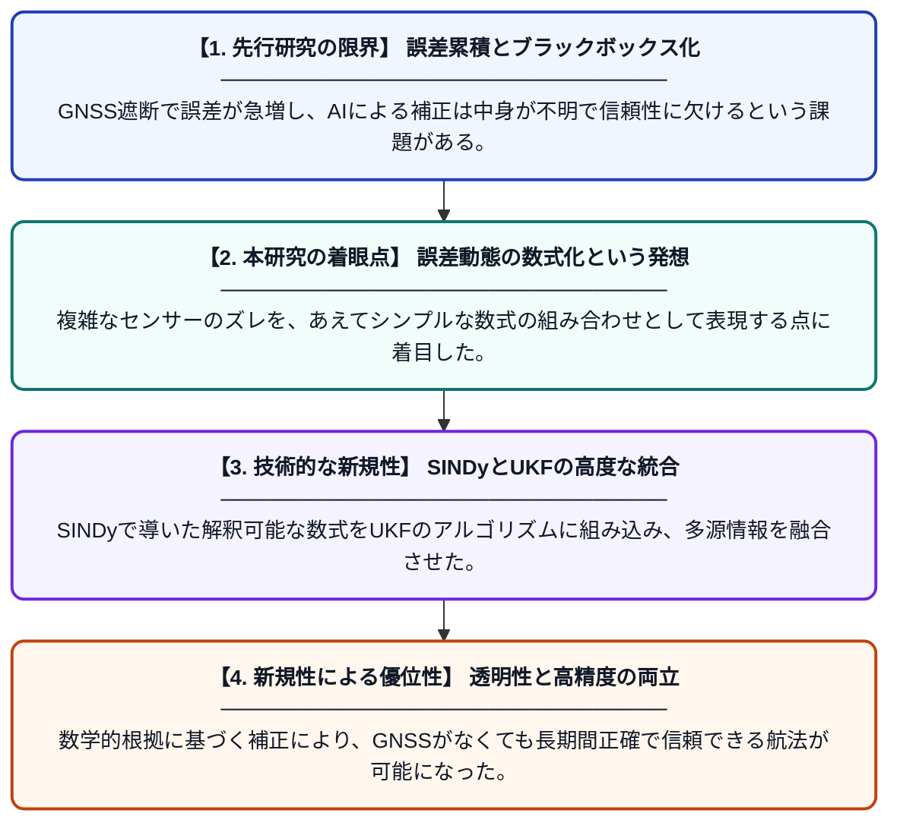

# SINDy支援型無香料カルマンフィルタを用いた、GNSS遮断下でのMEMS-IMU航法のための解釈可能なマルチソース融合

**Original Title**: *Interpretable Multi-Source Fusion for GNSS-Denied MEMS-IMU Navigation Using a SINDy-Aided Unscented Kalman Filter*

> **💡 一言要約**: SINDyで誤差を数式化し、GPSなしでも迷わない

| 項目 | 内容 |
|---|---|
| **著者** | Z Wang, K Feng, J Li, S Shen, Z Sun |
| **掲載誌** | IEEE Sensors Journal 2026 |
| **アラートキーワード** | kalman filter |
| **原文リンク** | [https://ieeexplore.ieee.org/abstract/document/11793976/](https://ieeexplore.ieee.org/abstract/document/11793976/) |
| **PDF版要約** | [README.pdf](./README.pdf) |

---

## 📊 新規性の図解（先行研究との違いと本研究のブレークスルー）

## 📝 要約

GNSSが利用できない環境において、MEMS-IMUの誤差が急速に蓄積する課題を解決するための新しい航法フレームワークです。SINDy（非線形動力学のスパース識別）を無香料カルマンフィルタ（UKF）に統合することで、誤差の挙動を数式として明示的にモデル化し、高精度で解釈可能な位置推定を実現しました。

## ❓ どんな問題に取り組んだか

GNSS信号が届かない場所では、安価なMEMS-IMUセンサーのみに頼ると誤差が指数関数的に増大し、正確な位置特定が困難になります。また、近年の深層学習を用いた補正手法は、なぜその結果になるのかという「解釈性」に乏しく、ミッションクリティカルな用途での信頼性に課題がありました。

## ✨ 何が新しい？何がすごい？（新規性）

物理的知見に基づいたデータ駆動手法であるSINDyを用いて、複雑なセンサー誤差の動態をスパースな数式として特定した点が最大の新規性です。これにより、ブラックボックスなAIモデルとは異なり、ナビゲーションの補正プロセスを人間が理解可能な形式で表現することに成功しました。この識別されたモデルをUKFの予測ステップに組み込むことで、非線形な環境下でも従来のフィルタリング手法を凌駕する推定精度と安定性を達成しています。

## 🎓 大学1年生向けの解説

トンネルや地下などGPSが使えない場所では、車やロボットは自分の動きを測るセンサー（IMU）だけで場所を計算しますが、これには少しずつズレが溜まる弱点があります。この研究では、そのズレが「どんな数式に従って起きるのか」を自動で見つけ出す魔法のような技術を使いました。計算の仕組みが数式として見えるので安心感があり、かつ非常に正確に自分の場所を予測し続けることができるようになりました。
