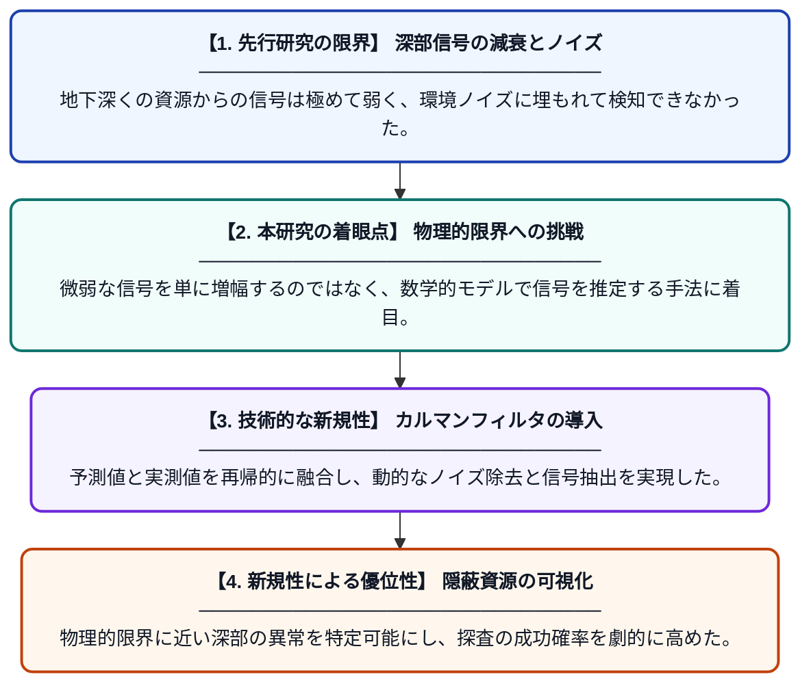

# 金属鉱物資源のための重力・磁気探査技術：進展と展望

**Original Title**: *Gravity and magnetic exploration technology for metallic mineral resources: Progress and prospects*

> **💡 一言要約**: 地下深くに眠る金属資源を暴く、重力・磁力探査の最前線

| 項目 | 内容 |
|---|---|
| **著者** | J Yan, L Guo, S Liu, G Ma, F Luo, H Liu |
| **掲載誌** | Science China Earth Sciences 2026 |
| **アラートキーワード** | kalman filter  "anomaly ... |
| **原文リンク** | [https://link.springer.com/article/10.1007/s11430-025-1905-1](https://link.springer.com/article/10.1007/s11430-025-1905-1) |
| **PDF版要約** | [README.pdf](./README.pdf) |

---

## 📊 新規性の図解（先行研究との違いと本研究のブレークスルー）

## 📝 要約

地下深くに隠された金属鉱床を見つけ出すための、重力および磁気探査技術の最新動向をまとめた論文です。物理的限界に近い微弱な信号を検出するため、カルマンフィルタなどの高度な数学的手法を用いた信号処理技術の重要性を論じています。

## ❓ どんな問題に取り組んだか

地下深くや隠蔽された場所にある鉱床は、地表で観測される磁気や重力の信号が極めて微弱であり、従来の技術ではノイズと区別することが困難でした。物理的な検出限界に挑戦しながら、いかにして精度の高いデータを抽出するかが大きな課題となっています。

## ✨ 何が新しい？何がすごい？（新規性）

深部の微弱な異常信号を捉えるために、カルマンフィルタリングなどの再帰的アルゴリズムを用いた最適推定手法を導入した点が革新的です。予測と実測データを融合させることで、従来の静的な解析では見落とされていた微かなシグナルを抽出することが可能になりました。これにより、探査の深度と解像度を大幅に向上させる理論的枠組みを提示しています。

## 🎓 大学1年生向けの解説

地面の下にある金属（金や銅など）を探すとき、地球が持つ「磁石の力」や「重力の強さ」のわずかな変化を手がかりにします。しかし、深い場所にある資源ほどその変化は弱く、まるで雑音の中でささやき声を聞き取るような難しさがあります。この研究は、最新の数学（アルゴリズム）を使って、その小さな声をはっきりと聞き取るための新しい方法をまとめています。これによって、今まで見つからなかった宝の山を発見できるかもしれません。
