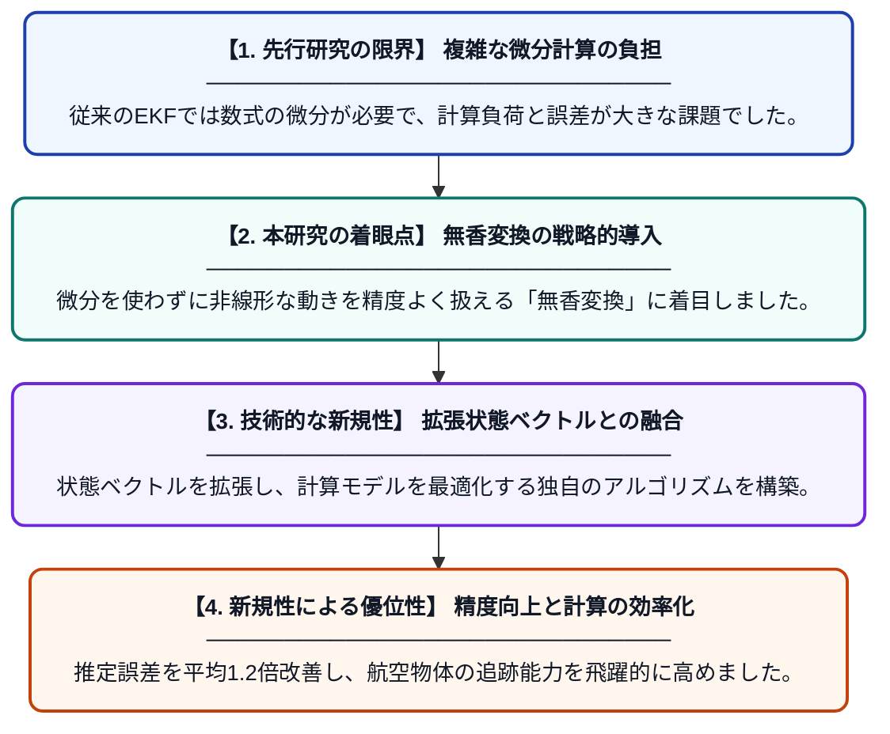

# 拡張状態ベクトルの無香変換に基づく航空物体の角旋回速度の推定

**Original Title**: *Estimation of the Angular Turn Rate of an Airborne Object Based on the Unscented Transformation of an Augmented State Vector*

> **💡 一言要約**: 計算を簡略化し精度も高めた新型旋回速度推定法

| 項目 | 内容 |
|---|---|
| **著者** | P Khmarski, V Artemiev, A Naumov, A Bondarenko… |
| **掲載誌** | Doklady BGUIR 2026 |
| **アラートキーワード** | kalman filter |
| **PDF** | [https://doklady.bsuir.by/jour/article/download/4447/2190](https://doklady.bsuir.by/jour/article/download/4447/2190) |
| **原文リンク** | [https://doklady.bsuir.by/jour/article/download/4447/2190](https://doklady.bsuir.by/jour/article/download/4447/2190) |
| **PDF版要約** | [README.pdf](./README.pdf) |

---

## 📊 新規性の図解（先行研究との違いと本研究のブレークスルー）

## 📝 要約

航空物体の角旋回速度を推定するため、拡張状態ベクトルを用いた無香変換（UT）に基づく新しいフィルタリング手法を提案しています。従来のエクステンデッド・カルマン・フィルタ（EKF）で必要だった複雑な微分計算（ヤコビアンの再計算）を不要にし、推定精度の向上を実現しました。

## ❓ どんな問題に取り組んだか

航空物体の追跡に用いられる従来の拡張カルマンフィルタ（EKF）は、複雑な関数の微分値（ヤコビアン）を常に計算し直さなければならず、計算負荷が高いことが課題でした。また、非線形性が強い場合には推定精度が不十分になるという問題もありました。

## ✨ 何が新しい？何がすごい？（新規性）

本研究は、状態ベクトルを拡張した上で無香変換（Unscented Transformation）を適用するというアプローチを開発しました。これにより、EKFの弱点であったヤコビアンの再計算を完全に排除しながら、より正確な非線形変換の近似が可能になりました。先行研究と比較して、推定の二乗平均平方根誤差（RMSE）を平均で1.2倍改善することに成功しています。

## 🎓 大学1年生向けの解説

空を飛ぶ物体の動きを予測するには、その物体がどれくらいの勢いで曲がっているかを知る必要があります。これまでの方法では数学的に非常に難しい「微分の計算」を何度も繰り返す必要があり、計算が大変な割に誤差も出やすいという欠点がありました。この研究では「代表的な点をいくつか選んで追跡する」という新しい計算法（無香変換）を工夫して取り入れることで、計算をシンプルにしつつ、予測の正確さを大幅にアップさせました。
