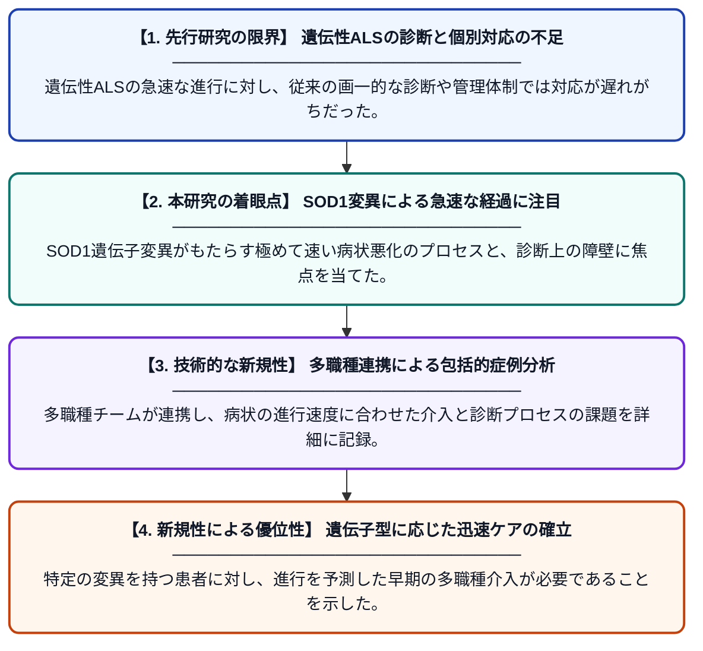

# SOD1変異を伴う家族性筋萎縮性側索硬化症：急速な進行、多職種連携、および診断上の課題に関する症例報告

**Original Title**: *Familial amyotrophic lateral sclerosis associated with SOD1 mutation: case report with rapid progression, multidisciplinary approach, and diagnostic challenges in a …*

> **💡 一言要約**: SOD1変異による急速進行型ALSの診断とケア

| 項目 | 内容 |
|---|---|
| **著者** | PS Bastos, MT Luiza, AE Lins |
| **掲載誌** | Arq. Neuro-Psiquiatr. 2026 |
| **アラートキーワード** | ALS |
| **原文リンク** | [https://www.arquivosdeneuropsiquiatria.org/article/familial-amyotrophic-lateral-sclerosis-associated-with-sod1-mutation-case-report-with-rapid-progression-multidisciplinary-approach-and-diagnostic-challenges-in-a-young-patient/](https://www.arquivosdeneuropsiquiatria.org/article/familial-amyotrophic-lateral-sclerosis-associated-with-sod1-mutation-case-report-with-rapid-progression-multidisciplinary-approach-and-diagnostic-challenges-in-a-young-patient/) |
| **PDF版要約** | [README.pdf](./README.pdf) |

---

## 📊 新規性の図解（先行研究との違いと本研究のブレークスルー）

## 📝 要約

SOD1遺伝子変異を持つ家族性筋萎縮性側索硬化症（ALS）の症例を報告し、病状の急速な進行と診断の困難さを分析しています。多職種チームによる包括的なアプローチの重要性を強調し、遺伝的背景が臨床経過に与える影響を考察しています。

## ❓ どんな問題に取り組んだか

家族性ALSは全症例の5〜10%を占め、特定の遺伝子変異が進行速度に大きく関与しますが、その診断と管理は依然として困難です。特に急速に悪化する症例において、適切なタイミングでの多職種介入や診断の確定が遅れることが大きな課題となっています。

## ✨ 何が新しい？何がすごい？（新規性）

本研究は、SOD1変異を持つ症例における極めて急速な病状進行の経過を詳細に記述し、臨床現場でのリアルタイムな課題を浮き彫りにしました。診断の遅れに繋がる具体的な要因や、多職種連携が患者のQOL維持にどう寄与したかを具体的に提示しています。これにより、特定の遺伝的変異を持つ患者に対する個別化医療と早期介入の必要性を強く示唆した点が重要な貢献です。

## 🎓 大学1年生向けの解説

ALSは全身の筋肉が徐々に動かなくなる病気で、その一部は遺伝子の変化が原因で起こります。この論文では、特定の遺伝子に変異がある患者さんの病気が、予想以上に速く進んでしまったケースを詳しく調べています。診断を早く正確に行うことの難しさや、多くの専門家が協力して患者さんを支えることの大切さを解説しています。将来、より良い治療法を見つけるための貴重な記録となる研究です。
