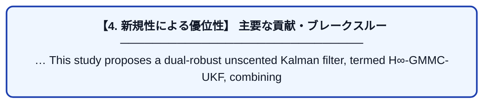

# Dual-robust unscented Kalman filter for UAV state estimation under simultaneous model and measurement uncertainties

| 項目 | 内容 |
|---|---|
| **著者** | J Liu, X Zhao, J Tian, Z Jiao, Y Wang, X Zou |
| **掲載誌** | Scientific Reports 2026 |
| **アラートキーワード** | kalman filter |
| **PDF** | [https://www.nature.com/articles/s41598-026-77396-7_reference.pdf](https://www.nature.com/articles/s41598-026-77396-7_reference.pdf) |
| **原文リンク** | [https://www.nature.com/articles/s41598-026-77396-7_reference.pdf](https://www.nature.com/articles/s41598-026-77396-7_reference.pdf) |
| **PDF版要約** | [README.pdf](./README.pdf) |

---

## 📊 新規性の図解（先行研究との違いと本研究のブレークスルー）

## 📝 要約

… This study proposes a dual-robust unscented Kalman filter, termed H∞-GMMC-UKF, combining an H∞-motivated priorcovariance modification with a generalized maximum mixture correntropy measurement update. The former improves tolerance …
