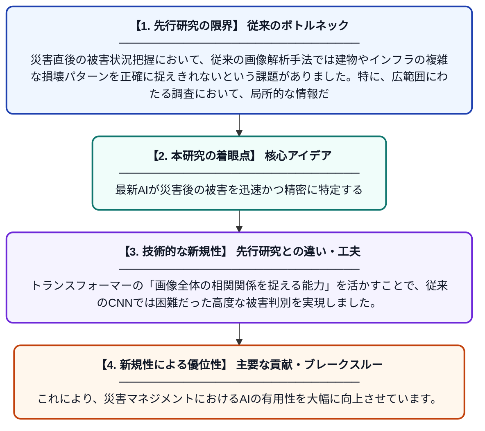

# トランスフォーマーを用いた深層表現学習による災害後の被害推定

**Original Title**: *Damage Estimation in Post-Disaster Surveys Using Transformer-Based Deep Representation Learning*

> **💡 一言要約**: 最新AIが災害後の被害を迅速かつ精密に特定する

| 項目 | 内容 |
|---|---|
| **著者** | PM Kebria, S Nahavandi |
| **掲載誌** | Artificial Intelligence for Disaster Management 2026 |
| **アラートキーワード** | representation learning |
| **原文リンク** | [https://ebooks.iospress.nl/doi/10.3233/NICSP260052](https://ebooks.iospress.nl/doi/10.3233/NICSP260052) |
| **PDF版要約** | [README.pdf](./README.pdf) |

---

## 📊 新規性の図解（先行研究との違いと本研究のブレークスルー）

## 📝 要約

大規模災害後の迅速な調査を目的とし、トランスフォーマーを活用した最新の深層表現学習による被害推定手法を提案しています。従来の画素ベースの分類やCNNから、最新のトランスフォーマーによる技術的進化までを体系的に論じています。

## ❓ どんな問題に取り組んだか

災害直後の被害状況把握において、従来の画像解析手法では建物やインフラの複雑な損壊パターンを正確に捉えきれないという課題がありました。特に、広範囲にわたる調査において、局所的な情報だけでなく全体の文脈を理解する高度な解析能力が求められていました。

## ✨ 何が新しい？何がすごい？（新規性）

本論文の新規性は、古典的な画素分類から畳み込みニューラルネットワーク（CNN）、そしてトランスフォーマーへと至る手法の変遷を整理し、トランスフォーマーを用いた最新の表現学習を災害推定に統合した点にあります。トランスフォーマーの「画像全体の相関関係を捉える能力」を活かすことで、従来のCNNでは困難だった高度な被害判別を実現しました。これにより、災害マネジメントにおけるAIの有用性を大幅に向上させています。

## 🎓 大学1年生向けの解説

地震や洪水が起きたとき、どの建物がどれくらい壊れたかを写真から自動で判断する最新のAI技術についての研究です。これまでは写真の「点」や「部分」だけを見て判断していましたが、この研究では最新の「トランスフォーマー」という仕組みを使い、写真全体のつながりや状況を理解して被害を調べます。これにより、人間が現地に行かなくても、より早く正確にどこを優先して助けるべきか判断できるようになります。
