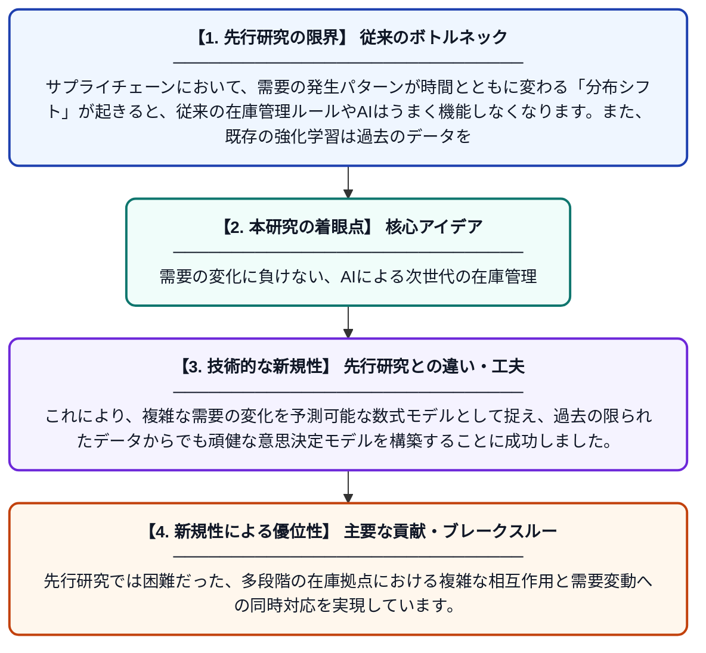

# 需要分布の変動に強い多段階在庫管理のためのクープマン作用素を用いたオフライン強化学習

**Original Title**: *Koopman-enhanced offline reinforcement learning for robust multi-echelon inventory control under demand distribution shift*

> **💡 一言要約**: 需要の変化に負けない、AIによる次世代の在庫管理

| 項目 | 内容 |
|---|---|
| **著者** | B Zhang |
| **掲載誌** | Modern Supply Chain Research and Applications 2026 |
| **アラートキーワード** | reinforcement |
| **原文リンク** | [https://www.emerald.com/mscra/article-abstract/doi/10.1108/MSCRA-06-2026-0107/1404008](https://www.emerald.com/mscra/article-abstract/doi/10.1108/MSCRA-06-2026-0107/1404008) |
| **PDF版要約** | [README.pdf](./README.pdf) |

---

## 📊 新規性の図解（先行研究との違いと本研究のブレークスルー）

## 📝 要約

需要の傾向が変化する状況下での多段階在庫最適化（MEIO）に対し、クープマン作用素を活用した新しいオフライン強化学習手法を提案しました。過去の蓄積データから需要の背後にある動的な構造を抽出することで、需要パターンが急変しても安定した在庫制御を実現します。

## ❓ どんな問題に取り組んだか

サプライチェーンにおいて、需要の発生パターンが時間とともに変わる「分布シフト」が起きると、従来の在庫管理ルールやAIはうまく機能しなくなります。また、既存の強化学習は過去のデータを十分に活用して需要の複雑な変化を捉えることが難しく、環境の変化に弱いという課題がありました。

## ✨ 何が新しい？何がすごい？（新規性）

非線形な現象を線形として扱う「クープマン作用素」をオフライン強化学習に組み込んだ点が画期的です。これにより、複雑な需要の変化を予測可能な数式モデルとして捉え、過去の限られたデータからでも頑健な意思決定モデルを構築することに成功しました。先行研究では困難だった、多段階の在庫拠点における複雑な相互作用と需要変動への同時対応を実現しています。

## 🎓 大学1年生向けの解説

お店や工場が「商品をいくつ持っておくか」を決めるのは、実はとても難しいパズルです。特に、流行が変わって売れ方が急に変わってしまうと、在庫が足りなくなったり余ったりしてしまいます。この研究では、過去のデータから「需要がどう変わっていくか」という法則を賢く見つけ出す新しいAI技術を開発しました。このAIを使うことで、世の中の好みが変わっても、無駄のない在庫管理を続けることができるようになります。
