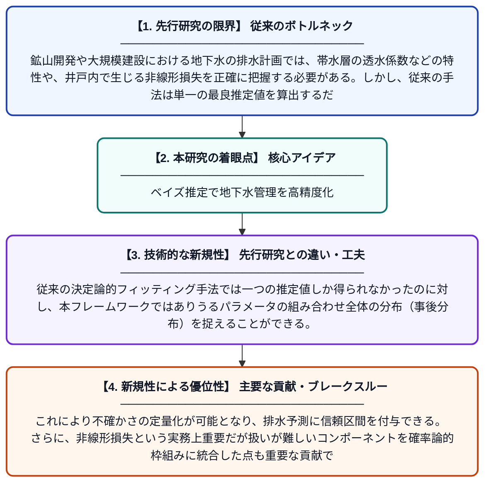

# 排水予測・計画を支援するための帯水層特性と非線形井戸損失の確率論的推定

**Original Title**: *Probabilistic Estimation of Aquifer Properties and Non-Linear Well Losses to Support Dewatering Forecasts and Planning*

> **💡 一言要約**: ベイズ推定で地下水管理を高精度化

| 項目 | 内容 |
|---|---|
| **著者** | S Miller, D Benson |
| **掲載誌** | 2026 |
| **アラートキーワード** | MCMC |
| **PDF** | [https://www.imwa.info/docs/imwa_2026/IMWA2026_Benson_47.pdf](https://www.imwa.info/docs/imwa_2026/IMWA2026_Benson_47.pdf) |
| **原文リンク** | [https://www.imwa.info/docs/imwa_2026/IMWA2026_Benson_47.pdf](https://www.imwa.info/docs/imwa_2026/IMWA2026_Benson_47.pdf) |
| **PDF版要約** | [README.pdf](./README.pdf) |

---

## 📊 新規性の図解（先行研究との違いと本研究のブレークスルー）

## 📝 要約

本論文は、地下水を汲み上げる際に必要な帯水層の特性と井戸の損失特性を、ベイズ推定とマルコフ連鎖モンテカルロ（MCMC）サンプリングを用いて確率論的に推定する手法を提案している。従来の決定論的なアプローチでは捉えられなかったパラメータの不確かさを、事後分布として定量的に表現することが可能となる。これにより、鉱山や建設現場などにおける地下水排水計画の信頼性と意思決定の精度を大幅に向上させることができる。

## ❓ どんな問題に取り組んだか

鉱山開発や大規模建設における地下水の排水計画では、帯水層の透水係数などの特性や、井戸内で生じる非線形損失を正確に把握する必要がある。しかし、従来の手法は単一の最良推定値を算出するだけで、推定の不確かさを適切に評価できていなかった。このため、排水量の予測に大きな誤差が生じ、計画の失敗リスクが高まるという問題があった。

## ✨ 何が新しい？何がすごい？（新規性）

本研究の新規性は、帯水層パラメータと非線形井戸損失係数をベイズ推論とMCMCサンプリングによって同時に確率論的推定する点にある。従来の決定論的フィッティング手法では一つの推定値しか得られなかったのに対し、本フレームワークではありうるパラメータの組み合わせ全体の分布（事後分布）を捉えることができる。これにより不確かさの定量化が可能となり、排水予測に信頼区間を付与できる。さらに、非線形損失という実務上重要だが扱いが難しいコンポーネントを確率論的枠組みに統合した点も重要な貢献である。

## 🎓 大学1年生向けの解説

地下水を大量に汲み出す工事では、地下の土や岩がどのくらい水を通しやすいかを知ることがとても重要です。でも、地下のことは直接見えないので、計測データから推測するしかなく、その推測には必ず「誤差」や「不確かさ」が伴います。この研究では、ベイズ統計という方法を使って、「この値が正解かもしれない」という候補をたくさん考え、それぞれの確からしさを計算します。こうすることで、「だいたいこの範囲に正解がある」という形で結果を示せるので、計画担当者がリスクをより正確に把握して安全な意思決定をしやすくなります。
