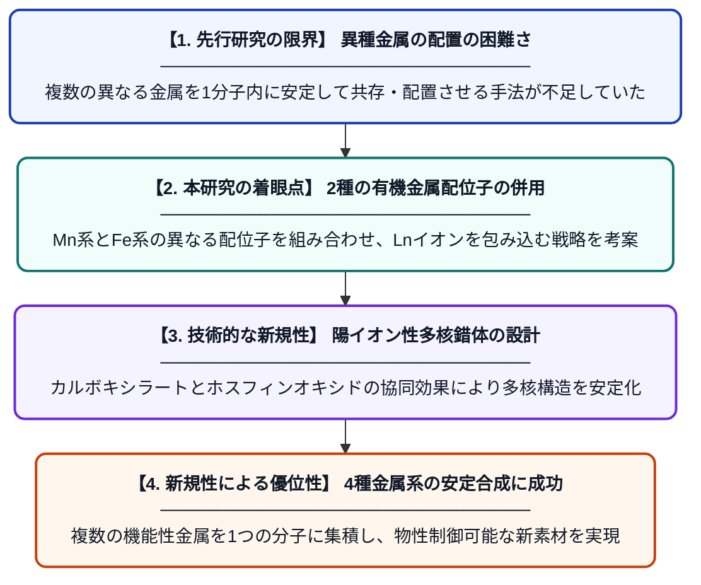

# シマントレンカルボキシラートおよびフェロセンホスフィンオキシド配位子を用いた新規d-f異種金属錯体：4種の異なる金属を含む化合物

**Original Title**: *Novel df heterometallic complexes based on ln ions chelated by cymantrenecarboxylate and ferrocenephosphine oxide ligands: Compounds containing four different …*

> **💡 一言要約**: 4種の金属が織りなす新機能錯体の創出

| 項目 | 内容 |
|---|---|
| **著者** | PS Koroteev, AB Ilyukhin, SS Shapovalov… |
| **掲載誌** | Inorganica Chimica Acta 2026 |
| **アラートキーワード** | ICA |
| **原文リンク** | [https://www.sciencedirect.com/science/article/pii/S0020169326004640](https://www.sciencedirect.com/science/article/pii/S0020169326004640) |
| **PDF版要約** | [README.pdf](./README.pdf) |

---

## 📊 新規性の図解（先行研究との違いと本研究のブレークスルー）

## 📝 要約

マンガン、鉄、およびランタノイドを組み合わせた新しい異種金属錯体のシリーズを合成しました。シマントレンとフェロセンという2種類の有機金属部位を配位子として用い、複雑な多核構造を持つ陽イオン性錯体の開発に成功しています。

## ❓ どんな問題に取り組んだか

異なる性質を持つ金属イオンを一つの分子内に精密に配置することは、多機能性材料の開発において極めて重要ですが、化学的な制御が非常に困難です。特に、遷移金属と希土類を複数組み合わせ、構造を安定化させつつ機能を引き出す合成手法は未だ限定的でした。

## ✨ 何が新しい？何がすごい？（新規性）

本研究は、シマントレン（Mn）とフェロセン（Fe）という二つの異なる有機金属骨格をランタノイド（Ln）周辺に同時に配置し、4つの異なる金属中心を含む陽イオン性錯体を構築しました。ホスフィンオキシドとカルボキシラートという異なる結合部位を巧みに使い分けることで、高い構造安定性を実現しています。これにより、磁性や光学特性を精密に制御可能な、これまでにないd-f混合系分子プラットフォームを提示しました。

## 🎓 大学1年生向けの解説

金属イオンは種類によって「磁石のような性質」や「光る性質」など、異なる個性を持っています。この研究では、マンガン、鉄、そしてランタノイドという3種類以上の金属を1つの分子の中にパズルのように組み込むことに成功しました。これにより、それぞれの金属の長所を活かした、これまでにない高性能な材料を作るための土台が築かれました。化学の力で、新しい機能を持つ複雑なミクロの構造体を作り上げた画期的な成果です。
