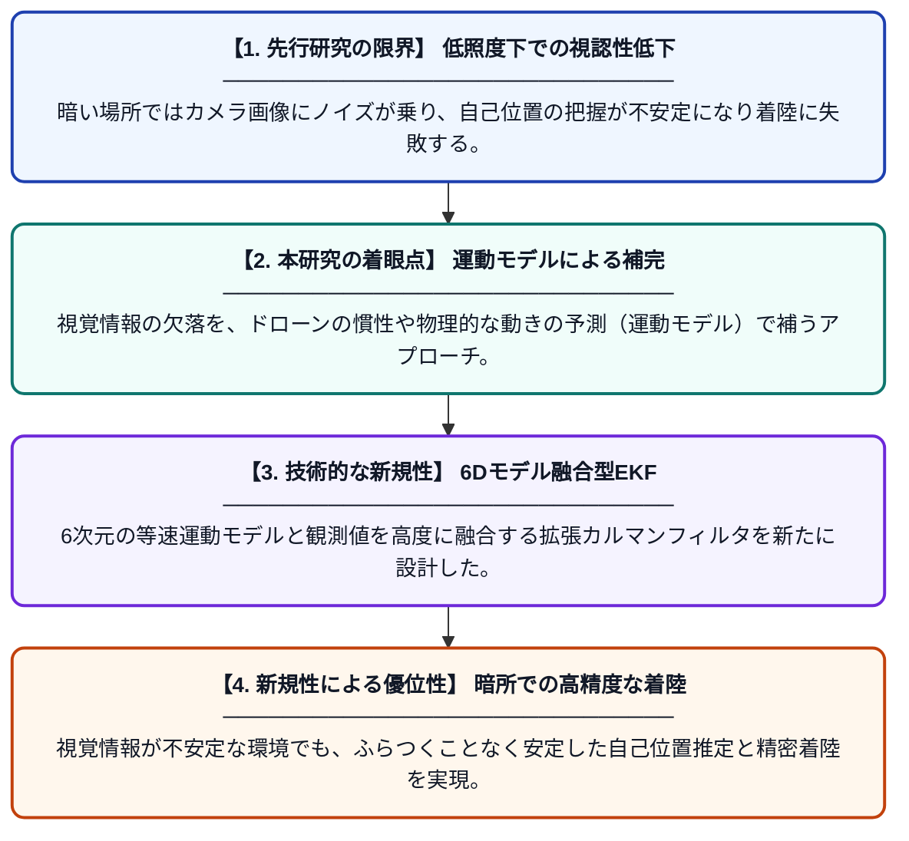

# 低照度環境におけるドローンの精密着陸

**Original Title**: *Precision Landing in Low-Light*

> **💡 一言要約**: 暗闇でも迷わず着陸、EKFが導くドローンの目

| 項目 | 内容 |
|---|---|
| **著者** | TD Do, N Xuan-Mung¹, J Lee, SK Hong |
| **掲載誌** | … and Applications 10: Results from the 12th … 2026 |
| **アラートキーワード** | kalman filter |
| **原文リンク** | [https://books.google.com/books?hl=ja&lr=lang_ja|lang_en&id=T9QoEgAAQBAJ&oi=fnd&pg=PA469&dq="kalman+filter"&ots=x0uT8XSKQm&sig=5URL2cs4Yvg0y0ZAypT6tLx7eH8](https://books.google.com/books?hl=ja&lr=lang_ja|lang_en&id=T9QoEgAAQBAJ&oi=fnd&pg=PA469&dq="kalman+filter"&ots=x0uT8XSKQm&sig=5URL2cs4Yvg0y0ZAypT6tLx7eH8) |
| **PDF版要約** | [README.pdf](./README.pdf) |

---

## 📊 新規性の図解（先行研究との違いと本研究のブレークスルー）

## 📝 要約

照明条件が悪い暗所でも無人航空機（UAV）が正確に着陸するための技術を提案しています。拡張カルマンフィルタ（EKF）を用い、センサーの測定値と6次元等速運動モデルを融合させることで、安定した位置と速度の推定を実現しました。

## ❓ どんな問題に取り組んだか

夜間や低照度環境では、ドローンのカメラが周囲を正しく認識できず、着陸精度が大幅に低下する問題があります。暗所特有のノイズや情報の欠落により、従来の自己位置推定手法では安定した制御が困難でした。

## ✨ 何が新しい？何がすごい？（新規性）

本研究は、低照度下での不安定な観測データを、6次元の等速運動モデルを組み込んだ拡張カルマンフィルタ（EKF）で補完する手法を開発しました。物理的な運動法則に基づいた予測と実際の観測値を高度に融合させることで、視覚情報が不十分な状況でもロバストな状態推定が可能です。実験により、従来手法と比較して暗所での推定安定性と着陸精度が飛躍的に向上したことを証明しました。

## 🎓 大学1年生向けの解説

夜の暗い場所でドローンを着陸させるのは、目隠しをして椅子に座るような難しさがあります。この研究では、ドローンのわずかな動きと「物理的にこう動くはずだ」という予測計算を組み合わせて、目に見えない部分を補う技術を作りました。これによって、暗闇の中でも自分の場所を正確に把握して、狙った場所にピタッと降りられるようになります。数学の力を使って、ドローンの「感覚」を鋭くした研究です。
