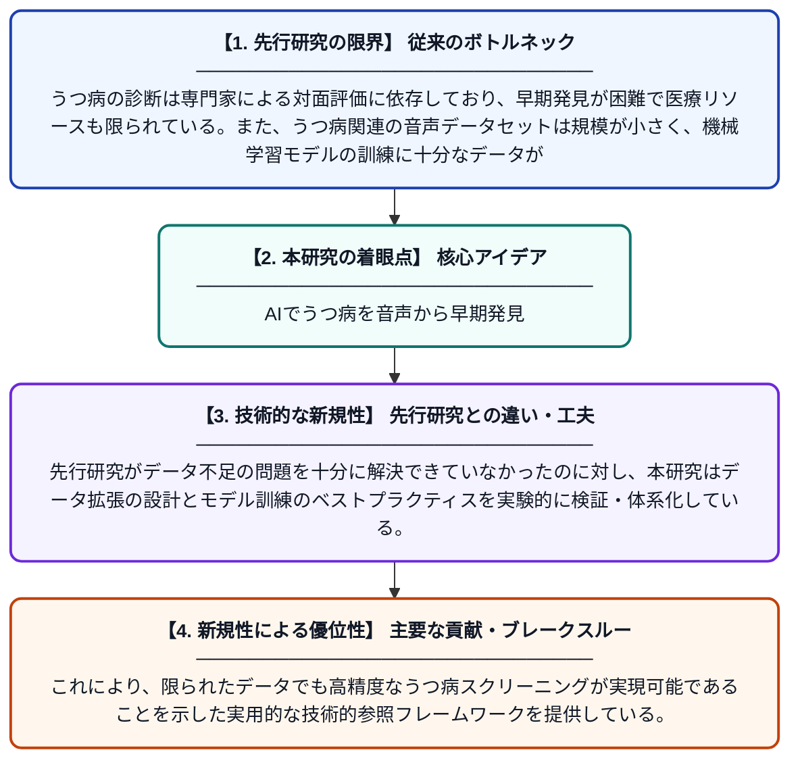

# オートエンコーダによるデータ拡張を活用したTransformerベースのうつ病音声スクリーニングフレームワーク

**Original Title**: *A transformer-based speech screening framework for depression using autoencoder-driven data augmentation*

> **💡 一言要約**: AIでうつ病を音声から早期発見

| 項目 | 内容 |
|---|---|
| **著者** | Z Zheng, L Liang, G Wang, C Xue |
| **掲載誌** | International Conference on Intelligent Signal and … 2026 |
| **アラートキーワード** | affective computing |
| **原文リンク** | [https://www.spiedigitallibrary.org/conference-proceedings-of-spie/14293/142930Z/A-transformer-based-speech-screening-framework-for-depression-using-autoencoder/10.1117/12.3118715.short](https://www.spiedigitallibrary.org/conference-proceedings-of-spie/14293/142930Z/A-transformer-based-speech-screening-framework-for-depression-using-autoencoder/10.1117/12.3118715.short) |
| **PDF版要約** | [README.pdf](./README.pdf) |

---

## 📊 新規性の図解（先行研究との違いと本研究のブレークスルー）

## 📝 要約

本研究は、うつ病の早期発見を目的とした音声スクリーニングシステムを構築するため、Transformerアーキテクチャとオートエンコーダを組み合わせたフレームワークを提案している。特にデータ不足という課題に対処するため、オートエンコーダを用いた音声データ拡張手法を導入し、モデルの汎化性能を向上させている。新しいバックボーンアーキテクチャの提案ではなく、実用的なデータ拡張とモデル訓練のための技術的な参照基盤の構築に注力している。

## ❓ どんな問題に取り組んだか

うつ病の診断は専門家による対面評価に依存しており、早期発見が困難で医療リソースも限られている。また、うつ病関連の音声データセットは規模が小さく、機械学習モデルの訓練に十分なデータが確保しにくいという深刻なデータ不足問題が存在する。

## ✨ 何が新しい？何がすごい？（新規性）

本研究の新規性は、新しいモデル構造の提案ではなく、オートエンコーダを活用した音声データ拡張手法をTransformerベースのうつ病スクリーニングに体系的に組み込んだ点にある。先行研究がデータ不足の問題を十分に解決できていなかったのに対し、本研究はデータ拡張の設計とモデル訓練のベストプラクティスを実験的に検証・体系化している。これにより、限られたデータでも高精度なうつ病スクリーニングが実現可能であることを示した実用的な技術的参照フレームワークを提供している。

## 🎓 大学1年生向けの解説

うつ病は世界中で多くの人が悩んでいる心の病気ですが、診断には専門医の診察が必要で、早期発見が難しいという問題があります。この研究では、人が話す声の特徴をAIで分析することで、うつ病の可能性を自動的にスクリーニング（ふるい分け）するシステムを開発しました。AIの学習には大量のデータが必要ですが、うつ病の音声データは少ないため、オートエンコーダという技術を使って人工的にデータを増やす工夫をしています。TransformerというAI技術（ChatGPTにも使われている技術）をベースに、データを賢く増やしながら精度の高いモデルを訓練する方法を確立しました。将来的には、このような技術でうつ病の早期発見・早期治療が誰でも受けやすくなることが期待されています。
