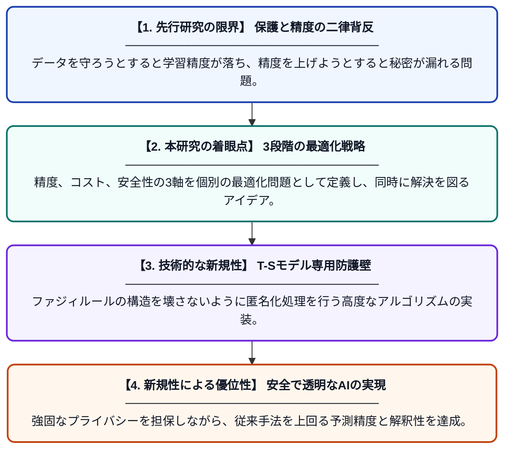

# Takagi-Sugenoファジィモデルの連合学習におけるプライバシー保護のための3段階最適化フレームワーク

**Original Title**: *A Trilevel Optimization Framework for Privacy Protection in Federated Learning of Takagi–Sugeno Fuzzy Models*

> **💡 一言要約**: 秘密を守りつつ皆で賢いAIを作る3段階の最適化技術

| 項目 | 内容 |
|---|---|
| **著者** | Y Yin, G Zhang, H Zuo, J Lu |
| **掲載誌** | IEEE Transactions on Fuzzy Systems 2026 |
| **アラートキーワード** | Federated Learning |
| **原文リンク** | [https://ieeexplore.ieee.org/abstract/document/11754008/](https://ieeexplore.ieee.org/abstract/document/11754008/) |
| **PDF版要約** | [README.pdf](./README.pdf) |

---

## 📊 新規性の図解（先行研究との違いと本研究のブレークスルー）

## 📝 要約

データの機密性を保持しながら複数の拠点で高精度なTakagi-Sugenoファジィモデルを共同構築するための、3段階の最適化フレームワークを提案しています。モデルの精度、解釈可能性、および通信コストのトレードオフを同時に最適化し、情報の漏洩を防ぐ堅牢な仕組みを実現しました。

## ❓ どんな問題に取り組んだか

連合学習でファジィモデルを構築する際、情報の共有によってプライバシーが侵害されるリスクや、通信コストが膨大になる課題があります。特に、モデルの「わかりやすさ（解釈性）」と「予測の正確さ」を保ちつつ、機密データを完全に保護することは困難でした。

## ✨ 何が新しい？何がすごい？（新規性）

本研究の新規性は、プライバシー保護、通信効率、学習精度の3つの階層を個別に、かつ統合的に扱う「3段階最適化構造」を導入した点にあります。従来の差分プライバシー技術をファジィモデル特有の構造に適応させ、不要なノイズによる精度低下を抑えつつ、モデル反転攻撃などの脅威からデータを防御する独自のアルゴリズムを開発しました。これにより、安全かつ実用的な共同学習が可能になりました。

## 🎓 大学1年生向けの解説

自分のデータを誰にも渡さずに、みんなで協力して「もし～なら～」という賢い判断ルール（ファジィモデル）を作る方法についての研究です。これまでは、協力して学習しようとすると中身が透けて見えてしまったり、計算が複雑になりすぎて時間がかかったりしていました。この論文では、3つのステップで計算を整理する工夫をすることで、秘密をガッチリ守りながら、効率よく正確なルールを作ることに成功しました。
