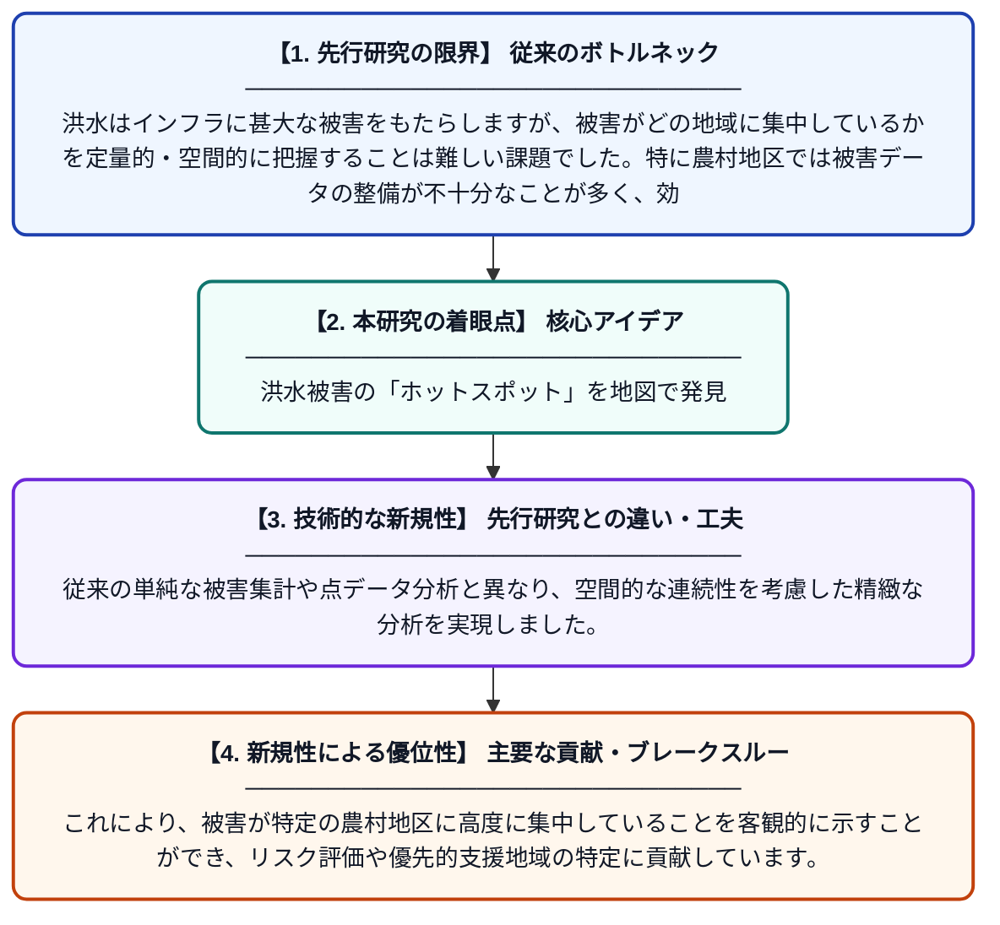

# バボル郡農村地区におけるインフラへの洪水被害の空間パターン分析

**Original Title**: *Spatial Pattern Analysis of Flood Damage to Infrastructure in the Rural Districts of Babol County*

> **💡 一言要約**: 洪水被害の「ホットスポット」を地図で発見

| 項目 | 内容 |
|---|---|
| **著者** | J Samia, M Heidari Rami |
| **掲載誌** | Disaster Prevention and Management Knowledge |
| **アラートキーワード** | kernel density estimation |
| **原文リンク** | [https://dpmk.ir/browse.php?a_id=863&sid=1&slc_lang=en&ftxt=0](https://dpmk.ir/browse.php?a_id=863&sid=1&slc_lang=en&ftxt=0) |
| **PDF版要約** | [README.pdf](./README.pdf) |

---

## 📊 新規性の図解（先行研究との違いと本研究のブレークスルー）

## 📝 要約

本研究では、イランのバボル郡の農村地区を対象に、洪水によるインフラ被害の空間的な分布パターンをカーネル密度推定法（KDE）を用いて分析しました。その結果、被害の強度が特定の農村地区に集中していることが明らかになりました。この知見は、今後の災害対策や復旧資源の効率的な配分に活用できます。

## ❓ どんな問題に取り組んだか

洪水はインフラに甚大な被害をもたらしますが、被害がどの地域に集中しているかを定量的・空間的に把握することは難しい課題でした。特に農村地区では被害データの整備が不十分なことが多く、効果的な防災対策の立案が困難な状況にありました。

## ✨ 何が新しい？何がすごい？（新規性）

本研究は、カーネル密度推定法（KDE）を洪水被害の空間分析に適用し、連続的な密度分布マップを生成することで被害集中エリアを可視化した点が新しいアプローチです。従来の単純な被害集計や点データ分析と異なり、空間的な連続性を考慮した精緻な分析を実現しました。これにより、被害が特定の農村地区に高度に集中していることを客観的に示すことができ、リスク評価や優先的支援地域の特定に貢献しています。

## 🎓 大学1年生向けの解説

洪水が起きると道路や橋などのインフラが壊れますが、「どこが一番被害を受けやすいか」を地図上で分かりやすく示すのがこの研究です。カーネル密度推定法という統計的な手法を使って、被害が多い場所をなめらかな「ホットスポットマップ」として表現しました。ちょうど天気予報の雨量マップのように、被害の濃淡を色で表示するイメージです。イランのバボル郡の農村を調べたところ、被害は特定の地域に偏って集中していることが分かりました。この結果を使えば、限られた予算や人員を最も危険な地域に重点的に投入できるようになります。
