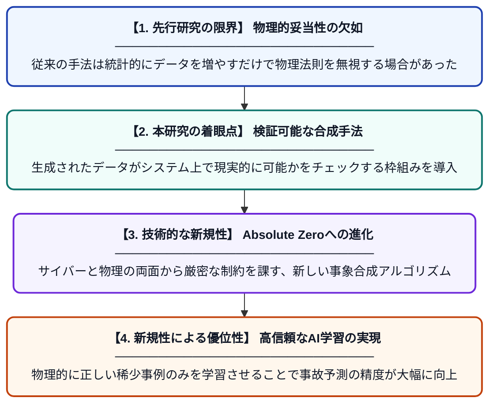

# スマートグリッド向けの検証可能な稀少事象合成：SMOTEからAbsolute Zeroへ

**Original Title**: *Verifiable Rare-Event Synthesis for Smart Grids: From SMOTE to Absolute Zero*

> **💡 一言要約**: 稀少な電力障害を物理的に検証し再現する新技術

| 項目 | 内容 |
|---|---|
| **著者** | JA Ortiz |
| **掲載誌** | Advanced AI Algorithms and Emerging Technologies … 2027 |
| **アラートキーワード** | SMOTE |
| **原文リンク** | [https://www.igi-global.com/chapter/verifiable-rare-event-synthesis-for-smart-grids/428869](https://www.igi-global.com/chapter/verifiable-rare-event-synthesis-for-smart-grids/428869) |
| **PDF版要約** | [README.pdf](./README.pdf) |

---

## 📊 新規性の図解（先行研究との違いと本研究のブレークスルー）

## 📝 要約

スマートグリッドにおける発生頻度は低いが影響が甚大な障害事象を対象に、信頼性の高い学習データを人工的に生成・検証する枠組みを提案しています。従来の統計的なデータ増幅手法（SMOTE）の限界を超え、サイバー・物理システムとしての妥当性を保証する新しいアプローチを論じています。

## ❓ どんな問題に取り組んだか

電力網の障害は発生頻度が極めて低いため学習データが不足していますが、一度発生すれば深刻な被害をもたらします。既存のデータ合成手法では、生成された事象が物理法則やシステムの制約に適合しているかを検証できないという課題がありました。

## ✨ 何が新しい？何がすごい？（新規性）

従来の単純な統計的補間ではなく、生成されたデータが電力網の運用ルールや物理的な妥当性を満たすかを確認する「検証フレームワーク」を構築した点が画期的です。SMOTEから『Absolute Zero』への進化を掲げ、サイバー・物理電力システム特有の複雑な制約を考慮した事象合成を可能にしました。これにより、AIが「あり得ないデータ」を学習するリスクを排除し、信頼性の高い障害検知を実現しています。

## 🎓 大学1年生向けの解説

電気の大きなトラブルはめったに起きませんが、AIにトラブルの予兆を教えるにはたくさんのデータが必要です。この研究は、足りないトラブルのデータをコンピュータで人工的に作り出す方法を開発しました。ただ作るだけでなく、そのデータが「本当に電力網で起こりうるものか」を自動で厳しくチェックする仕組みを加えたのが特徴です。これによって、まだ起きていない重大な事故にも備えられる、より安全な電力システムを作ることができます。
