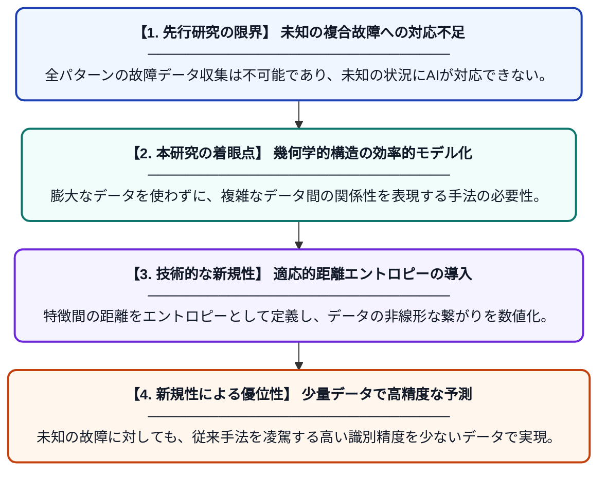

# 適応的距離エントロピーを用いた回転機械の一般化ゼロショット複合故障診断

**Original Title**: *Adaptive distance entropy informed generalized zero-shot compound fault diagnosis of rotating machinery*

> **💡 一言要約**: 距離エントロピーで未知の複合故障を正確に見抜く！

| 項目 | 内容 |
|---|---|
| **著者** | C Ma, K Feng, Y Gao, X Wang, J Zhang |
| **掲載誌** | Engineering Applications of Artificial … 2027 |
| **アラートキーワード** | manifold learning |
| **原文リンク** | [https://www.sciencedirect.com/science/article/pii/S0952197626030393](https://www.sciencedirect.com/science/article/pii/S0952197626030393) |
| **PDF版要約** | [README.pdf](./README.pdf) |

---

## 📊 新規性の図解（先行研究との違いと本研究のブレークスルー）

## 📝 要約

回転機械の複合故障診断において、学習データにない未知の故障を識別する「一般化ゼロショット学習」に、適応的距離エントロピーを導入した新しい手法を提案しています。データの幾何学的な非線形構造を効率的にモデル化することで、限られたデータからでも複雑な複合故障の識別精度を大幅に向上させました。

## ❓ どんな問題に取り組んだか

産業現場では複数の故障が重なる「複合故障」が頻発しますが、全パターンの学習データを揃えることは不可能です。また、データ間の複雑な非線形の幾何学関係をモデル化するには膨大なデータが必要であり、未知の故障を精度よく予測することは困難でした。

## ✨ 何が新しい？何がすごい？（新規性）

本研究の核心は、特徴空間の非線形な幾何学構造を「適応的距離エントロピー」によって明示的に捉える点にあります。先行研究ではグローバルな多様体構造の構築に膨大なリソースを要していましたが、本手法は距離情報の不確実性を適応的に評価することで、効率的に未知の故障への汎化性能を高めています。一般化ゼロショット学習の枠組みにエントロピーの概念を統合し、構造的特徴を抽出した点が最大の貢献です。

## 🎓 大学1年生向けの解説

工場の機械が壊れるとき、複数の部品が同時に故障することがありますが、その組み合わせすべてを事前にAIに教えるのは大変です。この研究では、一部の故障データから「まだ見たことがない故障の組み合わせ」を賢く推論する技術を開発しました。データがどのように分布しているかを「エントロピー（複雑さの指標）」を使って分析することで、少ないヒントからでも正確に故障の原因を特定できるようになります。
