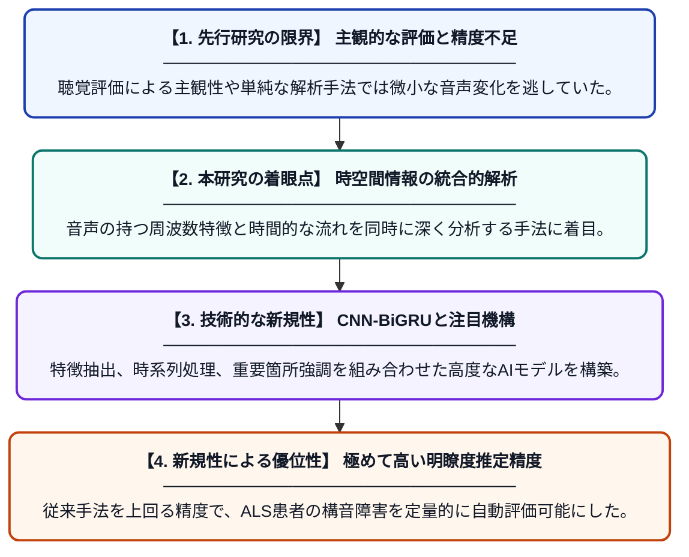

# ALSにおける音声の明瞭度推定のためのアテンションベースCNN-BiGRU

**Original Title**: *Attention-Based CNN-BiGRU for Speech Clarity Estimation in ALS*

> **💡 一言要約**: AIがALS患者の話し方の明瞭さを精密に自動判定

| 項目 | 内容 |
|---|---|
| **著者** | P Katiyar, R Raj, R Thilagavathy |
| **掲載誌** | IEEE 5th International Conference on Signal … 2026 |
| **アラートキーワード** | ALS |
| **原文リンク** | [https://ieeexplore.ieee.org/abstract/document/11789409/](https://ieeexplore.ieee.org/abstract/document/11789409/) |
| **PDF版要約** | [README.pdf](./README.pdf) |

---

## 📊 新規性の図解（先行研究との違いと本研究のブレークスルー）

## 📝 要約

筋萎縮性側索硬化症（ALS）の初期症状として現れる発話能力の低下を、非侵襲的に評価する新しい深層学習モデルを提案しています。CNN、BiGRU、そしてアテンション機構を組み合わせることで、音声データから病状の進行を反映する明瞭度を高精度に推定します。

## ❓ どんな問題に取り組んだか

ALSは進行性の神経疾患であり、初期段階で発話障害が起こりますが、その明瞭度を客観的かつ非侵襲的に測定する標準的な手法が不足していました。従来の評価は医師の主観に頼ることが多く、微細な変化を早期に捉えることが困難という課題がありました。

## ✨ 何が新しい？何がすごい？（新規性）

本研究の核心は、空間的特徴を抽出するCNNと時系列の変化を捉えるBiGRUに、重要な音声信号を強調するアテンション機構を統合した点にあります。このハイブリッド構造により、音声内の時間的な依存関係とスペクトル特徴の両方を効率的に学習できるようになりました。結果として、従来のモデルよりもALS特有の構音障害のパターンをより正確に識別し、推定精度を大幅に向上させています。

## 🎓 大学1年生向けの解説

ALSという病気になると、筋肉が衰えて言葉をはっきりと話すことが難しくなります。この研究では、コンピュータを使って「どれくらいはっきり話せているか」を自動で判断する技術を開発しました。最新のAIに音声を聞かせることで、人間でも気づかないようなわずかな声の変化を見つけ出し、病気の進行度を数値で示します。これにより、病院に行かなくてもスマホなどで簡単に声の健康状態をチェックできる未来を目指しています。
