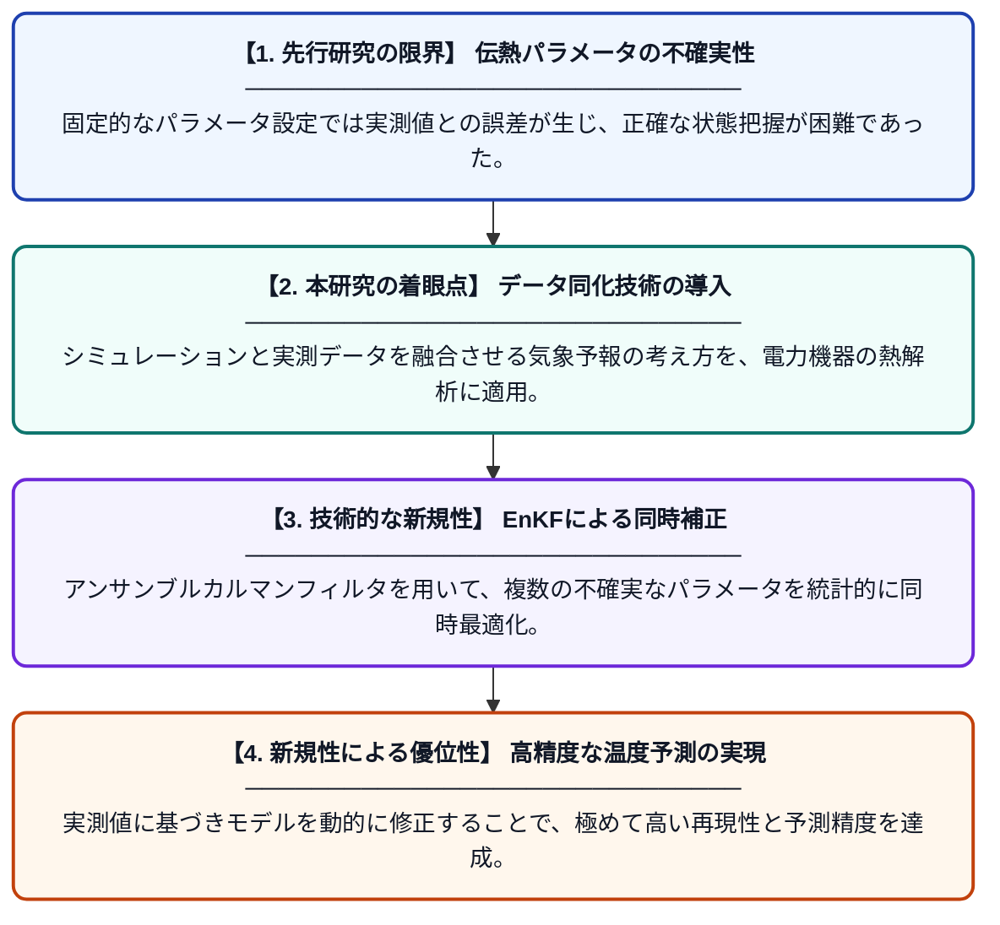

# アンサンブルカルマンフィルタを用いたGIS温度上昇シミュレーションのための伝熱パラメータ同時補正手法

**Original Title**: *Joint Correction Method of Heat Transfer Parameters for GIS Temperature Rise Simulation Based on Ensemble Kalman Filter*

> **💡 一言要約**: EnKFでGIS温度予測の精度を飛躍的に向上

| 項目 | 内容 |
|---|---|
| **著者** | Q Wei, H Wang, Y Zhou, Y Tan |
| **掲載誌** | IEEE 7th International Conference on … 2026 |
| **アラートキーワード** | kalman filter |
| **原文リンク** | [https://ieeexplore.ieee.org/abstract/document/11745685/](https://ieeexplore.ieee.org/abstract/document/11745685/) |
| **PDF版要約** | [README.pdf](./README.pdf) |

---

## 📊 新規性の図解（先行研究との違いと本研究のブレークスルー）

## 📝 要約

ガス絶縁開閉装置（GIS）の温度予測における不確実性を解消するため、アンサンブルカルマンフィルタ（EnKF）を用いたデータ同化手法を提案しました。この手法により、複雑な伝熱パラメータを実測値に基づいて同時に補正し、極めて精度の高い温度シミュレーションが可能になります。

## ❓ どんな問題に取り組んだか

GISの温度上昇計算では、ガスの熱物性や対流条件などのパラメータに不確実性が含まれるため、シミュレーション結果が実測値と一致しない課題がありました。複数の変数が複雑に絡み合うため、それらを個別に、かつ動的に最適化することは非常に困難でした。

## ✨ 何が新しい？何がすごい？（新規性）

本研究の新規性は、気象予報などで実績のあるデータ同化手法「アンサンブルカルマンフィルタ（EnKF）」をGISの熱解析に導入し、複数の伝熱パラメータを同時に自動補正する枠組みを構築した点にあります。従来の試行錯誤的な調整とは異なり、統計的なアプローチでシステム全体の不確実性をリアルタイムに低減できます。これにより、複雑な実稼働環境下でも、物理モデルの正確性を大幅に向上させることに成功しました。

## 🎓 大学1年生向けの解説

発電所や変電所にある「ガス絶縁開閉装置（GIS）」は、電気が流れると熱を持ち、熱くなりすぎると故障してしまいます。しかし、装置の中のガスの動きや熱の伝わり方は非常に複雑で、コンピュータでの温度予想はなかなか当たりませんでした。この研究では、天気予報の技術を応用して、実際の測定データを見ながら計算の「ズレ」を賢く修正する仕組みを作りました。これによって、装置の温度が将来どうなるかを正確に当てることができるようになります。
