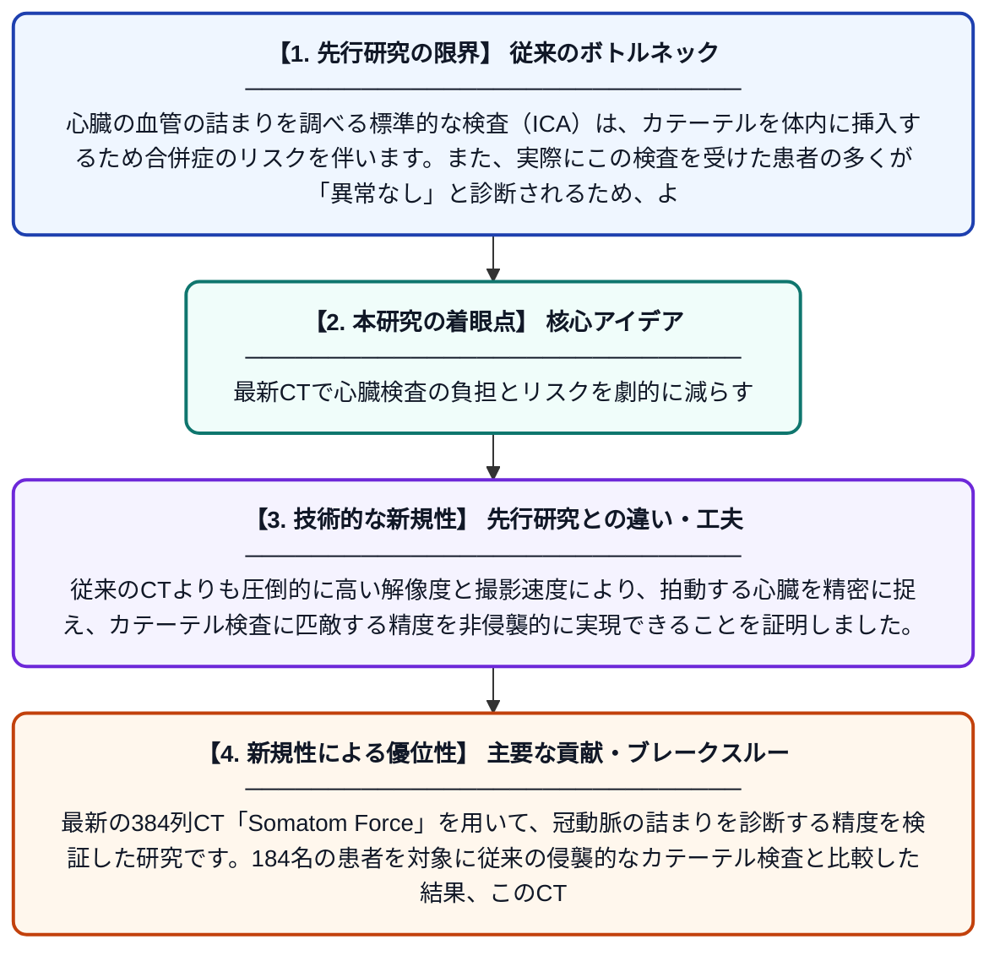

# SIEMENS SOMATOM FORCE 384列CTスキャナーによる冠動脈狭窄検出の診断精度

**Original Title**: *DIAGNOSTIC ACCURACY OF THE SIEMENS SOMATOM FORCE 384-SLICE CT SCANNER IN DETECTING CORONARY ARTERY STENOSIS*

> **💡 一言要約**: 最新CTで心臓検査の負担とリスクを劇的に減らす

| 項目 | 内容 |
|---|---|
| **著者** | AH ALRASHED |
| **掲載誌** | 2026 |
| **アラートキーワード** | ICA |
| **原文リンク** | [https://search.proquest.com/openview/6696ad8cde609ff7f541353446dd0991/1.pdf%3Fpq-origsite%3Dgscholar%26cbl%3D2026366%26diss%3Dy](https://search.proquest.com/openview/6696ad8cde609ff7f541353446dd0991/1.pdf%3Fpq-origsite%3Dgscholar%26cbl%3D2026366%26diss%3Dy) |
| **PDF版要約** | [README.pdf](./README.pdf) |

---

## 📊 新規性の図解（先行研究との違いと本研究のブレークスルー）

## 📝 要約

最新の384列CT「Somatom Force」を用いて、冠動脈の詰まりを診断する精度を検証した研究です。184名の患者を対象に従来の侵襲的なカテーテル検査と比較した結果、このCTが極めて高い精度を持ち、不要な外科的検査を減らせる可能性が示されました。

## ❓ どんな問題に取り組んだか

心臓の血管の詰まりを調べる標準的な検査（ICA）は、カテーテルを体内に挿入するため合併症のリスクを伴います。また、実際にこの検査を受けた患者の多くが「異常なし」と診断されるため、より安全で正確な事前診断の手法が切実に求められていました。

## ✨ 何が新しい？何がすごい？（新規性）

本研究は、最新鋭の384列CTであるSiemens Somatom Forceの臨床的有用性を、実際の患者データ184例を用いて直接評価した点に価値があります。従来のCTよりも圧倒的に高い解像度と撮影速度により、拍動する心臓を精密に捉え、カテーテル検査に匹敵する精度を非侵襲的に実現できることを証明しました。

## 🎓 大学1年生向けの解説

心臓の血管が細くなっていないか調べるには、これまでは細い管を足の付け根から心臓まで通すという、患者さんにとって負担の大きい検査が必要でした。この論文では、最新の超高性能なカメラ（CT）を使えば、外から写真を撮るだけでカテーテル検査と同じくらい正確に診断できることを明らかにしています。これにより、多くの人が痛い思いをすることなく、安全に心臓の状態を知ることができるようになります。
