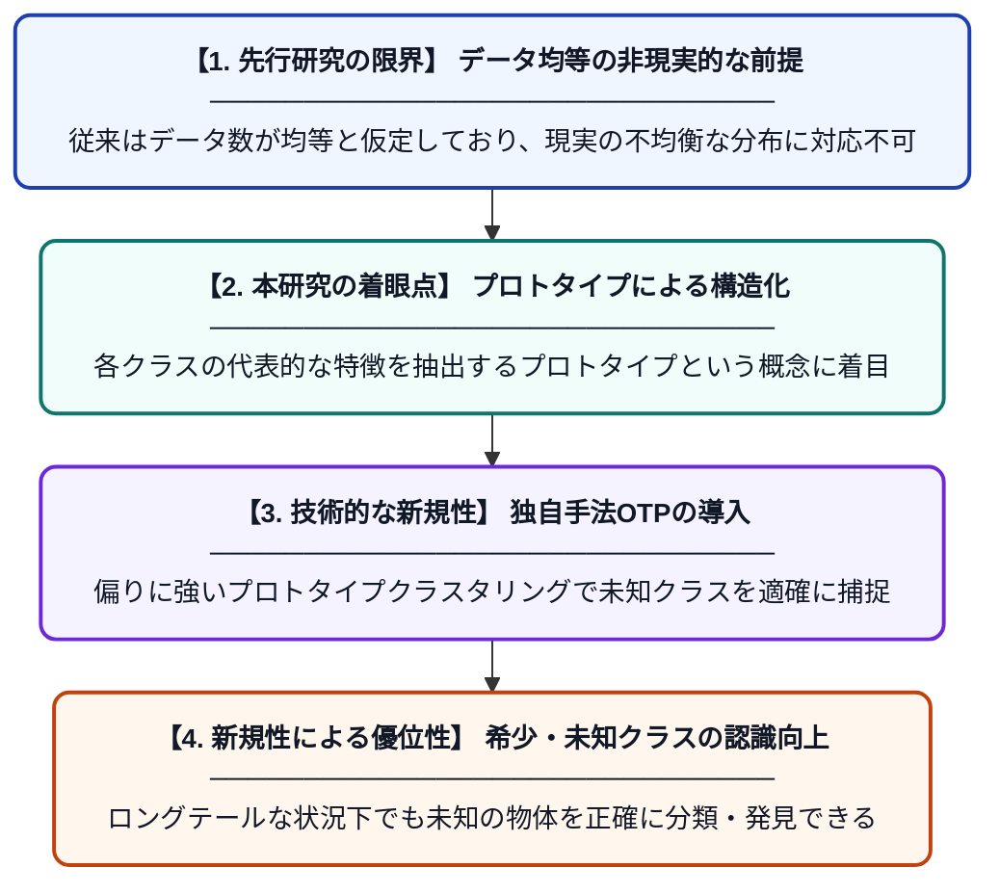

# プロトタイプ・クラスタリングによるオープンワールド・ロングテール準教師あり学習

**Original Title**: *Open-world long-tailed semi-supervised learning via prototype clustering*

> **💡 一言要約**: 偏った未知のデータも賢く分類する新技術

| 項目 | 内容 |
|---|---|
| **著者** | H Hu, R Dai, Y Kang, AH Tan, W Wang, D Wang |
| **掲載誌** | Neurocomputing 2026 |
| **アラートキーワード** | Semi supervise |
| **原文リンク** | [https://www.sciencedirect.com/science/article/pii/S0925231226030055](https://www.sciencedirect.com/science/article/pii/S0925231226030055) |
| **PDF版要約** | [README.pdf](./README.pdf) |

---

## 📊 新規性の図解（先行研究との違いと本研究のブレークスルー）

## 📝 要約

実世界で一般的な「データの偏り（ロングテール）」と「未知のクラスの混入」を同時に扱う、新しい準教師あり学習手法OTPを提案しています。プロトタイプベースのクラスタリングを活用することで、ラベルの少ないクラスや未知のデータの認識精度を大幅に向上させました。

## ❓ どんな問題に取り組んだか

従来のオープンワールド準教師あり学習は、各クラスのデータ数が均等であることを前提としていました。しかし、現実は特定のクラスにデータが偏る「ロングテール分布」であり、既存手法では希少クラスや未知クラスの認識精度が著しく低下するという課題がありました。

## ✨ 何が新しい？何がすごい？（新規性）

本研究は、プロトタイプ（各クラスの代表点）を用いたクラスタリング手法「OTP」を導入し、不均衡なデータ分布と未知クラスの発見を統一的に扱う枠組みを構築しました。これにより、ラベル付きデータが極端に少ないクラスに対しても頑健な特徴表現を獲得し、未知のクラスをより正確にグループ化することが可能になりました。先行研究が克服できなかった「データの偏り」と「未知への対応」の両立を、計算効率を維持しつつ実現した点が画期的です。

## 🎓 大学1年生向けの解説

AIが学習するとき、普通は「犬」や「猫」の写真が同じくらいの数あると想定しますが、現実には「珍しい動物」のように数枚しか写真がないものや、まだ名前も知らない未知の存在が混ざっています。この研究は、そんな「データの数の偏り」や「全く知らないもの」があっても、AIが混乱せずに賢く整理して分類できるようにする仕組みを開発しました。これにより、より現実に近い複雑な状況でもAIが正しく働くようになります。
