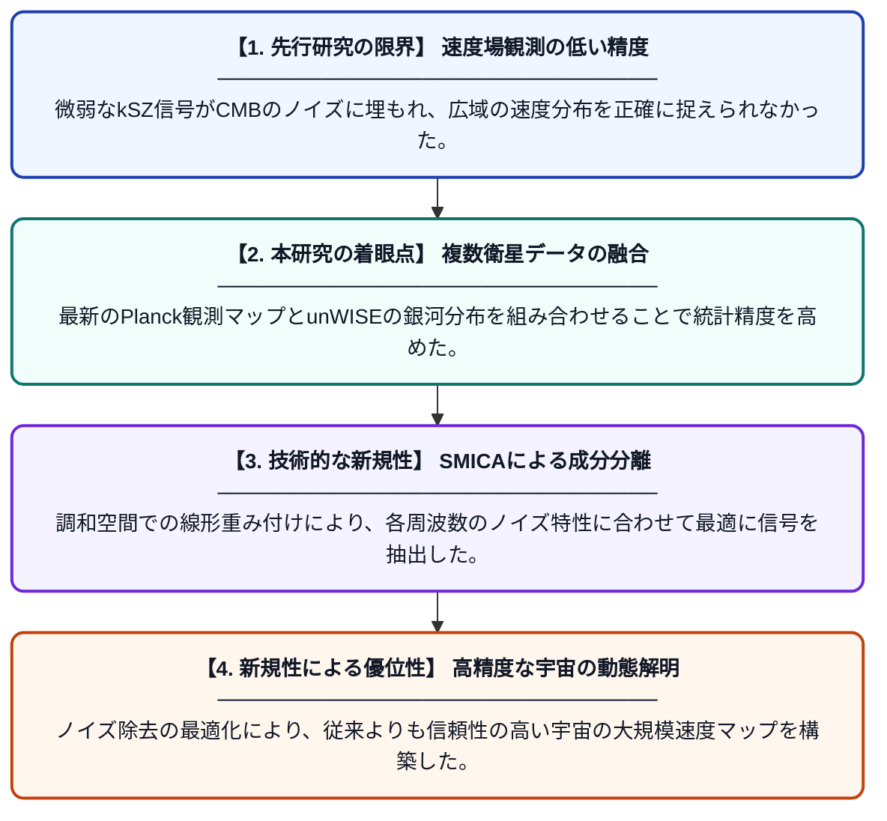

# Planck衛星とunWISE銀河データを用いた運動学的スニャエフ・ゼルドビッチ効果による速度再構成

**Original Title**: *Kinetic Sunyaev Zel'dovich velocity reconstruction from Planck and unWISE observations*

> **💡 一言要約**: 光の歪みから宇宙の巨大な流れを精密に描き出す

| 項目 | 内容 |
|---|---|
| **著者** | R Bloch, MC Johnson |
| **掲載誌** | Physical Review D 2026 |
| **アラートキーワード** | independent component ... |
| **原文リンク** | [https://link.aps.org/pdf/10.1103/j1jm-5j1y](https://link.aps.org/pdf/10.1103/j1jm-5j1y) |
| **PDF版要約** | [README.pdf](./README.pdf) |

---

## 📊 新規性の図解（先行研究との違いと本研究のブレークスルー）

## 📝 要約

宇宙マイクロ波背景放射（CMB）の観測データであるPlanckと、赤外線探査衛星のunWISE銀河カタログを組み合わせ、kSZ効果を用いた宇宙の速度場の再構成を行いました。成分分離手法SMICAを適用することでノイズを抑え、宇宙の大規模構造が重力に従ってどのように運動しているかを高精度に描き出しています。

## ❓ どんな問題に取り組んだか

宇宙の物質がどのように動いているかを示す「速度場」は重力理論の検証に重要ですが、直接観測は困難です。従来の観測では、微弱な信号であるkSZ効果を他の放射ノイズから精度良く分離し、広範囲で一貫した速度情報を抽出することが大きな課題でした。

## ✨ 何が新しい？何がすごい？（新規性）

本研究は、最新のSMICA成分分離マップとunWISEの膨大な銀河カタログを統合し、広域かつ高精度な速度再構成を実現しました。各周波数マップを調和空間で最適に重み付けするSMICA手法により、ノイズの影響を最小限に抑えつつkSZ信号を抽出することに成功しています。これにより、宇宙の構造形成におけるダークマターの振る舞いを探るための、より強力な統計的制限を与えられるようになりました。

## 🎓 大学1年生向けの解説

宇宙には、ビッグバンの名残である古い光（CMB）が満ちています。この光が移動する銀河のガスを通り抜けるとき、ドップラー効果のようにわずかに変化します。この変化を詳しく分析することで、目に見えない銀河の「動き」を逆算して調べることができます。この研究は、複数の衛星データを賢く組み合わせて、宇宙の巨大な構造がどこへ向かって動いているかを明らかにする「宇宙の天気図」のようなものを作ったのです。
