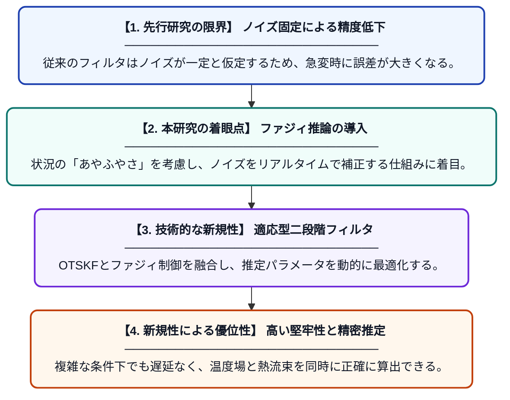

# 温度場と熱流束の同時推定のためのファジィ適応戦略を用いた改良型最適二段階カルマンフィルタ：比較性能評価

**Original Title**: *Improving optimal two-stage Kalman filtering using fuzzy adaptive strategy for simultaneous estimation of temperature field and heat flux: A comparative performance …*

> **💡 一言要約**: ファジィ制御で進化、熱と温度の精密推定。

| 項目 | 内容 |
|---|---|
| **著者** | X Wang, X Li, X Zhang |
| **掲載誌** | International Communications in Heat and Mass … 2026 |
| **アラートキーワード** | kalman filter |
| **原文リンク** | [https://www.sciencedirect.com/science/article/pii/S073519332602645X](https://www.sciencedirect.com/science/article/pii/S073519332602645X) |
| **PDF版要約** | [README.pdf](./README.pdf) |

---

## 📊 新規性の図解（先行研究との違いと本研究のブレークスルー）

## 📝 要約

熱流束と温度分布を同時に精度良く推定するため、従来の最適二段階カルマンフィルタ（OTSKF）にファジィ適応戦略を導入した研究です。未知のシステムノイズや測定誤差に対して、フィルタのパラメータを動的に調整することで、過酷な条件下でも安定した推定を可能にしました。

## ❓ どんな問題に取り組んだか

従来のカルマンフィルタを用いた熱流束の推定では、システムノイズの共分散行列が固定されているため、急激な温度変化や複雑な境界条件において推定精度が低下する問題がありました。特に温度場と熱流束の相互作用をリアルタイムで正確に追跡することは困難でした。

## ✨ 何が新しい？何がすごい？（新規性）

本研究は、最適二段階カルマンフィルタ（OTSKF）に「ファジィ適応戦略」を統合し、ノイズ特性をリアルタイムで最適化する手法を開発した点が画期的です。従来の静的なフィルタとは異なり、残差の変化に応じて推定ゲインを動的に変更できるため、非定常な熱伝導現象に対して極めて高い頑健性を示します。これにより、先行研究で見られた推定の遅延やオーバーシュートが劇的に改善されました。

## 🎓 大学1年生向けの解説

部屋の温度やヒーターから出る熱の強さを同時に測るのは、実は非常に難しい技術です。測定データには必ず「ノイズ（誤差）」が含まれますが、これまでの方法では急な変化に対応しきれないことがありました。この研究では、人間の曖昧な判断に近い「ファジィ理論」を使って、状況に合わせて計算式を賢く書き換える仕組みを作りました。その結果、熱の動きをこれまで以上に正確に予測できるようになりました。
