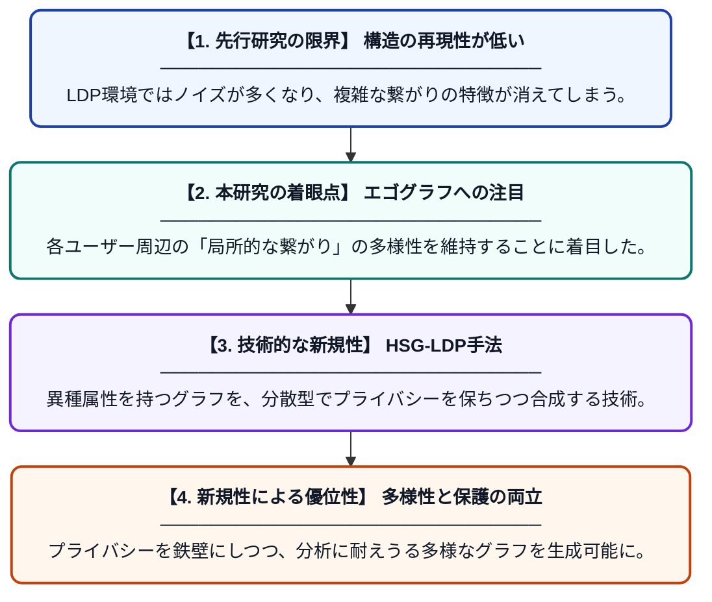

# ローカル差分プライバシーを用いた社会グラフ合成における社会的接続の多様性保持

**Original Title**: *Preserving Socio-Connective Diversity in Locally Private Social Graph Synthesis*

> **💡 一言要約**: 秘密を守りつつ、SNSの多様な繋がりを再現する

| 項目 | 内容 |
|---|---|
| **著者** | M Jerbi, R Gil Pons, S Mauw |
| **掲載誌** | International Conference on Availability, Reliability and … 2027 |
| **アラートキーワード** | differential privacy |
| **原文リンク** | [https://link.springer.com/chapter/10.1007/978-3-032-36874-4_2](https://link.springer.com/chapter/10.1007/978-3-032-36874-4_2) |
| **PDF版要約** | [README.pdf](./README.pdf) |

---

## 📊 新規性の図解（先行研究との違いと本研究のブレークスルー）

## 📝 要約

プライバシーを保護しながらソーシャルメディアの繋がり（グラフ）を再現するために、ローカル差分プライバシー（LDP）を用いた新しい分散型合成手法を提案しています。個々のユーザーの周囲の繋がりである「エゴグラフ」の多様な構造を維持しつつ、情報の機密性を守るHSG-LDPという枠組みを導入しています。

## ❓ どんな問題に取り組んだか

ソーシャルデータの共有はプライバシー侵害のリスクが高く、従来の匿名化手法では分析に役立つ構造が失われがちでした。特に中央管理者を信頼しないLDP環境では、複雑で多様な接続パターンを精度良く再現することが非常に困難でした。

## ✨ 何が新しい？何がすごい？（新規性）

個々のユーザーが持つ局所的なネットワーク構造（エゴグラフ）と、その多様な接続特性に直接着目した点が革新的です。中央サーバーがデータを一括管理せず、各ユーザーの端末側で情報を加工して集約することで、高度なプライバシー保護と複雑なグラフ特性の再現を両立させました。具体的には、異種混合な属性を持つグラフにおいて、コミュニティの多様性を損なわずに合成データを生成できる仕組みを構築しています。

## 🎓 大学1年生向けの解説

SNSでの「誰と誰が繋がっているか」というデータは研究に役立ちますが、そのまま公開するとプライバシーが漏れてしまいます。この研究では、自分のスマホの中で情報を「適度にぼかす」ことで、個人の特定を防ぎつつも、全体としてのSNSの繋がり方を正しく再現する技術を作りました。これによって、個人の秘密を守ったまま、より正確なSNS分析やシミュレーションが可能になります。
