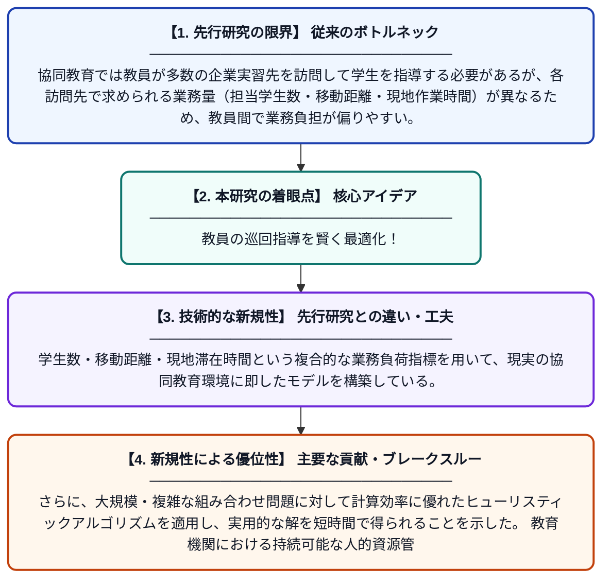

# 協同教育における持続可能な教員巡回指導と業務負担均等化のためのヒューリスティック手法の応用

**Original Title**: *Application of a Heuristic-Based System for Sustainable Faculty Routing and Workload Balancing in Cooperative Education*

> **💡 一言要約**: 教員の巡回指導を賢く最適化！

| 項目 | 内容 |
|---|---|
| **著者** | A Siraphatwongkorn, J Arbking |
| **掲載誌** | ASEAN Journal of Scientific and Technological Reports 2026 |
| **アラートキーワード** | VRP |
| **原文リンク** | [https://ph02.tci-thaijo.org/index.php/tsujournal/article/view/262669](https://ph02.tci-thaijo.org/index.php/tsujournal/article/view/262669) |
| **PDF版要約** | [README.pdf](./README.pdf) |

---

## 📊 新規性の図解（先行研究との違いと本研究のブレークスルー）

## 📝 要約

本研究は、協同教育プログラムにおいて教員が複数の企業実習先を巡回指導する際の経路計画と業務負担の均等化問題を扱っている。学生数・移動距離・現地滞在時間などの多様な制約を考慮しながら、ヒューリスティックアルゴリズムを用いて効率的かつ持続可能なスケジューリング手法を提案している。これにより、教員の過負荷を防ぎつつ巡回コストの最小化を実現することを目指している。

## ❓ どんな問題に取り組んだか

協同教育では教員が多数の企業実習先を訪問して学生を指導する必要があるが、各訪問先で求められる業務量（担当学生数・移動距離・現地作業時間）が異なるため、教員間で業務負担が偏りやすい。この不均等な負担配分は教員の疲弊や教育の質の低下を招く恐れがある。巡回経路の最適化と負担均等化を同時に達成する実用的な手法が求められていた。

## ✨ 何が新しい？何がすごい？（新規性）

従来研究では巡回経路の最短化（VRP問題）や業務配分の均等化を個別に扱うケースが多かったが、本研究は両者を統合した問題として定式化した点が新しい。学生数・移動距離・現地滞在時間という複合的な業務負荷指標を用いて、現実の協同教育環境に即したモデルを構築している。さらに、大規模・複雑な組み合わせ問題に対して計算効率に優れたヒューリスティックアルゴリズムを適用し、実用的な解を短時間で得られることを示した。教育機関における持続可能な人的資源管理への応用可能性も示している点が本研究の主要な貢献である。

## 🎓 大学1年生向けの解説

大学の「インターンシップ」のような制度では、先生が学生の働く会社を一つひとつ訪問して指導します。しかし訪問先が多いと、先生によって仕事量の差が大きくなってしまいます。この研究では、コンピュータのプログラムを使って「どの先生がどの順番でどの会社を回るか」を自動的に計算し、全員の負担をできるだけ均等にする方法を考えました。カーナビが最短ルートを案内するように、先生の巡回スケジュールも賢く最適化できることを示した研究です。
