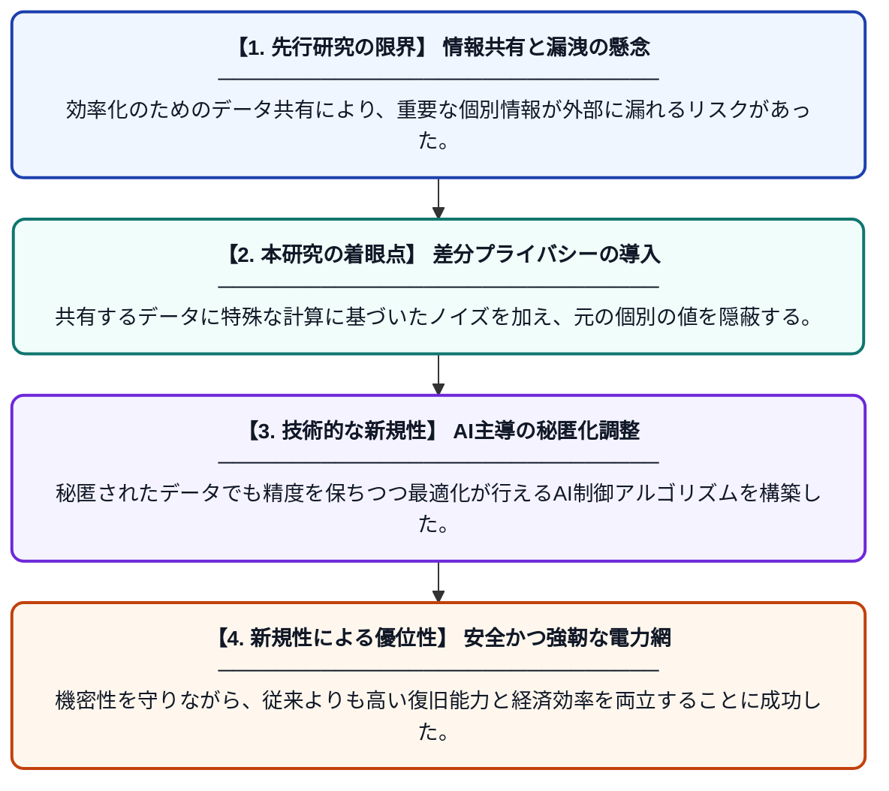

# AIによるネットワーク化されたマイクログリッドの調整と最適化：回復力と経済効率の向上

**Original Title**: *AI-Driven Coordination and Optimization of Networked Microgrids for Enhanced Resilience and Economic Efficiency*

> **💡 一言要約**: プライバシーを守りAIで電力網を最適化する

| 項目 | 内容 |
|---|---|
| **著者** | NA Natraj, B Sundaravadivazhagan, U Arunkumar… |
| **掲載誌** | AI Control Strategies for Optimal … |
| **アラートキーワード** | differential privacy |
| **原文リンク** | [https://api.taylorfrancis.com/content/chapters/edit/download?identifierName=doi&identifierValue=10.1201/9781003648666-10&type=chapterpdf](https://api.taylorfrancis.com/content/chapters/edit/download?identifierName=doi&identifierValue=10.1201/9781003648666-10&type=chapterpdf) |
| **PDF版要約** | [README.pdf](./README.pdf) |

---

## 📊 新規性の図解（先行研究との違いと本研究のブレークスルー）

## 📝 要約

複数のマイクログリッドを効率的に連携させるため、AIを活用した最適化手法を提案しています。特に差分プライバシー技術を導入することで、機密情報を保護しながらシステム全体の回復力と経済性を高めることに成功しています。

## ❓ どんな問題に取り組んだか

分散型電源であるマイクログリッドの連携にはデータ共有が不可欠ですが、これには機密情報が漏洩するリスクが伴います。また、データの安全性を保ちながら、停電などの障害に対する回復力と運用コストの削減を同時に達成することが困難でした。

## ✨ 何が新しい？何がすごい？（新規性）

本研究は、調整プロセスに差分プライバシー技術を組み込み、共有データに適切なノイズを加えることで個別の記録の特定を防止しています。先行研究では困難だった「プライバシー保護」と「高度な最適化制御」をAI戦略によって統合し、情報の機密性を保ったまま電力網の経済性と強靭性を最大化できることを示しました。

## 🎓 大学1年生向けの解説

この研究は、小さな発電所（マイクログリッド）同士が「秘密」を守りながら協力する方法を開発したものです。みんなで協力すれば電気代が安くなり停電にも強くなりますが、データをそのまま渡すと企業秘密がバレてしまいます。そこで、データに「あえて少しだけ雑音（ノイズ）」を混ぜる特殊な技術を使い、プライバシーを守りながらAIが賢く全体を動かす仕組みを作りました。
