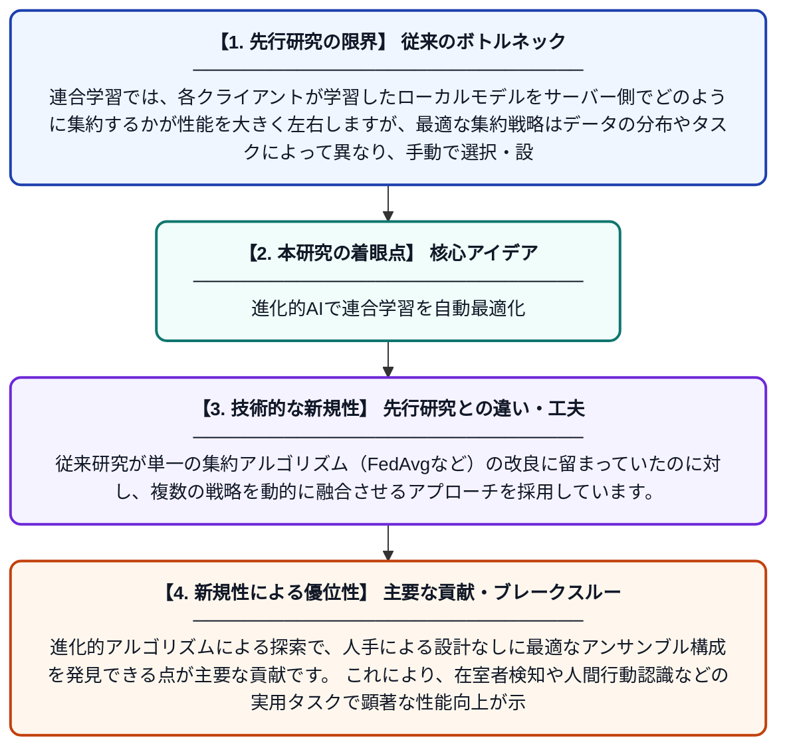

# 連合学習における集約戦略のアンサンブルを最適化する進化的アルゴリズム

**Original Title**: *Evolutionary Algorithm-Based Ensemble of Aggregation Strategies in Federated Learning*

> **💡 一言要約**: 進化的AIで連合学習を自動最適化

| 項目 | 内容 |
|---|---|
| **著者** | B Cansiz, M Hassan, M Taskiran, G Iacca |
| **掲載誌** | IEEE Transactions on Evolutionary Computation 2026 |
| **アラートキーワード** | Federated Learning |
| **PDF** | [https://ieeexplore.ieee.org/iel8/4235/4358751/11625945.pdf](https://ieeexplore.ieee.org/iel8/4235/4358751/11625945.pdf) |
| **原文リンク** | [https://ieeexplore.ieee.org/iel8/4235/4358751/11625945.pdf](https://ieeexplore.ieee.org/iel8/4235/4358751/11625945.pdf) |
| **PDF版要約** | [README.pdf](./README.pdf) |

---

## 📊 新規性の図解（先行研究との違いと本研究のブレークスルー）

## 📝 要約

連合学習（FL）において、複数のモデル集約戦略を進化的アルゴリズムで自動的に組み合わせるアンサンブル手法を提案した研究です。在室者検知や人間行動認識などのプライバシーに敏感なタスクに対して、単一の集約戦略よりも高い精度を実現しています。進化的アルゴリズムを用いることで、データの特性やタスクに応じた最適な集約戦略の組み合わせを自動探索できます。

## ❓ どんな問題に取り組んだか

連合学習では、各クライアントが学習したローカルモデルをサーバー側でどのように集約するかが性能を大きく左右しますが、最適な集約戦略はデータの分布やタスクによって異なり、手動で選択・設計するのは困難です。また、単一の集約戦略では多様なデータ環境に対して十分な汎化性能を発揮できないという課題があります。

## ✨ 何が新しい？何がすごい？（新規性）

本研究は、複数の集約戦略を進化的アルゴリズムによって自動的に最適な重みで組み合わせるアンサンブル手法を初めて提案しました。従来研究が単一の集約アルゴリズム（FedAvgなど）の改良に留まっていたのに対し、複数の戦略を動的に融合させるアプローチを採用しています。進化的アルゴリズムによる探索で、人手による設計なしに最適なアンサンブル構成を発見できる点が主要な貢献です。これにより、在室者検知や人間行動認識などの実用タスクで顕著な性能向上が示されています。

## 🎓 大学1年生向けの解説

連合学習とは、スマートフォンなどの端末がデータをサーバーに送らずに、各自でAIモデルを学習し、その結果だけを共有して賢いモデルを作る仕組みです。この仕組みで重要なのが「各端末の学習結果をどうまとめるか（集約）」ですが、どのまとめ方が最善かは状況によって違います。この研究では、生物の進化を模した「進化的アルゴリズム」を使って、複数のまとめ方を自動的に良い比率でミックスする方法を考案しました。料理のレシピを自動で最適化するように、AIが最良の「集約レシピ」を見つけてくれるイメージです。これにより、人が手動で設定するよりも高い精度を達成できることが実験で確認されました。
