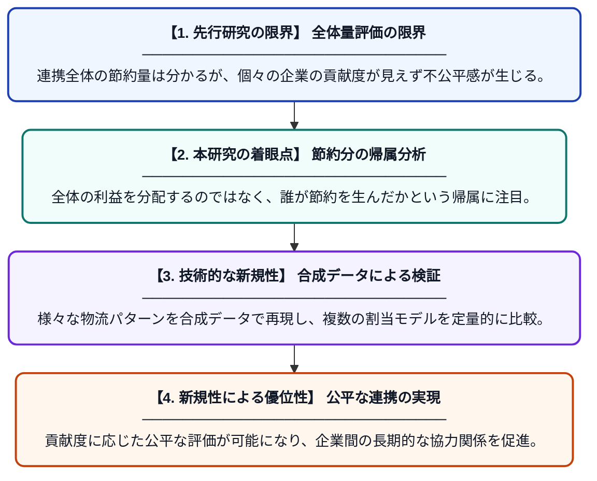

# 持続可能な物流連携におけるエネルギー節約とその帰属に関する研究

**Original Title**: *Energy Savings and Their Attribution in Sustainable Logistics Collaboration*

> **💡 一言要約**: 物流連携の省エネ効果を公平に「見える化」する手法

| 項目 | 内容 |
|---|---|
| **著者** | A Tatarczak |
| **掲載誌** | Sustainability 2026 |
| **アラートキーワード** | logistics |
| **PDF** | [https://www.mdpi.com/2071-1050/18/21/11210/pdf](https://www.mdpi.com/2071-1050/18/21/11210/pdf) |
| **原文リンク** | [https://www.mdpi.com/2071-1050/18/21/11210/pdf](https://www.mdpi.com/2071-1050/18/21/11210/pdf) |
| **PDF版要約** | [README.pdf](./README.pdf) |

---

## 📊 新規性の図解（先行研究との違いと本研究のブレークスルー）

## 📝 要約

物流業者間の共同配送などの連携はエネルギー消費を削減しますが、全体の節約量だけでは各企業の具体的な貢献度が不明確です。本研究は合成データを用い、節約されたエネルギーを各参加企業へ公平に割り当てるための評価手法を検証しています。

## ❓ どんな問題に取り組んだか

物流企業が共同配送で協力する場合、全体のエネルギー消費は減りますが、どの企業がどれだけ貢献したかを評価するのは困難です。全体の節約量のみに注目すると、個々の企業の努力や役割が隠れてしまい、不公平感から連携が破綻するリスクがあります。

## ✨ 何が新しい？何がすごい？（新規性）

本研究の新規性は、物流連携におけるエネルギー節約分を個々の企業に「帰属」させるための数学的アプローチを体系化した点にあります。先行研究では全体最適化に焦点が当てられていましたが、本研究は合成データを活用して多様な条件下での帰属モデルを検証し、各企業の寄与度を定量化する枠組みを構築しました。これにより、持続可能な物流戦略における公平なインセンティブ設計が可能になります。

## 🎓 大学1年生向けの解説

複数の運送会社が協力して荷物を運ぶと、トラックの走行距離が減ってガソリンを節約できます。しかし、たくさん荷物を出した会社や、遠くまで運んだ会社など事情が異なるため、誰が一番「省エネ」に貢献したかを決めるのは難しい問題です。この研究は、その貢献度を公平に計算するための新しいルールを提案しました。これによって、みんなが納得して協力し合える環境に優しい物流の仕組みを作ることができます。
