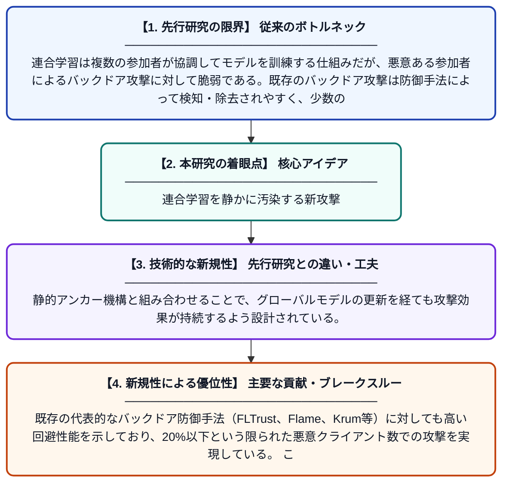

# PREFed：連合学習におけるトリガー事前最適化による効果的かつ隠密な静的アンカー型バックドア攻撃

**Original Title**: *PREFed: An Effective and Stealthy Static-Anchor Backdoor Attack via Trigger Pre-Optimization in Federated Learning*

> **💡 一言要約**: 連合学習を静かに汚染する新攻撃

| 項目 | 内容 |
|---|---|
| **著者** | X Chen, R Zeng, C Zhou, Y Zhang, Q Li, Y Pu, Z Liu |
| **掲載誌** | IEEE Transactions on Information Forensics and Security 2026 |
| **アラートキーワード** | Federated Learning |
| **原文リンク** | [https://ieeexplore.ieee.org/abstract/document/11622588/](https://ieeexplore.ieee.org/abstract/document/11622588/) |
| **PDF版要約** | [README.pdf](./README.pdf) |

---

## 📊 新規性の図解（先行研究との違いと本研究のブレークスルー）

## 📝 要約

本論文は、連合学習システムに対する新たなバックドア攻撃手法「PREFed」を提案する。攻撃者は全クライアントの最大20%を制御するだけで、トリガーパターンを事前最適化することにより、既存の防御機構を回避しながら高い攻撃成功率を実現する。静的アンカー戦略と組み合わせることで、攻撃の永続性と隠密性を両立させている。

## ❓ どんな問題に取り組んだか

連合学習は複数の参加者が協調してモデルを訓練する仕組みだが、悪意ある参加者によるバックドア攻撃に対して脆弱である。既存のバックドア攻撃は防御手法によって検知・除去されやすく、少数の悪意あるクライアントで効果的かつ持続的な攻撃を行うことが難しかった。特に、トリガーパターンの設計が攻撃の有効性と隠密性に大きく影響するという課題があった。

## ✨ 何が新しい？何がすごい？（新規性）

PREFedは、攻撃前にトリガーパターンを最適化する「事前最適化」戦略を導入した点が新しく、従来の固定トリガーや単純なパターンを用いる攻撃とは一線を画す。静的アンカー機構と組み合わせることで、グローバルモデルの更新を経ても攻撃効果が持続するよう設計されている。既存の代表的なバックドア防御手法（FLTrust、Flame、Krum等）に対しても高い回避性能を示しており、20%以下という限られた悪意クライアント数での攻撃を実現している。これにより、現実的な脅威モデル下での連合学習の脆弱性を新たに明らかにした。

## 🎓 大学1年生向けの解説

連合学習とは、多くのスマートフォンやパソコンが協力してAIを一緒に学習させる仕組みです。しかし、その中に悪意のある参加者が混じると、AIに「特定の合図（トリガー）を見せると誤った答えを出す」という罠（バックドア）を仕込める危険があります。この論文では、その罠をより巧みに隠すために「トリガーをあらかじめ最適化して作る」という新しい攻撃方法PREFedを提案しています。怪しまれにくく、かつ効果が長続きする攻撃が少数の悪者クライアントで可能になることを示しており、連合学習のセキュリティ上の弱点を改めて警告しています。
