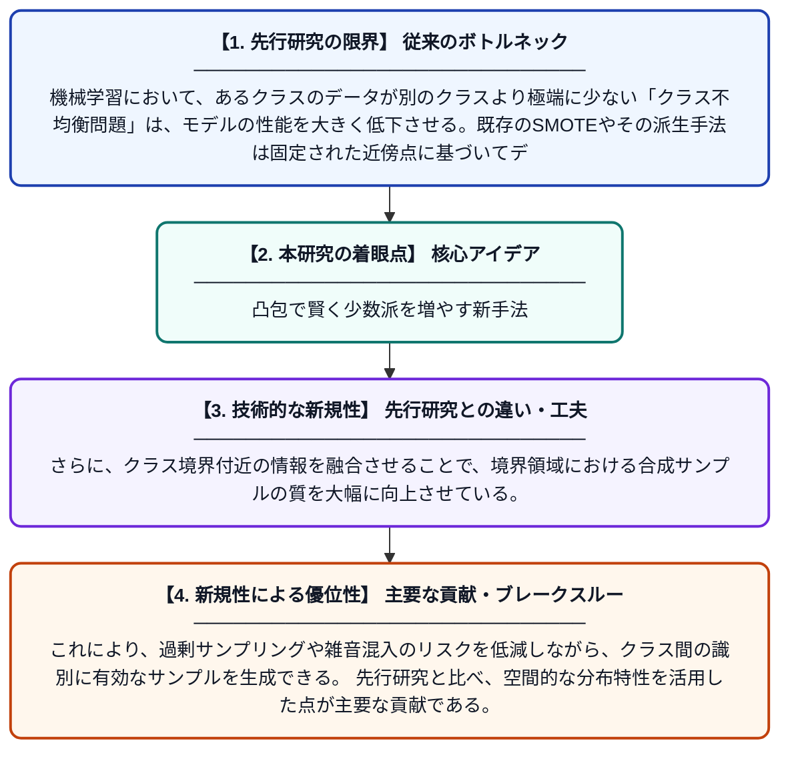

# 境界融合凸包合成少数派オーバーサンプリング技術（BFCH-SMOTE）

**Original Title**: *BFCH-SMOTE: Boundary fusion convex hull synthetic minority oversampling technique*

> **💡 一言要約**: 凸包で賢く少数派を増やす新手法

| 項目 | 内容 |
|---|---|
| **著者** | H Wen, Y Li, J Pei, R Zheng, H Liu |
| **掲載誌** | Neurocomputing 2026 |
| **アラートキーワード** | SMOTE |
| **原文リンク** | [https://www.sciencedirect.com/science/article/pii/S0925231226019934](https://www.sciencedirect.com/science/article/pii/S0925231226019934) |
| **PDF版要約** | [README.pdf](./README.pdf) |

---

## 📊 新規性の図解（先行研究との違いと本研究のブレークスルー）

## 📝 要約

本論文は、不均衡データ問題に対処するための新しいオーバーサンプリング手法「BFCH-SMOTE」を提案する。従来のSMOTEおよびその派生手法が固定された近傍ベースのサンプリングに依存し、クラス境界付近での過剰サンプリングや雑音に弱いという問題を解決する。BFCH-SMOTEは凸包の概念と境界融合情報を同時に活用し、より適切で多様な合成サンプルを生成する。

## ❓ どんな問題に取り組んだか

機械学習において、あるクラスのデータが別のクラスより極端に少ない「クラス不均衡問題」は、モデルの性能を大きく低下させる。既存のSMOTEやその派生手法は固定された近傍点に基づいてデータを合成するため、クラス境界付近に不適切なサンプルが生成されたり、雑音データの影響を受けやすいという限界がある。

## ✨ 何が新しい？何がすごい？（新規性）

BFCH-SMOTEは、従来の固定近傍サンプリングを脱却し、「凸包（Convex Hull）」という幾何学的構造を利用して少数クラスの分布をより正確に捉える点が新しい。さらに、クラス境界付近の情報を融合させることで、境界領域における合成サンプルの質を大幅に向上させている。これにより、過剰サンプリングや雑音混入のリスクを低減しながら、クラス間の識別に有効なサンプルを生成できる。先行研究と比べ、空間的な分布特性を活用した点が主要な貢献である。

## 🎓 大学1年生向けの解説

例えば、病気の患者データが健康な人のデータより極端に少ない場合、AIはうまく学習できません。そこで「少ないデータを人工的に増やす」手法が使われます。従来の方法は近くのデータ点を結んで新しいデータを作りますが、境界付近で間違ったデータを作りやすい問題がありました。この論文では「凸包」という図形の概念を使い、少数派データの形をより正確に捉えて、クラスの境界情報も考慮しながら質の高い人工データを生成する方法を提案しています。これにより、不均衡なデータでもAIがより正確に学習できるようになります。
