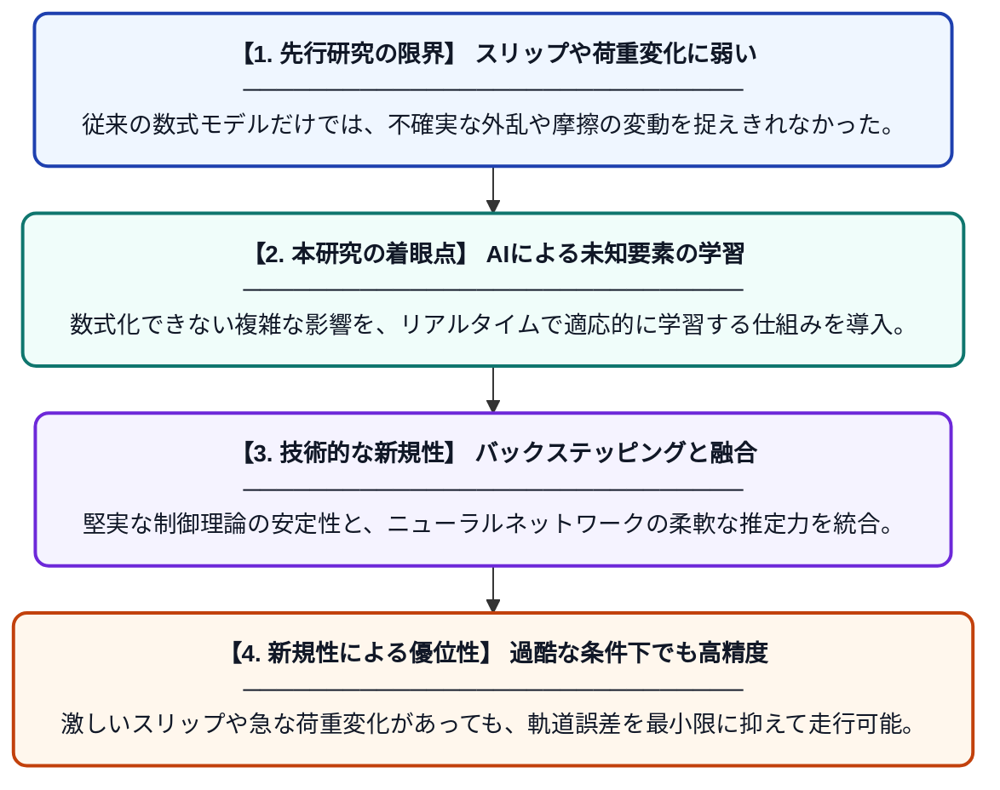

# 物流アプリケーション向けニューラル推定を用いたバックステッピング制御によるスキッドステア型移動ロボットの軌道追従

**Original Title**: *Trajectory tracking of SSMR using backstepping control with neural estimation for logistics applications*

> **💡 一言要約**: AI推定と高度制御で、物流ロボの滑りを克服。

| 項目 | 内容 |
|---|---|
| **著者** | KA Alattas, S Boubaker, F Rossomando |
| **掲載誌** | Scientific Reports 2026 |
| **アラートキーワード** | logistics |
| **PDF** | [https://www.nature.com/articles/s41598-026-78031-1_reference.pdf](https://www.nature.com/articles/s41598-026-78031-1_reference.pdf) |
| **原文リンク** | [https://www.nature.com/articles/s41598-026-78031-1_reference.pdf](https://www.nature.com/articles/s41598-026-78031-1_reference.pdf) |
| **PDF版要約** | [README.pdf](./README.pdf) |

---

## 📊 新規性の図解（先行研究との違いと本研究のブレークスルー）

## 📝 要約

物流現場で活用されるスキッドステア型移動ロボット（SSMR）の精密な軌道追従を実現するため、バックステッピング制御とニューラルネットワークを統合した新しい制御アルゴリズムを提案しました。荷物の重さの変化や車輪のスリップ、床面の摩擦変化といった未知の要因をAIがリアルタイムで推定し、高い精度で走行ルートを補正します。

## ❓ どんな問題に取り組んだか

スキッドステア型ロボットは旋回時に必ず車輪が滑るため、正確な動きを数式で表現することが非常に困難です。さらに、運ぶ荷物の重さが変わったり、床の状態によって滑り方が変わったりといった予測できない外乱が、物流現場での運用において制御の精度を著しく低下させる原因となっていました。

## ✨ 何が新しい？何がすごい？（新規性）

従来のバックステッピング法に、動的な未知のパラメータを学習するニューラルネットワーク推定器を統合した点が革新的です。これにより、物理モデルを完全には構築できないスリップや摩擦の変動を、システムが動いている最中にリアルタイムで補償することが可能になりました。また、リアプノフ安定性理論を用いてシステムの数学的な安定性を証明しており、不確実な環境下でも暴走せずに目標軌道を追従できることを担保しています。

## 🎓 大学1年生向けの解説

倉庫で荷物を運ぶロボットが、重い荷物を載せたり滑りやすい床を通ったりしても、決まったルートを正確に走れるようにする技術です。ロボットの「滑り」や「荷物による重さの変化」を、AI（ニューラルネットワーク）が走りながらリアルタイムで予測します。その予測結果を「バックステッピング」という賢い制御方法と組み合わせることで、たとえ想定外の事態が起きても、即座に動きを修正して目的地へたどり着けるようになります。
