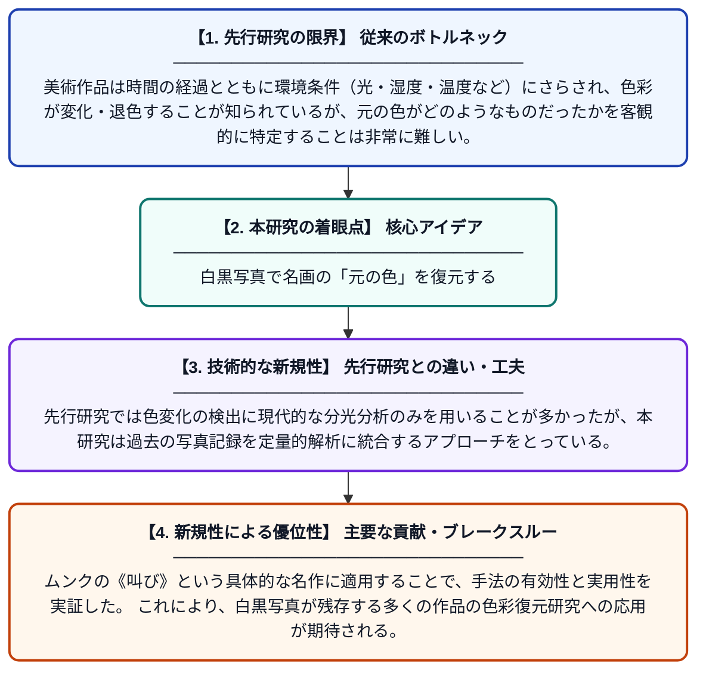

# 白黒写真は絵画の元の色について何を教えてくれるか？：エドヴァルド・ムンクの《叫び》(1910年?)を事例として

**Original Title**: *… photograph tell us about the original colours of a painting?: A case study on Edvard Munch's The Scream (1910?): authors: P. Siozos, ICA Sandu, PI Stavroulakis,...[et al…*

> **💡 一言要約**: 白黒写真で名画の「元の色」を復元する

| 項目 | 内容 |
|---|---|
| **著者** | ICA Sandu, S Campana, P Siozos, PI Stavroulakis |
| **アラートキーワード** | ICA |
| **原文リンク** | [https://munch.tind.io/record/46807](https://munch.tind.io/record/46807) |
| **PDF版要約** | [README.pdf](./README.pdf) |

---

## 📊 新規性の図解（先行研究との違いと本研究のブレークスルー）

## 📝 要約

本研究では、歴史的な白黒写真と最新のマルチ／ハイパースペクトルイメージングを組み合わせた計算手法を提案し、環境条件などによって生じた美術作品の色変化を検出する。ムンクの《叫び》を事例として、過去に撮影された白黒写真から元の色情報を推定し、現在の状態と比較することで退色・変色の程度を定量的に明らかにした。この手法は、修復・保存分野における非破壊的な色変化解析の新たな可能性を示すものである。

## ❓ どんな問題に取り組んだか

美術作品は時間の経過とともに環境条件（光・湿度・温度など）にさらされ、色彩が変化・退色することが知られているが、元の色がどのようなものだったかを客観的に特定することは非常に難しい。特に古い作品では、当時の色情報を記録した資料が白黒写真しか残っていない場合が多く、色変化の程度を定量的に評価する手段が限られていた。

## ✨ 何が新しい？何がすごい？（新規性）

本研究の新規性は、歴史的白黒写真という従来は色情報が失われたと見なされていた資料を、最新のハイパースペクトルイメージングデータと組み合わせることで、色変化の推定に活用できる計算手法を構築した点にある。先行研究では色変化の検出に現代的な分光分析のみを用いることが多かったが、本研究は過去の写真記録を定量的解析に統合するアプローチをとっている。ムンクの《叫び》という具体的な名作に適用することで、手法の有効性と実用性を実証した。これにより、白黒写真が残存する多くの作品の色彩復元研究への応用が期待される。

## 🎓 大学1年生向けの解説

ムンクの《叫び》のような有名な絵画は、長い年月の間に色が変わってしまうことがあります。でも昔の写真は白黒だったため、元々どんな色だったかを知るのはとても難しいです。この研究では、昔の白黒写真と今の特殊なカメラ（様々な光の波長で撮影できるもの）を組み合わせるコンピュータの方法を作りました。これによって、絵がどれだけ色あせたか・変色したかを科学的に調べることができます。絵画の保存・修復に役立つ、まるで「タイムマシン」のような技術です。
