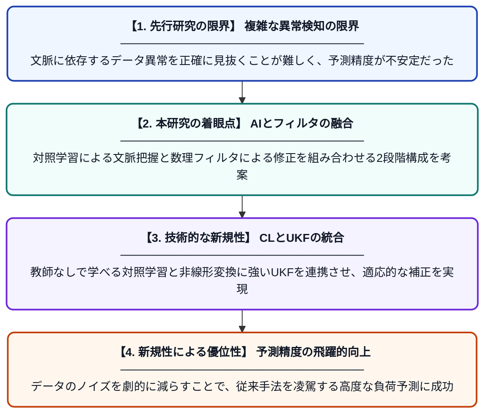

# 負荷予測精度向上のための対照学習による異常検知とアンセンテッド・カルマンフィルタ補正

**Original Title**: *Contrastive Learning-Guided Anomaly Detection with Unscented Kalman Filter Correction for Enhanced Load Forecasting Accuracy*

> **💡 一言要約**: AIと高度なフィルタで電力予測の異常を克服

| 項目 | 内容 |
|---|---|
| **著者** | M Choubey, RK Chaurasiya, JS Yadav |
| **掲載誌** | IEEE Transactions on Sustainable … 2026 |
| **アラートキーワード** | kalman filter |
| **原文リンク** | [https://ieeexplore.ieee.org/abstract/document/11783203/](https://ieeexplore.ieee.org/abstract/document/11783203/) |
| **PDF版要約** | [README.pdf](./README.pdf) |

---

## 📊 新規性の図解（先行研究との違いと本研究のブレークスルー）

## 📝 要約

本研究は、電力負荷予測の精度を高めるために、対照学習を用いた異常検知とアンセンテッド・カルマンフィルタ（UKF）による適応的補正を組み合わせた2段階の前処理手法を提案しています。対照学習により文脈に応じた異常値を特定し、UKFによってそれらを適切に修正することで、予測モデルの信頼性を大幅に向上させています。

## ❓ どんな問題に取り組んだか

電力需要の予測において、データに含まれるノイズや異常値は予測精度を著しく低下させる要因となります。特に、急激な需要変化や測定エラーなど、文脈によって判断が分かれる複雑な異常を正確に検知し、かつ適切に修正することは従来の技術では困難でした。

## ✨ 何が新しい？何がすごい？（新規性）

本研究の核心的な新規性は、教師なしの「対照学習（Contrastive Learning）」と、高度な非線形推定を行う「アンセンテッド・カルマンフィルタ（UKF）」を前処理に統合した点にあります。先行研究では個別に扱われることが多かった異常検知とデータ補正を密接に連携させることで、ラベルのないデータからでも文脈に即した異常を特定し、適応的に修正する革新的なアーキテクチャを実現しました。

## 🎓 大学1年生向けの解説

電気が将来どれくらい使われるかを予測することは、エネルギーを効率的に使うために非常に重要です。しかし、記録されたデータには間違いや変な値が混じることがあり、それが予測を邪魔してしまいます。この研究では、AIの力で「おかしなデータ」を見つけ出し、さらに特殊な計算式（フィルタ）を使ってその間違いを自動で直す仕組みを作りました。これにより、今までよりもずっと正確に電気の未来を予測できるようになりました。
