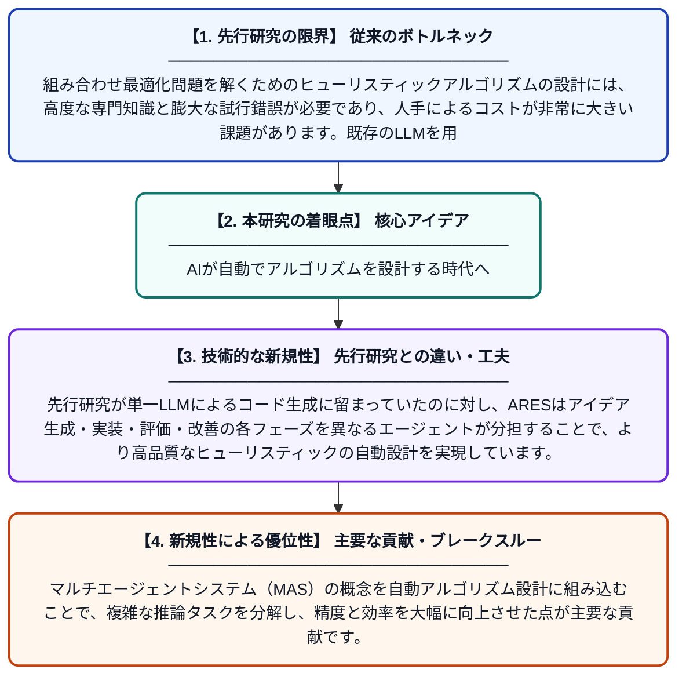

# 大規模言語モデルを活用した自動ヒューリスティック設計のためのマルチエージェントフレームワーク

**Original Title**: *A multi-agent framework powered by large language models for automatic heuristic design*

> **💡 一言要約**: AIが自動でアルゴリズムを設計する時代へ

| 項目 | 内容 |
|---|---|
| **著者** | J Yang, X Chen, R Qu, Z Qiu, R Bai |
| **掲載誌** | Swarm and Evolutionary Computation 2026 |
| **アラートキーワード** | multi agent |
| **原文リンク** | [https://www.sciencedirect.com/science/article/pii/S2210650226002075](https://www.sciencedirect.com/science/article/pii/S2210650226002075) |
| **PDF版要約** | [README.pdf](./README.pdf) |

---

## 📊 新規性の図解（先行研究との違いと本研究のブレークスルー）

## 📝 要約

本論文では、大規模言語モデル（LLM）を用いて最適化問題向けのヒューリスティックアルゴリズムを自動生成するマルチエージェントフレームワーク「ARES（AI Research Ensemble System）」を提案しています。複数のAIエージェントが協調して設計・評価・改善を繰り返すことで、従来の手作業によるアルゴリズム設計を自動化します。これにより、専門家なしでも高品質なヒューリスティックアルゴリズムを効率的に得られることを示しています。

## ❓ どんな問題に取り組んだか

組み合わせ最適化問題を解くためのヒューリスティックアルゴリズムの設計には、高度な専門知識と膨大な試行錯誤が必要であり、人手によるコストが非常に大きい課題があります。既存のLLMを用いた自動設計手法は単一のモデルに依存することが多く、複雑な設計プロセスにおける推論能力や実行精度に限界がありました。

## ✨ 何が新しい？何がすごい？（新規性）

本研究は、複数の専門役割を持つLLMエージェントが協調するARESフレームワークを提案した点が新規性の核心です。先行研究が単一LLMによるコード生成に留まっていたのに対し、ARESはアイデア生成・実装・評価・改善の各フェーズを異なるエージェントが分担することで、より高品質なヒューリスティックの自動設計を実現しています。マルチエージェントシステム（MAS）の概念を自動アルゴリズム設計に組み込むことで、複雑な推論タスクを分解し、精度と効率を大幅に向上させた点が主要な貢献です。

## 🎓 大学1年生向けの解説

例えばカーナビの最短ルート探索のように、複雑な問題を解くための「アルゴリズム」は、これまで専門家が長い時間をかけて手作りしていました。この研究では、ChatGPTのような賢いAIを複数組み合わせて、そのアルゴリズム作りを自動でやってもらう仕組みを作りました。複数のAIが役割分担しながら「アイデアを出す係」「プログラムを書く係」「評価して改善する係」として協力し合います。これにより、専門家がいなくても優れたアルゴリズムが自動生成できるようになります。
