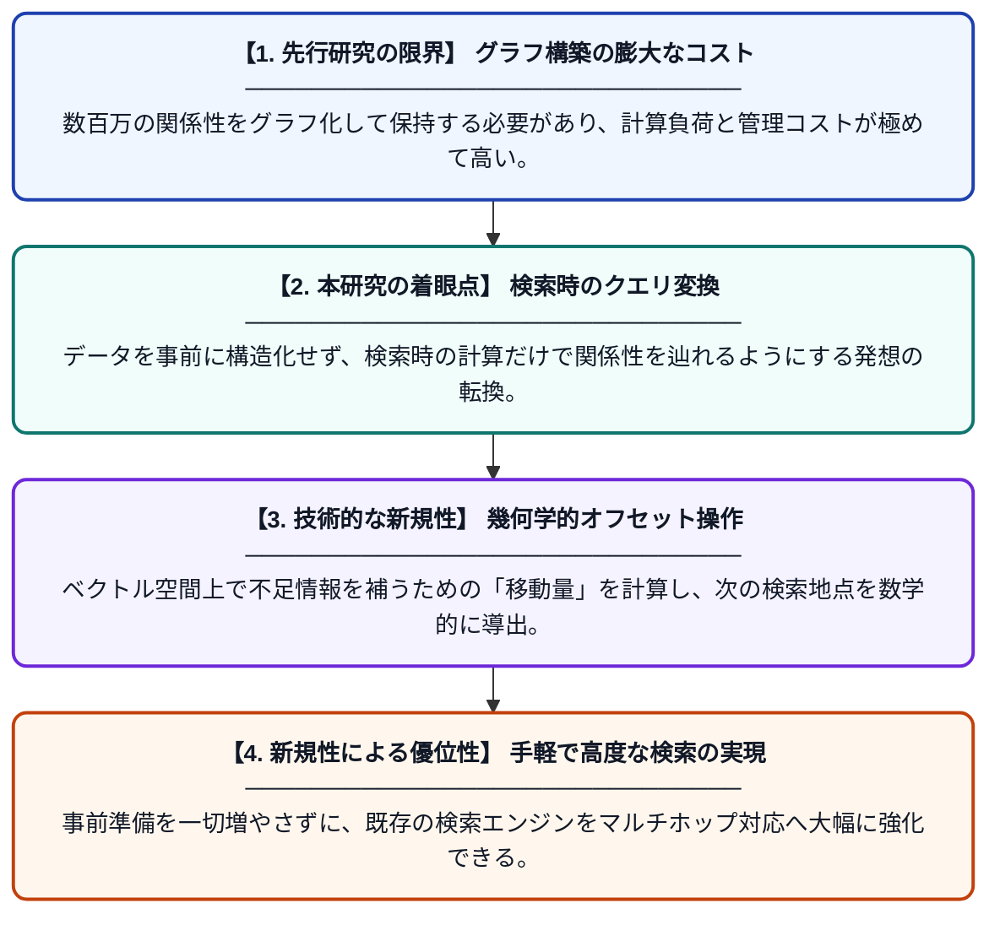

# GMOR: 大規模コーパスにおける幾何学的マルチホップ・オフセット検索

**Original Title**: *GMOR: Geometric Multi-Hop Offset Retrieval over Large Corpora*

> **💡 一言要約**: グラフ構築不要で高度なマルチホップ検索を実現

| 項目 | 内容 |
|---|---|
| **著者** | RAG Graph |
| **アラートキーワード** | graph rag |
| **PDF** | [https://openreview.net/pdf?id=qq9ME3Fpol](https://openreview.net/pdf?id=qq9ME3Fpol) |
| **原文リンク** | [https://openreview.net/pdf?id=qq9ME3Fpol](https://openreview.net/pdf?id=qq9ME3Fpol) |
| **PDF版要約** | [README.pdf](./README.pdf) |

---

## 📊 新規性の図解（先行研究との違いと本研究のブレークスルー）

## 📝 要約

大規模な文書群から複雑な質問の答えを探す際、従来のGraphRAG手法は膨大な知識グラフの構築を必要とし、多大なコストがかかっていました。本研究が提案するGMORは、グラフを構築せずに検索モデルにマルチホップ能力を付与するクエリ側のプラグインであり、幾何学的なベクトル操作によって効率的な検索を実現します。

## ❓ どんな問題に取り組んだか

複数の情報を組み合わせて回答するマルチホップ検索では、情報を関連付ける「知識グラフ」を事前に作る手法が主流ですが、数百万もの関係性を管理するコストが非常に高いという課題があります。また、既存の検索モデルをそのまま使いつつ、高度な推論能力を持たせることが困難でした。

## ✨ 何が新しい？何がすごい？（新規性）

本研究の最大の特徴は、データ側にグラフ構造を構築するのではなく、検索クエリ側のベクトルを幾何学的に変換（オフセット）することでマルチホップ検索を可能にした点です。これにより、既存の検索モデルに後付けするだけで、事前準備なしに複雑な関係性を辿る検索が可能になります。特定の関係性をベクトル空間上の「移動量」として定義することで、未知の関連情報へ効率的にアクセスできる仕組みを確立しました。

## 🎓 大学1年生向けの解説

検索エンジンで「Aさんの出身地の名産品は何？」と聞くとき、まずAさんの出身地を特定し、次にその場所の名産を調べるという2段階の手順が必要です。これまでは、あらかじめ膨大な「相関図」を作っておかないとこれができませんでしたが、この研究ではその図を作らずに解決しました。質問の言葉を数学的な計算で「移動」させることで、図がなくても次の目的地を予測して探し出せるようにした画期的な技術です。
