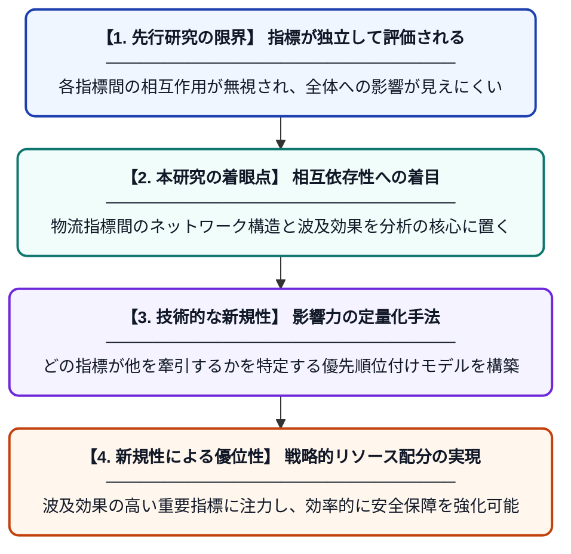

# 物流および供給網指標の相互依存関係の優先順位付けを通じたグローバル・ヘルス・セキュリティの強化

**Original Title**: *Strengthening global health security through prioritizing interdependent logistics and supply network indicators*

> **💡 一言要約**: 物流の相互依存性を解明し保健安保を強化する

| 項目 | 内容 |
|---|---|
| **著者** | F Aziz, A Qazi, MCE Simsekler |
| **掲載誌** | Humanities and Social Sciences Communications 2026 |
| **アラートキーワード** | logistics |
| **PDF** | [https://www.nature.com/articles/s41599-026-09619-1_reference.pdf](https://www.nature.com/articles/s41599-026-09619-1_reference.pdf) |
| **原文リンク** | [https://www.nature.com/articles/s41599-026-09619-1_reference.pdf](https://www.nature.com/articles/s41599-026-09619-1_reference.pdf) |
| **PDF版要約** | [README.pdf](./README.pdf) |

---

## 📊 新規性の図解（先行研究との違いと本研究のブレークスルー）

## 📝 要約

世界保健安全保障（GHS）指数における物流とサプライチェーン指標の相互依存性を分析し、健康危機への備えにおける各指標の影響力を明らかにしました。どの物流要素が他の要素に最も強く作用するかを特定することで、戦略的なリソース配分の優先順位を提案しています。

## ❓ どんな問題に取り組んだか

従来の保健安全保障の評価では、物流や供給網の各指標が独立した項目として扱われることが多く、それらの間の複雑な相互作用が十分に考慮されていませんでした。このため、限られた資源をどの分野に集中させるべきかという戦略的な判断が難しいという課題がありました。

## ✨ 何が新しい？何がすごい？（新規性）

本研究は、GHS指数の物流指標間に存在する「依存関係」を定量的にモデル化した点が極めて独創的です。単なる現状分析に留まらず、ネットワーク分析等を用いて、他の指標に対して波及効果の高い「ハブ」となる指標を特定しました。これにより、一見独立した課題に見える物流問題が、全体的な準備態勢にどのように連鎖的な影響を与えるかを理論的に裏付けた点が大きな貢献です。

## 🎓 大学1年生向けの解説

パンデミックなどの大きな病気が流行したとき、薬やマスクを効率よく運ぶ「物流」は命に関わる重要な役割を果たします。この研究は、物流の様々な仕組みがバラバラに動いているのではなく、お互いにどう助け合ったり邪魔し合ったりしているかを調べました。一番影響力が大きい「鍵となるポイント」を見つけることで、世界中の国々がどこを優先して改善すれば効率よく危機に備えられるかを教えてくれます。
