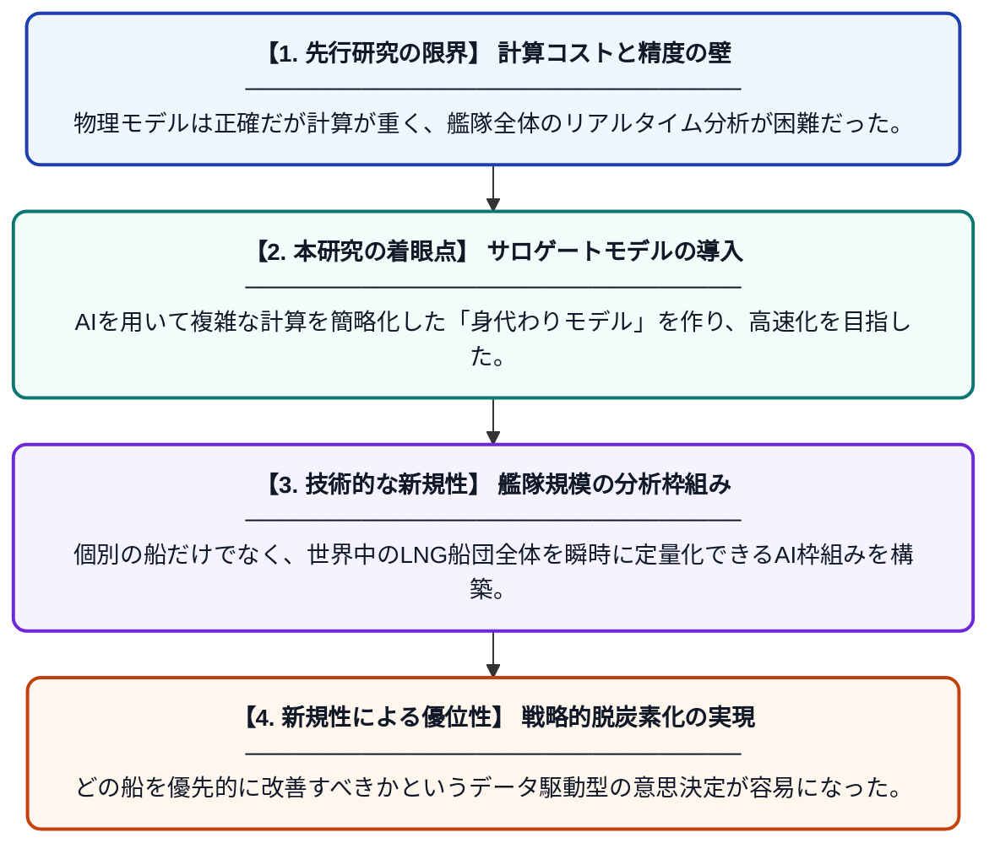

# AIを活用した世界のLNG運搬船の温室効果ガス定量化と脱炭素化：クリーンな海上物流のためのサロゲートモデル

**Original Title**: *AI-enabled greenhouse gas quantification and targeted decarbonization of the global LNG carrier fleet: a surrogate modeling approach for cleaner maritime logistics*

> **💡 一言要約**: AIで世界のLNG船の排出量を可視化し脱炭素を加速

| 項目 | 内容 |
|---|---|
| **著者** | HA Saddiqi, NA Al-Azri, MA Qyyum |
| **掲載誌** | Cleaner Logistics and Supply Chain 2026 |
| **アラートキーワード** | logistics |
| **原文リンク** | [https://www.sciencedirect.com/science/article/pii/S2772390926000909](https://www.sciencedirect.com/science/article/pii/S2772390926000909) |
| **PDF版要約** | [README.pdf](./README.pdf) |

---

## 📊 新規性の図解（先行研究との違いと本研究のブレークスルー）

## 📝 要約

本研究は、AIを用いたサロゲートモデル（代替モデル）により、世界のLNG運搬船から排出される温室効果ガスを正確かつ迅速に定量化する手法を提案しています。このモデルを活用することで、個別の船舶や艦隊全体の排出特性を把握し、より効果的な脱炭素化戦略を立てることが可能になります。

## ❓ どんな問題に取り組んだか

LNG輸送の拡大に伴い、海上輸送による温室効果ガス（GHG）排出の把握が急務となっています。しかし、従来の物理ベースの計算モデルは複雑で計算コストが高く、艦隊全体を対象としたリアルタイムの定量化や将来予測を行うのが困難でした。

## ✨ 何が新しい？何がすごい？（新規性）

本研究は、複雑な物理モデルをAI（サロゲートモデル）で近似することで、高精度を維持しつつ計算時間を劇的に短縮した点が画期的です。先行研究では個別のケーススタディに留まることが多かったのに対し、本研究はグローバルなLNG船団全体を対象としたスケーラブルな分析フレームワークを構築しました。これにより、特定の船舶をターゲットにした効率的な脱炭素化施策の選定が可能になります。

## 🎓 大学1年生向けの解説

天然ガスを運ぶ大きな船（LNG船）は、地球温暖化の原因となるガスを排出します。これまでは、その排出量を正確に計算するのに膨大な時間がかかっていました。この研究では、AIを使うことで「計算の手抜き（賢い近似）」を可能にし、世界中の船がどれくらいガスを出しているか一瞬でわかるようにしました。これによって、どの船から対策を始めれば効率よく地球に優しくなれるかが明確になります。
