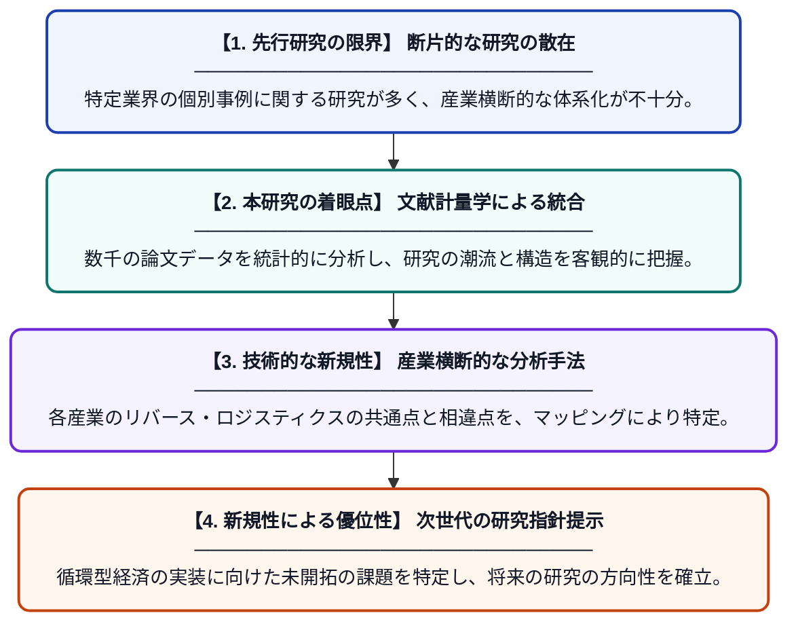

# 産業界におけるサーキュラーエコノミー実装のためのリバース・ロジスティクス：系統的文献計量学的レビュー

**Original Title**: *Reverse logistics in circular economy implementation across industries: a systematic bibliometric review*

> **💡 一言要約**: 逆物流で循環型社会を加速させるための研究羅針盤

| 項目 | 内容 |
|---|---|
| **著者** | C Gamage, V Perera, V Pahalage, H Rupasingha… |
| **掲載誌** | Cogent Business & … 2026 |
| **アラートキーワード** | logistics |
| **原文リンク** | [https://www.tandfonline.com/doi/full/10.1080/23311975.2026.2745285](https://www.tandfonline.com/doi/full/10.1080/23311975.2026.2745285) |
| **PDF版要約** | [README.pdf](./README.pdf) |

---

## 📊 新規性の図解（先行研究との違いと本研究のブレークスルー）

## 📝 要約

本論文は、循環型経済（CE）の実現において重要な役割を果たすリバース・ロジスティクス（逆物流）に関する研究動向を、文献計量学の手法を用いて体系的に分析したものです。様々な産業における廃棄物削減と資源効率向上のための、回収・再利用・再資源化プロセスの現状と将来の展望を明らかにしています。

## ❓ どんな問題に取り組んだか

循環型経済の概念は注目されていますが、製品の回収や再利用を支える「リバース・ロジスティクス（RL）」が各産業でどのように統合されているかの全体像が不明確でした。特に、膨大な研究成果が分散しており、どの産業でどのような手法が有効か、あるいは研究上の空白がどこにあるかが整理されていませんでした。

## ✨ 何が新しい？何がすごい？（新規性）

本研究は、最新の文献計量学的分析を通じて、広範な産業におけるリバース・ロジスティクスの進化と現状を包括的に可視化した点が画期的です。単なる文献の紹介に留まらず、特定の産業分野における成功事例や障壁を抽出し、今後の研究が優先的に取り組むべき領域を明確に定義しています。理論的な枠組みと実務的な実装のギャップを埋めるための具体的なロードマップを提示したことが、本研究の主要な貢献です。

## 🎓 大学1年生向けの解説

私たちが商品を買うときの物の流れを「物流」と言いますが、使い終わった商品を回収してリサイクルする流れを「逆物流」と呼びます。この論文は、ゴミを出さない「循環型社会」を作るために、世界中の学者がこの逆物流をどのように研究してきたかを大規模に調査したものです。どの業界でリサイクルが進んでいるのか、これからどのような技術や仕組みが必要なのかを、たくさんの論文データから読み解いています。
