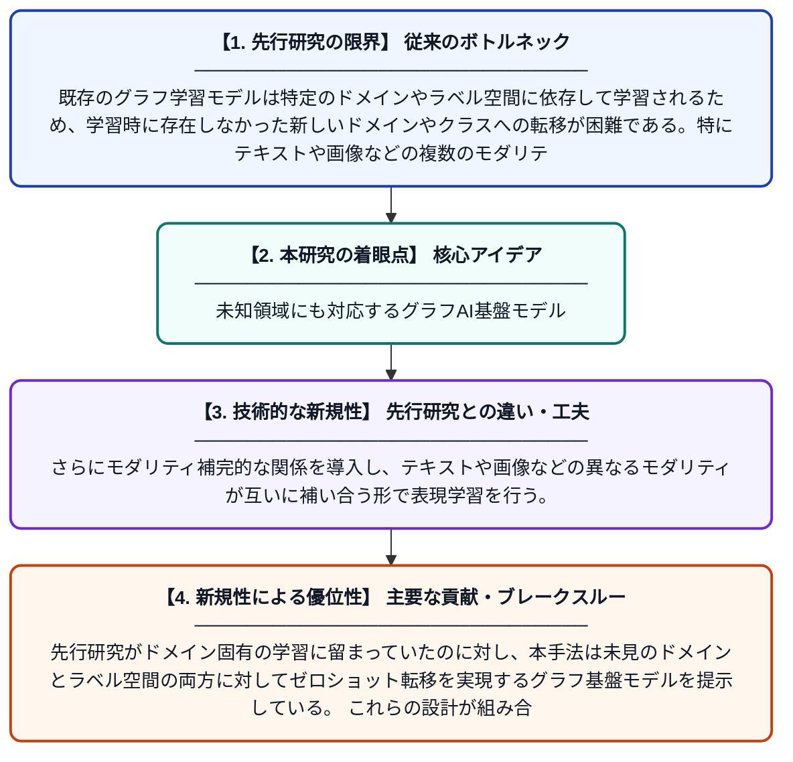

# CHARM: 階層的コンテキストモデリングによるゼロショット転移のためのマルチモーダルグラフ基盤モデル

**Original Title**: *CHARM: A Multimodal Graph Foundation Model with Hierarchical Context Modeling for Zero-Shot Transfer*

> **💡 一言要約**: 未知領域にも対応するグラフAI基盤モデル

| 項目 | 内容 |
|---|---|
| **著者** | A Yang, J Zhao, D Jin, Y Huang, D He |
| **掲載誌** | arXiv preprint arXiv:2607.26023 2026 |
| **アラートキーワード** | zero shot |
| **PDF** | [https://arxiv.org/pdf/2607.26023](https://arxiv.org/pdf/2607.26023) |
| **原文リンク** | [https://arxiv.org/pdf/2607.26023](https://arxiv.org/pdf/2607.26023) |
| **PDF版要約** | [README.pdf](./README.pdf) |

---

## 📊 新規性の図解（先行研究との違いと本研究のブレークスルー）

## 📝 要約

本論文は、未知のターゲットドメインやラベル空間に対するマルチモーダルグラフ上のゼロショット転移を研究する。階層的な合成グラフ構造とモダリティ補完的な関係を組み合わせたCHARMというグラフ基盤モデルを提案し、高レベルの意味的文脈を提供する。これにより、学習時に見たことのないドメインやクラスに対しても汎化できるモデルを実現している。

## ❓ どんな問題に取り組んだか

既存のグラフ学習モデルは特定のドメインやラベル空間に依存して学習されるため、学習時に存在しなかった新しいドメインやクラスへの転移が困難である。特にテキストや画像などの複数のモダリティが混在するマルチモーダルグラフでは、この問題がさらに複雑になる。ゼロショット設定での汎化性能を高めることが大きな課題となっている。

## ✨ 何が新しい？何がすごい？（新規性）

CHARMは、Layer-1・Layer-2・グローバルアンカーからなる合成階層グラフを構築することで、高レベルの意味的文脈情報を明示的にモデル化する点が新しい。さらにモダリティ補完的な関係を導入し、テキストや画像などの異なるモダリティが互いに補い合う形で表現学習を行う。先行研究がドメイン固有の学習に留まっていたのに対し、本手法は未見のドメインとラベル空間の両方に対してゼロショット転移を実現するグラフ基盤モデルを提示している。これらの設計が組み合わさることで、従来手法を超える汎化性能を達成している。

## 🎓 大学1年生向けの解説

グラフとは人間関係や知識のような「つながり」を表すデータ構造です。このAIは、文章や画像などが混ざったグラフデータを学習し、まったく新しい分野の問題でも事前学習なしに解ける「ゼロショット転移」を目指しています。木の構造のように情報を階層的に整理することで、AIが大きな文脈や意味を把握できるようにしました。たとえるなら、国語・数学・理科を総合的に学んだ生徒が、初めて見た社会の問題でも応用力で解けるようなイメージです。
