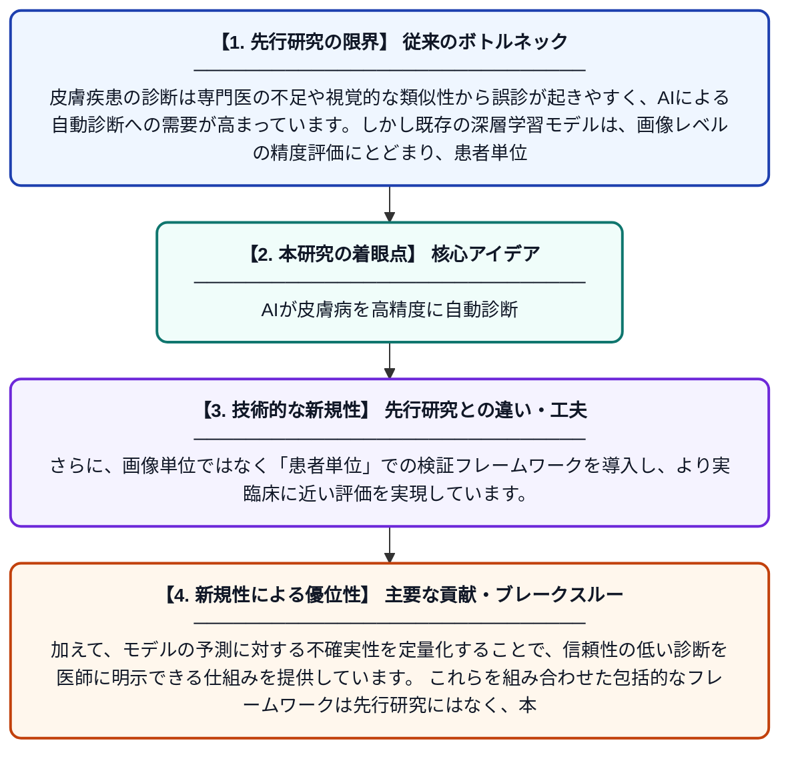

# アンサンブル深層学習による皮膚疾患の自動分類：不確実性定量化を備えた多スケール患者レベル検証フレームワーク

**Original Title**: *Ensemble Deep Learning for Automated Skin Disease Classification: A Multi-Scale Patient-Level Validation Framework with Uncertainty Quantification*

> **💡 一言要約**: AIが皮膚病を高精度に自動診断

| 項目 | 内容 |
|---|---|
| **著者** | FR Supti, MK Refat, MDM Mamun, S Dutta, A Kader |
| **アラートキーワード** | manifold learning |
| **PDF** | [https://www.researchgate.net/profile/Mithila-Arman/publication/410819704_Ensemble_Deep_Learning_for_Automated_Skin_Disease_Classification_A_Multi-Scale_Patient-Level_Validation_Framework_with_Uncertainty_Quantification/links/6a65fd28f475b23f400ea578/Ensemble-Deep-Learning-for-Automated-Skin-Disease-Classification-A-Multi-Scale-Patient-Level-Validation-Framework-with-Uncertainty-Quantification.pdf](https://www.researchgate.net/profile/Mithila-Arman/publication/410819704_Ensemble_Deep_Learning_for_Automated_Skin_Disease_Classification_A_Multi-Scale_Patient-Level_Validation_Framework_with_Uncertainty_Quantification/links/6a65fd28f475b23f400ea578/Ensemble-Deep-Learning-for-Automated-Skin-Disease-Classification-A-Multi-Scale-Patient-Level-Validation-Framework-with-Uncertainty-Quantification.pdf) |
| **原文リンク** | [https://www.researchgate.net/profile/Mithila-Arman/publication/410819704_Ensemble_Deep_Learning_for_Automated_Skin_Disease_Classification_A_Multi-Scale_Patient-Level_Validation_Framework_with_Uncertainty_Quantification/links/6a65fd28f475b23f400ea578/Ensemble-Deep-Learning-for-Automated-Skin-Disease-Classification-A-Multi-Scale-Patient-Level-Validation-Framework-with-Uncertainty-Quantification.pdf](https://www.researchgate.net/profile/Mithila-Arman/publication/410819704_Ensemble_Deep_Learning_for_Automated_Skin_Disease_Classification_A_Multi-Scale_Patient-Level_Validation_Framework_with_Uncertainty_Quantification/links/6a65fd28f475b23f400ea578/Ensemble-Deep-Learning-for-Automated-Skin-Disease-Classification-A-Multi-Scale-Patient-Level-Validation-Framework-with-Uncertainty-Quantification.pdf) |
| **PDF版要約** | [README.pdf](./README.pdf) |

---

## 📊 新規性の図解（先行研究との違いと本研究のブレークスルー）

## 📝 要約

本論文は、多様体学習の原理とアンサンブル最適化戦略を組み合わせた深層学習フレームワークを用いて、複数クラスの皮膚病変を自動分類する手法を提案しています。患者レベルでの検証や不確実性の定量化など、従来研究で見落とされてきた方法論的課題に取り組んでいます。複数のモデルを組み合わせるアンサンブル手法により、単一モデルよりも高精度・高信頼性の皮膚疾患診断支援を実現しています。

## ❓ どんな問題に取り組んだか

皮膚疾患の診断は専門医の不足や視覚的な類似性から誤診が起きやすく、AIによる自動診断への需要が高まっています。しかし既存の深層学習モデルは、画像レベルの精度評価にとどまり、患者単位での検証や予測の信頼度（不確実性）を考慮していないという課題がありました。また、クラス間の不均衡や多スケールの特徴抽出など、実臨床に即した方法論的な問題も未解決でした。

## ✨ 何が新しい？何がすごい？（新規性）

本研究の主な新規性は、複数の深層学習モデルを組み合わせるアンサンブル手法と多様体学習を統合した点にあります。さらに、画像単位ではなく「患者単位」での検証フレームワークを導入し、より実臨床に近い評価を実現しています。加えて、モデルの予測に対する不確実性を定量化することで、信頼性の低い診断を医師に明示できる仕組みを提供しています。これらを組み合わせた包括的なフレームワークは先行研究にはなく、本論文の主要な貢献です。

## 🎓 大学1年生向けの解説

皮膚の病気には見た目がよく似たものが多く、専門医でも診断が難しいことがあります。この研究では、複数のAIモデルを組み合わせて「みんなで多数決」をとる手法で、皮膚病の種類を自動的に判別するシステムを作りました。さらに、AIが「自信を持って答えているか、迷っているか」も一緒に出力することで、医師が結果を信頼してよいかどうかを判断できるようにしています。まるでAIが自分の答えに点数をつけながら診断を下すようなイメージです。これにより、より安全で実用的なAI診断支援ツールの実現を目指しています。
