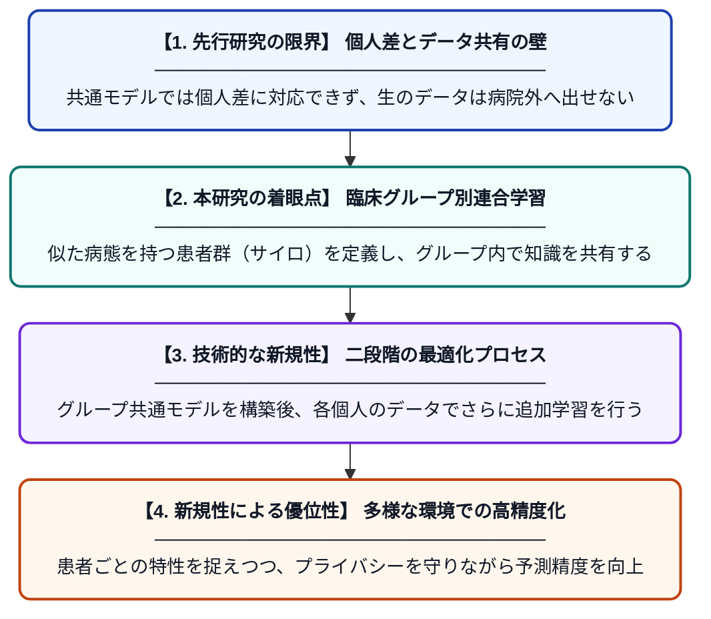

# 1型糖尿病の血糖値予測のためのパーソナライズされたハイブリッド連合学習フレームワーク

**Original Title**: *A personalized hybrid federated learning framework for glucose prediction in type 1 diabetes*

> **💡 一言要約**: 患者の個性に寄り添う、高精度な血糖値予測AI

| 項目 | 内容 |
|---|---|
| **著者** | C Gallardo-García, C Fuertes, ME Hernando, D Subías… |
| **掲載誌** | Artificial Intelligence in … 2026 |
| **アラートキーワード** | Federated Learning |
| **原文リンク** | [https://www.sciencedirect.com/science/article/pii/S0933365726002137](https://www.sciencedirect.com/science/article/pii/S0933365726002137) |
| **PDF版要約** | [README.pdf](./README.pdf) |

---

## 📊 新規性の図解（先行研究との違いと本研究のブレークスルー）

## 📝 要約

1型糖尿病患者の血糖値を予測するために、プライバシーを保護しつつ各患者の特性に合わせた学習を行う「パーソナライズされたハイブリッド連合学習」を提案した研究です。臨床的なグループ分けに基づいた連合学習（cross-silo）と個別のモデル調整を組み合わせることで、多様な患者データが存在する環境下でも高い予測精度を実現しました。

## ❓ どんな問題に取り組んだか

糖尿病患者の血糖変動は個人差が非常に大きく、一つの汎用的なモデルでは高い予測精度を維持することが困難でした。また、医療データは機密性が高く、プライバシー保護の観点から複数の施設間で生のデータを共有して大規模に学習させることが難しいという課題がありました。

## ✨ 何が新しい？何がすごい？（新規性）

従来の連合学習が全参加者で一つの共通モデルを作るのに対し、本研究は臨床的に意味のあるグループ単位で学習を行う「ハイブリッド型」を採用しました。さらに、グループ学習の結果を個々の患者にさらに最適化（パーソナライズ）する仕組みを導入した点が画期的です。これにより、データ共有の制約を守りながら、個々の生活習慣や病態に密着した予測が可能になりました。

## 🎓 大学1年生向けの解説

糖尿病の治療では「次に血糖値がどう動くか」を予測することが大切ですが、人によって体質や生活スタイルがバラバラなのが悩みでした。この研究では、みんなのデータを一箇所に集めなくても、各病院や各個人で学習を進めながら知恵だけを共有する「連合学習」という技術を使っています。その中でも、似たタイプの人たちでグループを作って学習し、最後に自分専用に微調整することで、より正確な予測を可能にしました。
