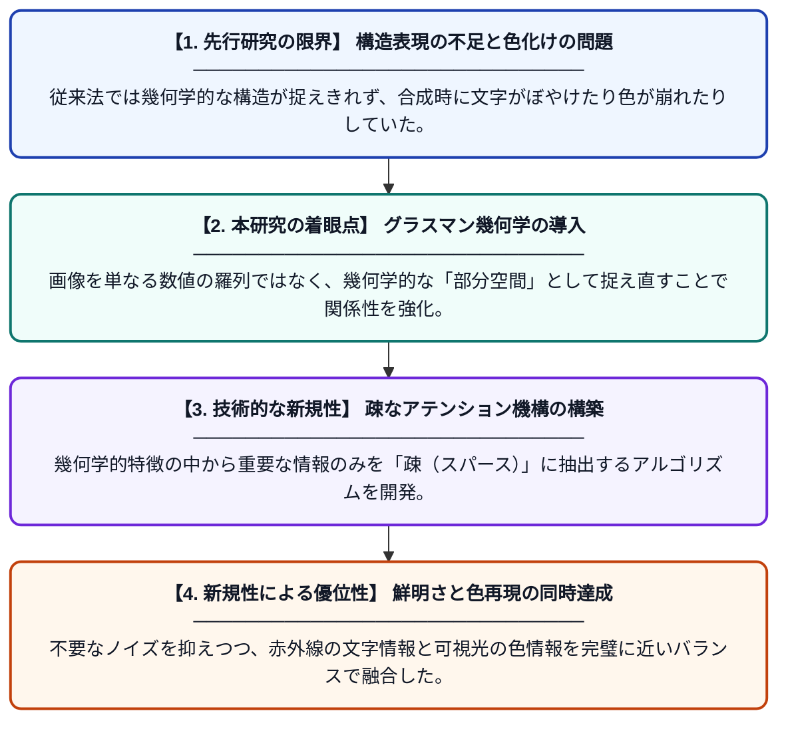

# 竹簡画像の色彩を保持する赤外線・可視光融合のための疎なグラスマン・アテンション

**Original Title**: *Sparse Grassmann Attention for Color-Preserving Infrared–Visible Fusion of Bamboo-Slip Images*

> **💡 一言要約**: グラスマン幾何学で竹簡の文字と色彩を鮮明に融合

| 項目 | 内容 |
|---|---|
| **著者** | J Han, Y Qi, Q Zhang, T Wan, Y Yang |
| **掲載誌** | International Conference on Image and … 2026 |
| **アラートキーワード** | manifold learning |
| **原文リンク** | [https://link.springer.com/chapter/10.1007/978-981-92-7192-4_3](https://link.springer.com/chapter/10.1007/978-981-92-7192-4_3) |
| **PDF版要約** | [README.pdf](./README.pdf) |

---

## 📊 新規性の図解（先行研究との違いと本研究のブレークスルー）

## 📝 要約

竹簡（ちくかん）画像の解析において、幾何学的な構造を捉えるグラスマン多様体学習を用いた新しい画像融合手法を提案しています。赤外線画像の鮮明な文字情報と可視光画像の色彩情報を、計算効率の高い「疎なアテンション機構」によって高精度に統合し、視認性を大幅に向上させています。

## ❓ どんな問題に取り組んだか

従来の竹簡画像の融合手法では、赤外線の文字情報と可視光の色彩を統合する際、情報の欠落や計算コストの増大が課題でした。特に、ユークリッド距離に基づく従来の類似度測定では、複雑なテクスチャや構造的な依存関係を十分に表現できないという限界がありました。

## ✨ 何が新しい？何がすごい？（新規性）

本研究はグラスマン多様体学習を導入し、画像特徴を線形部分空間として幾何学的にモデル化することで、従来のユークリッド空間では困難だった構造的依存関係の抽出を可能にしました。また、スパース（疎）なアテンション機構を採用することで、不要な情報を排除しつつ計算負荷を抑え、色再現性と文字の鮮明さを両立させています。幾何学的視点と計算効率の最適化を高度に融合させた点が、先行研究に対する大きな貢献です。

## 🎓 大学1年生向けの解説

歴史的な竹の札（竹簡）に書かれた文字を読みやすくするため、赤外線カメラの「形がくっきり見える力」と、普通のカメラの「色が見える力」を合体させる研究です。今までは合体させた時に色が変わってしまったり、計算が難しすぎて時間がかかったりする悩みがありました。この研究では「グラスマン多様体」という高度な数学の考え方を使い、データの形を整理して、必要な情報だけを賢く選んで計算するようにしました。その結果、本物のような色を保ちながら、文字がはっきりと浮かび上がる画像を作れるようになりました。
