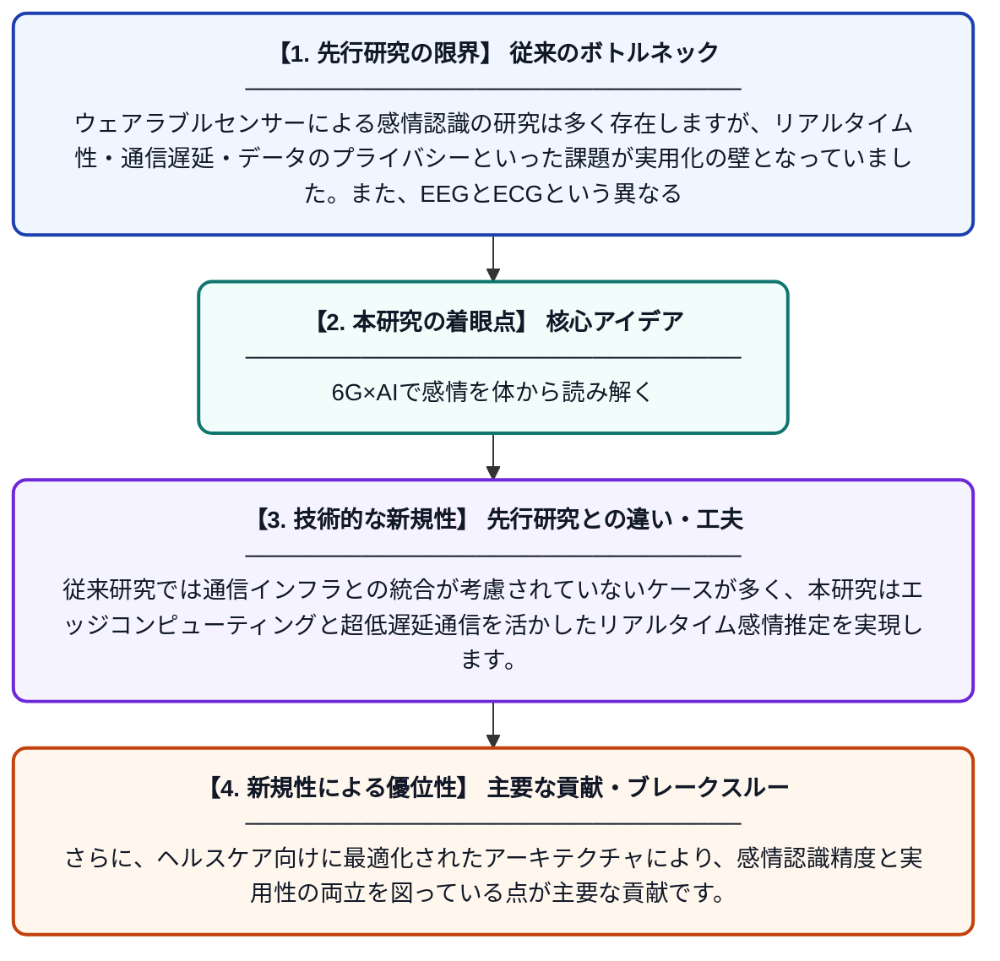

# 6G IoTヘルスケアネットワーク上でのディープラーニングを用いたEEGおよびECGウェアラブル生体センサーによる感情状態分析

**Original Title**: *EEG and ECG Wearable Biosensor-Based Affective State Analysis Using Deep Learning over 6G IoT Healthcare Networks*

> **💡 一言要約**: 6G×AIで感情を体から読み解く

| 項目 | 内容 |
|---|---|
| **著者** | HSB Yeşilkaya, M Özbaltan, N Özbaltan, C Şeker |
| **掲載誌** | Biosensors 2026 |
| **アラートキーワード** | affective computing |
| **原文リンク** | [https://www.mdpi.com/2079-6374/16/8/400](https://www.mdpi.com/2079-6374/16/8/400) |
| **PDF版要約** | [README.pdf](./README.pdf) |

---

## 📊 新規性の図解（先行研究との違いと本研究のブレークスルー）

## 📝 要約

ウェアラブル生体センサー（EEGとECG）から取得した生体信号をディープラーニングで解析し、人間の感情状態をリアルタイムで推定するシステムを提案した研究です。6G IoTネットワークと組み合わせることで、低遅延かつ高信頼性の遠隔ヘルスケアモニタリングの実現を目指しています。感情認識の精度向上と実用的な医療応用への橋渡しを同時に達成しようとしています。

## ❓ どんな問題に取り組んだか

ウェアラブルセンサーによる感情認識の研究は多く存在しますが、リアルタイム性・通信遅延・データのプライバシーといった課題が実用化の壁となっていました。また、EEGとECGという異なる生体信号を組み合わせて高精度に感情を推定するための統合的なディープラーニング手法が十分に確立されていませんでした。

## ✨ 何が新しい？何がすごい？（新規性）

本研究の新規性は、EEGとECGのマルチモーダル生体信号をディープラーニングで統合解析する手法を、6G IoTネットワーク基盤と組み合わせた点にあります。従来研究では通信インフラとの統合が考慮されていないケースが多く、本研究はエッジコンピューティングと超低遅延通信を活かしたリアルタイム感情推定を実現します。さらに、ヘルスケア向けに最適化されたアーキテクチャにより、感情認識精度と実用性の両立を図っている点が主要な貢献です。

## 🎓 大学1年生向けの解説

人間は嬉しいとき・悲しいときで脳波（EEG）や心拍（ECG）のパターンが変わります。この研究では、頭や胸につけた小さなセンサーでそのパターンを計測し、AIが「今どんな気持ちか」を自動で判定するシステムを作りました。さらに、次世代通信技術である6Gを使うことで、データをほぼリアルタイムで病院やクラウドに送れるようにしています。将来的には、精神的な不調や心臓の異変を遠隔で早期発見するウェアラブル医療デバイスへの応用が期待されます。
