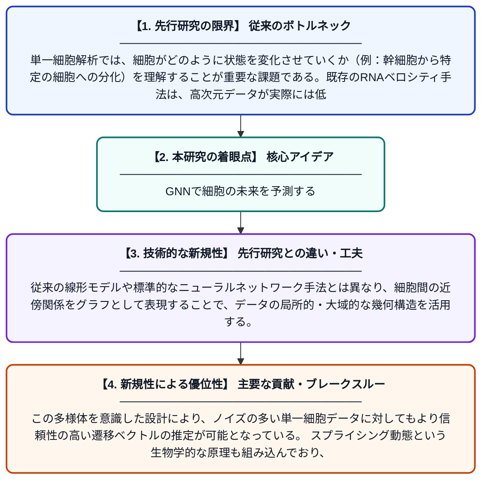

# グラフニューラルRNAベロシティ：スプライシング済み/未スプライシングカウントからの多様体を考慮した単一細胞状態遷移の予測

**Original Title**: *Graph Neural RNA Velocity: Manifold-Aware Prediction of Single-Cell State Transitions from Spliced/Unspliced Counts*

> **💡 一言要約**: GNNで細胞の未来を予測する

| 項目 | 内容 |
|---|---|
| **著者** | ASM Bakibillah, H Sasahara, J Imura |
| **掲載誌** | Proceedings of the 17th ACM International … 2026 |
| **アラートキーワード** | manifold learning |
| **原文リンク** | [https://dl.acm.org/doi/full/10.1145/3807503.3819354](https://dl.acm.org/doi/full/10.1145/3807503.3819354) |
| **PDF版要約** | [README.pdf](./README.pdf) |

---

## 📊 新規性の図解（先行研究との違いと本研究のブレークスルー）

## 📝 要約

本論文は、単一細胞RNA解析において細胞の将来の転写状態を予測する「RNAベロシティ」をグラフニューラルネットワーク（GNN）を用いて改善する手法を提案している。従来手法が見落としていた細胞データの多様体（データが存在する低次元の曲面構造）を考慮することで、より精度の高い細胞状態遷移の予測を実現する。スプライシング済みおよび未スプライシングmRNAのカウントデータを活用し、細胞分化などの動態を高精度に捉えることを目指している。

## ❓ どんな問題に取り組んだか

単一細胞解析では、細胞がどのように状態を変化させていくか（例：幹細胞から特定の細胞への分化）を理解することが重要な課題である。既存のRNAベロシティ手法は、高次元データが実際には低次元の多様体上に分布するという幾何学的構造を十分に考慮しておらず、細胞遷移方向の推定精度に限界があった。

## ✨ 何が新しい？何がすごい？（新規性）

本研究は、細胞データの多様体構造を明示的に取り込んだグラフニューラルネットワークベースのRNAベロシティ推定フレームワークを新たに提案している。従来の線形モデルや標準的なニューラルネットワーク手法とは異なり、細胞間の近傍関係をグラフとして表現することで、データの局所的・大域的な幾何構造を活用する。この多様体を意識した設計により、ノイズの多い単一細胞データに対してもより信頼性の高い遷移ベクトルの推定が可能となっている。スプライシング動態という生物学的な原理も組み込んでおり、解釈可能性と予測精度の両立を図っている点も特筆される。

## 🎓 大学1年生向けの解説

私たちの体の細胞は、同じDNAを持ちながらも皮膚や神経など異なる種類に変化します。この「細胞がどの方向に変化しつつあるか」をmRNAというメッセージ分子の量から予測するのがRNAベロシティという技術です。本研究では、細胞のデータが持つ複雑な曲面のような構造（多様体）をグラフニューラルネットワークという人工知能技術で捉えることで、従来よりも正確に細胞の将来の状態を予測できるようにしました。ちょうど地図で山の等高線を考慮して道を選ぶように、データの形状を考慮して予測精度を上げているイメージです。これにより、病気の仕組みの解明や新薬開発への応用が期待されます。
