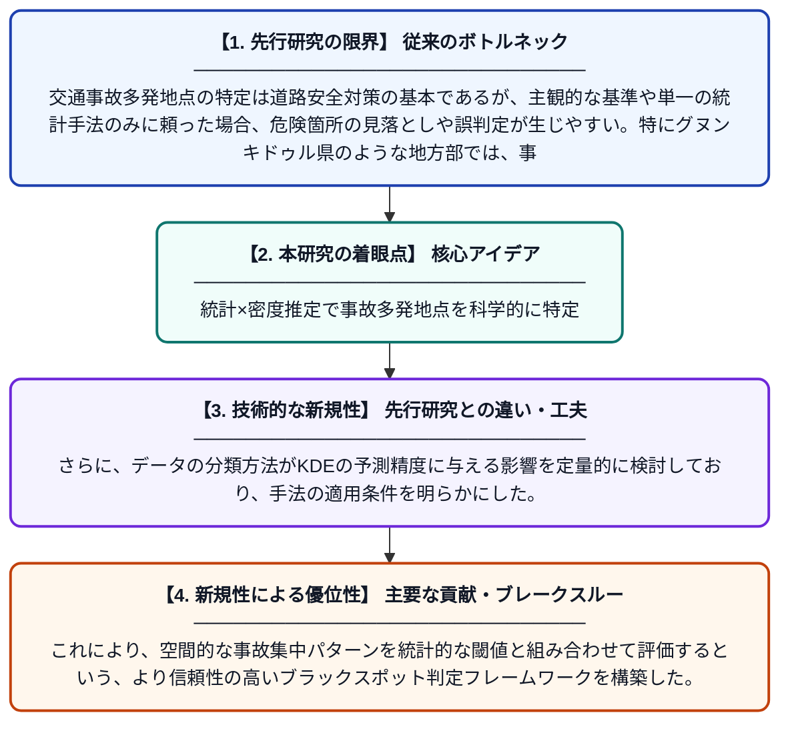

# グヌンキドゥル県におけるブラックスポット地点特定のための管理上限値とカーネル密度推定の活用

**Original Title**: *Upper Control Limit and Kernel Density Estimation to Determine Black Spots Areas in Gunungkidul Regency*

> **💡 一言要約**: 統計×密度推定で事故多発地点を科学的に特定

| 項目 | 内容 |
|---|---|
| **著者** | AT Dika, N Mahmudah |
| **掲載誌** | ICCSTE 2026 Proceedings 2026 |
| **アラートキーワード** | kernel density estimation |
| **PDF** | [https://www.avestia.com/ICCSTE2026_Proceedings/files/paper/ICCSTE_186.pdf](https://www.avestia.com/ICCSTE2026_Proceedings/files/paper/ICCSTE_186.pdf) |
| **原文リンク** | [https://www.avestia.com/ICCSTE2026_Proceedings/files/paper/ICCSTE_186.pdf](https://www.avestia.com/ICCSTE2026_Proceedings/files/paper/ICCSTE_186.pdf) |
| **PDF版要約** | [README.pdf](./README.pdf) |

---

## 📊 新規性の図解（先行研究との違いと本研究のブレークスルー）

## 📝 要約

本研究は、インドネシアのグヌンキドゥル県における交通事故多発地点（ブラックスポット）を特定するために、管理上限値（UCL）とカーネル密度推定（KDE）の2つの手法を組み合わせたアプローチを提案している。データの分類方法がカーネル密度推定の予測精度に与える影響を検証し、より精度の高い危険地点の特定を目指した。両手法を統合することで、従来よりも客観的かつ空間的に精緻な事故リスクの評価が可能となることを示している。

## ❓ どんな問題に取り組んだか

交通事故多発地点の特定は道路安全対策の基本であるが、主観的な基準や単一の統計手法のみに頼った場合、危険箇所の見落としや誤判定が生じやすい。特にグヌンキドゥル県のような地方部では、事故データの分布が不均一であるため、適切な手法の選択が課題となっている。

## ✨ 何が新しい？何がすごい？（新規性）

従来の研究では管理上限値（UCL）またはカーネル密度推定（KDE）のいずれか一方を用いることが多かったが、本研究はこれらを統合的に組み合わせた点が新しい。さらに、データの分類方法がKDEの予測精度に与える影響を定量的に検討しており、手法の適用条件を明らかにした。これにより、空間的な事故集中パターンを統計的な閾値と組み合わせて評価するという、より信頼性の高いブラックスポット判定フレームワークを構築した。

## 🎓 大学1年生向けの解説

道路上には事故がよく起きる「危険な場所」があり、これをブラックスポットと呼びます。この研究では、事故データを使って「どこが特に危ないか」を数学的な方法で自動的に見つけようとしています。一つ目の方法（UCL）は統計的に「異常に事故が多い場所」を見つけ、二つ目の方法（KDE）は地図上で事故の密集具合を視覚的に表します。この二つを組み合わせることで、より正確に危険な場所を見つけられることを示しました。安全な道路づくりに役立てることが目的です。
