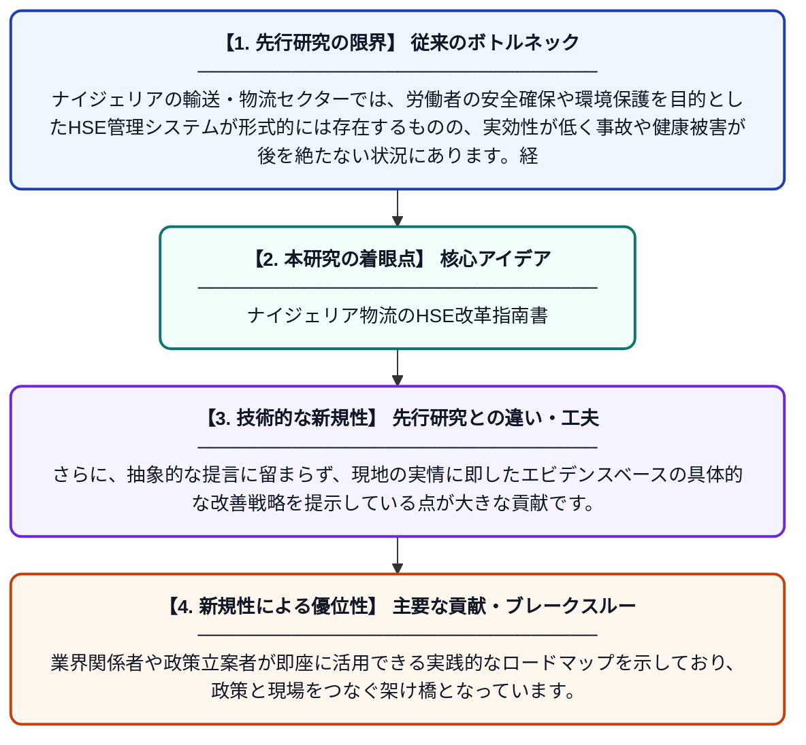

# HSE管理システムの課題：ナイジェリアの輸送・物流セクターにおける改善戦略の提案

**Original Title**: *HSE Management Systems Challenges: Proposed Improvement Strategies in the Nigerian Transportation and Logistics Sector*

> **💡 一言要約**: ナイジェリア物流のHSE改革指南書

| 項目 | 内容 |
|---|---|
| **著者** | S Onyeabor, J Amobi |
| **掲載誌** | ScienceOpen Preprints 2026 |
| **アラートキーワード** | logistics |
| **PDF** | [https://www.scienceopen.com/document_file/5b951120-9408-4a6f-aff8-74e8b1b05f67/ScienceOpenPreprint/HSE%20MANAGEMENT%20SYSTEMS%20CHALLENGES%20-%20%20PROPOSED%20IMPROVEMENT%20STRATEGIES%20IN%20THE%20NIGERIAN%20TRANSPORTATION%20AND%20LOGISTICS%20SECTOR.pdf](https://www.scienceopen.com/document_file/5b951120-9408-4a6f-aff8-74e8b1b05f67/ScienceOpenPreprint/HSE%20MANAGEMENT%20SYSTEMS%20CHALLENGES%20-%20%20PROPOSED%20IMPROVEMENT%20STRATEGIES%20IN%20THE%20NIGERIAN%20TRANSPORTATION%20AND%20LOGISTICS%20SECTOR.pdf) |
| **原文リンク** | [https://www.scienceopen.com/document_file/5b951120-9408-4a6f-aff8-74e8b1b05f67/ScienceOpenPreprint/HSE%20MANAGEMENT%20SYSTEMS%20CHALLENGES%20-%20%20PROPOSED%20IMPROVEMENT%20STRATEGIES%20IN%20THE%20NIGERIAN%20TRANSPORTATION%20AND%20LOGISTICS%20SECTOR.pdf](https://www.scienceopen.com/document_file/5b951120-9408-4a6f-aff8-74e8b1b05f67/ScienceOpenPreprint/HSE%20MANAGEMENT%20SYSTEMS%20CHALLENGES%20-%20%20PROPOSED%20IMPROVEMENT%20STRATEGIES%20IN%20THE%20NIGERIAN%20TRANSPORTATION%20AND%20LOGISTICS%20SECTOR.pdf) |
| **PDF版要約** | [README.pdf](./README.pdf) |

---

## 📊 新規性の図解（先行研究との違いと本研究のブレークスルー）

## 📝 要約

本論文は、ナイジェリアの輸送・物流セクターにおける健康・安全・環境（HSE）管理システムの現状と課題を分析したものです。重要性への認識が高まる一方で、実際の現場では効果的なHSE管理が十分に実施されていない実態を明らかにしています。その上で、エビデンスに基づく改善戦略を提案し、実践的なロードマップを提示しています。

## ❓ どんな問題に取り組んだか

ナイジェリアの輸送・物流セクターでは、労働者の安全確保や環境保護を目的としたHSE管理システムが形式的には存在するものの、実効性が低く事故や健康被害が後を絶たない状況にあります。経済的制約、制度的な不備、管理体制の弱さなどが複合的に絡み合い、適切なHSE運用の妨げとなっています。

## ✨ 何が新しい？何がすごい？（新規性）

本研究は、ナイジェリアという発展途上国の文脈に特化してHSE管理システムの課題を体系的に整理した点が新しく、先行研究が先進国事例に偏りがちであった点を補完しています。さらに、抽象的な提言に留まらず、現地の実情に即したエビデンスベースの具体的な改善戦略を提示している点が大きな貢献です。業界関係者や政策立案者が即座に活用できる実践的なロードマップを示しており、政策と現場をつなぐ架け橋となっています。

## 🎓 大学1年生向けの解説

HSE（健康・安全・環境）管理とは、働く人が怪我をしたり病気になったりしないよう、また環境を汚染しないようにするための仕組みのことです。ナイジェリアのトラックや倉庫などの物流業界では、この仕組みが整っていないために多くの問題が起きています。この論文では、なぜその仕組みがうまく機能していないのかを調べ、どうすれば改善できるかを具体的に提案しています。日本でも工場や運送会社では安全管理が非常に重要視されていますが、それと同じような取り組みをナイジェリアで実現するための指針をまとめたものです。
