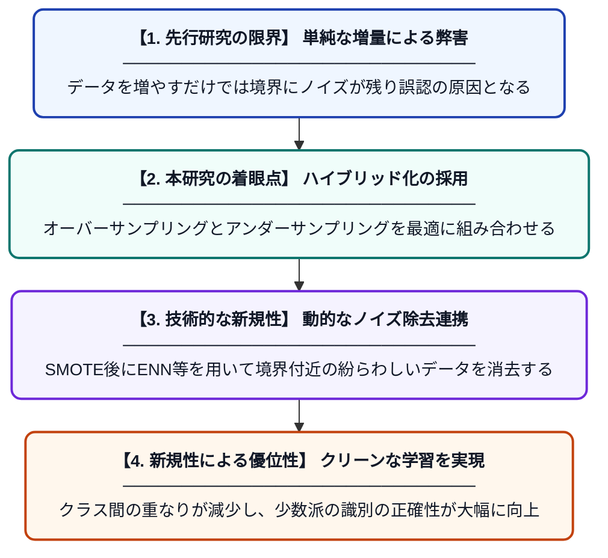

# クラス不均衡に対するハイブリッド・リサンプリング手法の比較評価

**Original Title**: *A Comparative Evaluation of Hybrid Resampling Techniques for Class Imbalance*

> **💡 一言要約**: 増量と掃除の同時実行で、不均衡データの壁を打破

| 項目 | 内容 |
|---|---|
| **著者** | P Rajarajeswari, PJ Suryaprabha, M Navina… |
| **掲載誌** | 10th International … 2026 |
| **アラートキーワード** | SMOTE |
| **原文リンク** | [https://ieeexplore.ieee.org/abstract/document/11790111/](https://ieeexplore.ieee.org/abstract/document/11790111/) |
| **PDF版要約** | [README.pdf](./README.pdf) |

---

## 📊 新規性の図解（先行研究との違いと本研究のブレークスルー）

## 📝 要約

不均衡データに対する機械学習の精度を向上させるため、SMOTEとアンダーサンプリングを組み合わせたハイブリッド手法を比較評価しています。SMOTE-TomekやSMOTE-ENNといった手法が、少数派クラスの補完とノイズ除去を同時に行い、分類性能を改善することを示しています。

## ❓ どんな問題に取り組んだか

機械学習では、特定のクラスが極端に少ない「クラス不均衡」が学習を困難にします。単純なデータ増強ではクラス間の境界が曖昧になりやすく、モデルの予測精度が十分に上がらないという課題がありました。

## ✨ 何が新しい？何がすごい？（新規性）

本研究は、データの増強（SMOTE）とノイズ除去（Tomek Links/ENN）を統合したハイブリッド手法の優位性を定量的に明らかにしました。単にデータを増やすだけでなく、増強後に生じる不適切なサンプルを動的に削除することで、より鮮明な決定境界を構築できる点を実証しています。特にSMOTE-ENNが多様な評価指標において高いロバスト性を示すことを結論付けました。

## 🎓 大学1年生向けの解説

AIに「当たり」と「ハズレ」を教える際、ハズレが多すぎるとAIは手抜きをして全部ハズレと答えがちになります。この研究は、少ない方のデータを人工的に増やしつつ、紛らわしいデータを掃除する「セット技」を比較しました。料理で言えば、具材を増やすだけでなく、余分なアクを抜くことで味を整えるような手法です。これにより、データの偏りに負けない、賢いAIを作ることができます。
