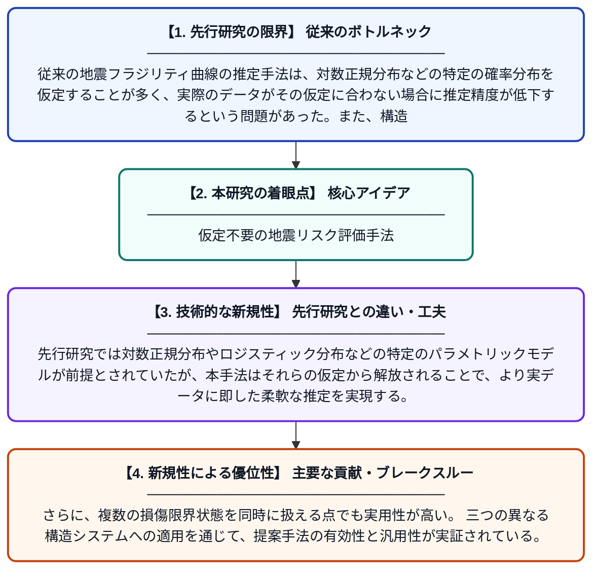

# 序数回帰を用いた構造システムのノンパラメトリック地震フラジリティ曲線

**Original Title**: *Nonparametric seismic fragility curves for structural systems using ordinal regression*

> **💡 一言要約**: 仮定不要の地震リスク評価手法

| 項目 | 内容 |
|---|---|
| **著者** | Y Park, S Mangalathu, JS Jeon |
| **掲載誌** | Mechanical Systems and Signal Processing 2026 |
| **アラートキーワード** | kernel density estimation |
| **原文リンク** | [https://www.sciencedirect.com/science/article/pii/S0888327026009040](https://www.sciencedirect.com/science/article/pii/S0888327026009040) |
| **PDF版要約** | [README.pdf](./README.pdf) |

---

## 📊 新規性の図解（先行研究との違いと本研究のブレークスルー）

## 📝 要約

本論文は、地震時における構造物の損傷確率を表すフラジリティ曲線を推定するための新しいノンパラメトリック手法を提案している。ノンパラメトリック最尤推定とカーネル密度推定を組み合わせることで、特定の誤差分布を仮定せずに柔軟なリンク関数を推定する。これにより、従来の対数正規分布などの仮定に依存しない、より汎用性の高いフラジリティ曲線の構築が可能となる。

## ❓ どんな問題に取り組んだか

従来の地震フラジリティ曲線の推定手法は、対数正規分布などの特定の確率分布を仮定することが多く、実際のデータがその仮定に合わない場合に推定精度が低下するという問題があった。また、構造物の損傷状態は複数の順序付きカテゴリ（無損傷・軽微・中程度・重大など）で表されるにもかかわらず、これを適切に扱う枠組みが十分に整備されていなかった。

## ✨ 何が新しい？何がすごい？（新規性）

本研究は、序数回帰とノンパラメトリック最尤推定・カーネル密度推定を組み合わせることで、特定の分布形状を仮定せずにフラジリティ曲線を推定できる初めての統合的枠組みを提案した。先行研究では対数正規分布やロジスティック分布などの特定のパラメトリックモデルが前提とされていたが、本手法はそれらの仮定から解放されることで、より実データに即した柔軟な推定を実現する。さらに、複数の損傷限界状態を同時に扱える点でも実用性が高い。三つの異なる構造システムへの適用を通じて、提案手法の有効性と汎用性が実証されている。

## 🎓 大学1年生向けの解説

地震が起きたとき、建物がどのくらいの確率で壊れるかを表したグラフを『フラジリティ曲線』といいます。これまでは、データが特定の数学的な形（例：釣り鐘型の正規分布）に従うと仮定して曲線を描いていましたが、実際のデータがその形と合わないと答えがずれてしまう問題がありました。この研究では、そのような仮定を一切しなくても、データから直接フラジリティ曲線を描ける新しい方法を開発しました。建物の損傷を『無傷・少し壊れた・かなり壊れた・全壊』のように順番のあるランクで扱う『序数回帰』という技術を活用しています。これにより、より正確で信頼性の高い地震リスク評価が実現できます。
