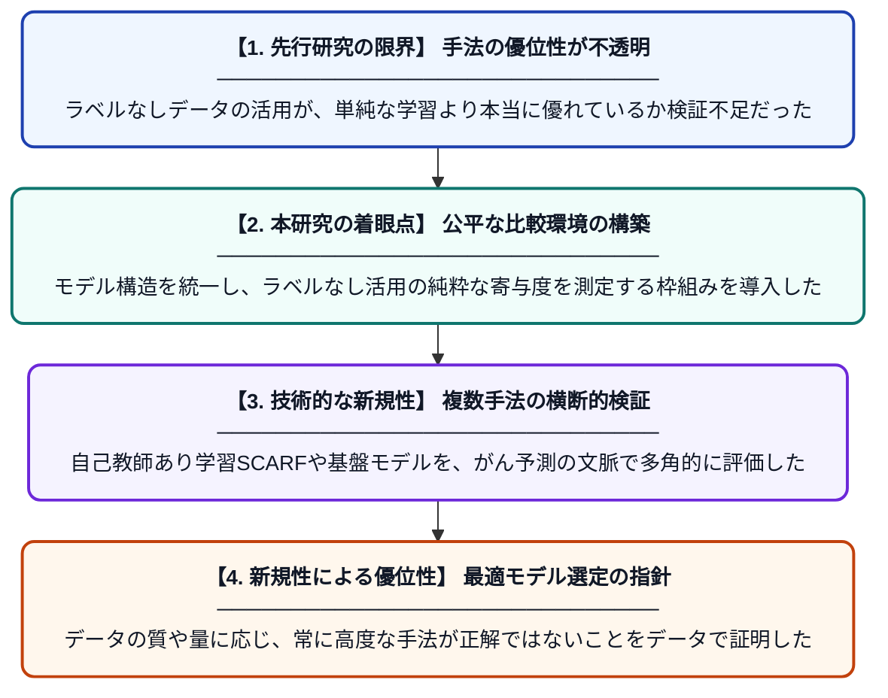

# ラベルなしデータの活用はがんの診断と予後に役立つか？半教師あり学習・自己教師あり学習とテーブルデータ基盤モデルの比較

**Original Title**: *Does Learning from Unlabeled Data Help Cancer Diagnosis and Prognosis? Semi-Supervised and Self-Supervised Learning Versus Tabular Foundation Model*

> **💡 一言要約**: がん予測でのラベルなしデータ活用の真価を厳密に検証

| 項目 | 内容 |
|---|---|
| **著者** | F Gurcan, M Kilinc, A Soylu |
| **掲載誌** | Cancers 2026 |
| **アラートキーワード** | Semi supervise |
| **原文リンク** | [https://www.mdpi.com/2072-6694/18/22/3701](https://www.mdpi.com/2072-6694/18/22/3701) |
| **PDF版要約** | [README.pdf](./README.pdf) |

---

## 📊 新規性の図解（先行研究との違いと本研究のブレークスルー）

## 📝 要約

がんの診断と予後予測において、ラベルなしデータを活用する手法（SSLやSCARFなど）が、従来の教師あり学習や最新の基盤モデルに対してどれほど有効かを検証した研究です。厳密な比較の結果、ラベルなしデータの利用が必ずしも精度向上に直結しないケースがあることを明らかにしました。

## ❓ どんな問題に取り組んだか

医療データにおいて、専門医によるラベル付けはコストが高いため、ラベルなしデータの活用が期待されています。しかし、これらの高度な手法が、単純な教師あり学習と比べて実務的にどれほど優れているのかは、これまで公平な条件下で十分に評価されていませんでした。

## ✨ 何が新しい？何がすごい？（新規性）

本研究は、Label SpreadingやSCARFといった自己教師あり学習手法を、同一のネットワーク構造を持つ教師ありモデルと直接比較した点が独創的です。さらに、最新のテーブルデータ向け基盤モデルとも比較を行い、医療用テーブルデータにおける最適な学習戦略を模索しました。その結果、特定の条件下では従来の教師あり学習が依然として優位であることを示し、安易な高度化への警鐘を鳴らしました。

## 🎓 大学1年生向けの解説

AIに「がん」かどうかを教えるとき、正解がわかっているデータは少ないですが、正解が不明なデータは大量にあります。この研究は「正解不明なデータも使ってAIを賢くする最新手法」が、本当に効果があるのかを確かめました。実験の結果、実は正解があるデータだけでじっくり教えた方が、かえって正確な診断ができる場合もあることが分かりました。つまり、新しい技術を盲信するのではなく、データの特性を見極めることが大切だという教訓です。
