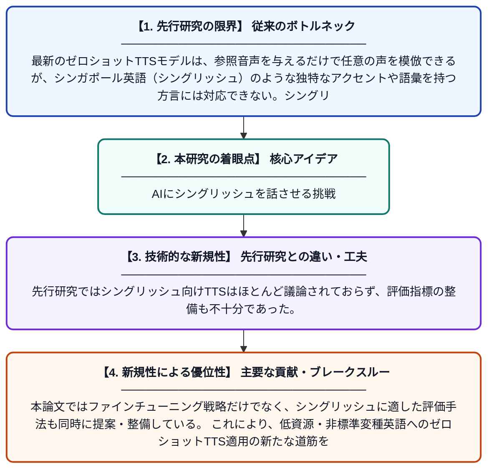

# シングリッシュ、できるかな？シンガポール英語向けゼロショット音声合成のファインチューニングと評価

**Original Title**: *Singlish, Can or Not? Fine-Tuning and Evaluating Zero-Shot TTS for Singapore English*

> **💡 一言要約**: AIにシングリッシュを話させる挑戦

| 項目 | 内容 |
|---|---|
| **著者** | I Kukanov, ZX Chai |
| **掲載誌** | arXiv preprint arXiv:2607.23027 2026 |
| **アラートキーワード** | zero shot |
| **PDF** | [https://arxiv.org/pdf/2607.23027](https://arxiv.org/pdf/2607.23027) |
| **Git リポジトリ** | [https://github.com/FunAudioLLM/CosyV](https://github.com/FunAudioLLM/CosyV) |
| **原文リンク** | [https://arxiv.org/pdf/2607.23027](https://arxiv.org/pdf/2607.23027) |
| **PDF版要約** | [README.pdf](./README.pdf) |

---

## 📊 新規性の図解（先行研究との違いと本研究のブレークスルー）

## 📝 要約

本論文は、市販のゼロショット音声合成（TTS）モデルがシンガポール英語（シングリッシュ）のアクセントを正確に再現できないという問題に取り組んでいる。ChatterboxやCosyVoice 3などのモデルをシングリッシュ向けにファインチューニングする手法を体系的に研究し、その評価方法についても検討している。シングリッシュという低資源・独自アクセントを持つ変種英語に対して、ゼロショットTTSを実用レベルに引き上げることを目指している。

## ❓ どんな問題に取り組んだか

最新のゼロショットTTSモデルは、参照音声を与えるだけで任意の声を模倣できるが、シンガポール英語（シングリッシュ）のような独特なアクセントや語彙を持つ方言には対応できない。シングリッシュは英語・中国語・マレー語などが混在した複雑な言語変種であり、標準的な訓練データに含まれにくく、既存モデルでは自然な発話を生成することが困難である。

## ✨ 何が新しい？何がすごい？（新規性）

本研究は、ゼロショットTTSモデルをシングリッシュという特定の低資源アクセントに対してターゲットファインチューニングする手法を初めて体系的に検討した点が新しい。先行研究ではシングリッシュ向けTTSはほとんど議論されておらず、評価指標の整備も不十分であった。本論文ではファインチューニング戦略だけでなく、シングリッシュに適した評価手法も同時に提案・整備している。これにより、低資源・非標準変種英語へのゼロショットTTS適用の新たな道筋を示している。

## 🎓 大学1年生向けの解説

シンガポールでは「シングリッシュ」と呼ばれる独特の英語が話されており、普通の英語とは発音や語彙がかなり異なります。AIに文章を読み上げさせる技術（TTS）は最近とても進歩しましたが、このシングリッシュを自然に話せるAIはまだありませんでした。この研究では、既存のAI音声合成モデルをシングリッシュ用に追加学習（ファインチューニング）させることで、より自然なシングリッシュ音声を作れるかを試みています。さらに、できあがった音声が本当にシングリッシュらしいかを正しく評価する方法も考えました。少ないデータしかない言語でも、AIをうまく使えるようにするための大切な研究です。
